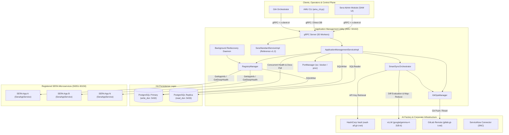

# Application Management Utility (AMU) - Architecture & Design Document

**Doc_Type:** Architecture & Design
**Category:** (U) Utility
**Name:** Application Management Utility
**Acronym:** AMU
**Version:** 0.4.3
**Date:** 2026-10-31
**Author:** Martin Kecka & Gemini AI
**Status:** Active

---

## 1. Introduction & Purpose 📜

The **Application Management Utility (AMU)** is a headless, centralized gRPC microservice and CLI orchestration engine designed to govern **Application Portfolio Management (APM)**, **GitOps Automation**, and **ITSM Integration** across the SERA/GIA AI ecosystem.

Operating as an autonomous, standalone control plane, AMU provides engineers and operators with a rich Click CLI for ecosystem auditing, compliance verification, and GitOps rollouts. Concurrently, it serves as the primary portfolio and GitOps backend data broker powering the **Sera Admin Module (SAM)** web interface. While physical infrastructure monitoring and resource provisioning are delegated to specialized utilities, AMU acts as the single source of truth governing the **logical reality** and application lifecycle of the platform.

AMU persists its state in HA PostgreSQL (`sam_admin_prod_db`) and coordinates directly with HashiCorp Vault, GitLab, and the AI Factory's vLLM inference cluster.

Its primary operational capabilities include:
- **Application Portfolio Governance (APM):** Authoritative registry for all registered microservices and unmanaged external agents, inter-service dependency graphs, network boundary classifications (`LOCAL`, `AI_FACTORY`, `CORPORATE`, `EXTERNAL`), and port allocation planning (`50051-50150` gRPC blocks and `7888+` frontend blocks).
- **Universal Standard Contract Custodian:** Ecosystem reference implementation and distribution authority for the universal SERA standard contract (`sera_standard.proto`), propagating unified metadata, changelog, and deep health protocols across all modules.
- **Real-Time Aggregated Health Fan-Out:** High-concurrency parallel polling of active microservices, dynamic dependency health matrix aggregation, and automatic database version self-healing.
- **Autonomous GitOps & SmartSync Engine:** Map-Reduce LLM diff evaluation, automated `CHANGELOG.yaml` categorization, semantic version bumping, and git commit/push workflows.
- **Ecosystem Compliance & Infrastructure Auditing:** Automated verification of production AI Factory LLM endpoints, legacy model deprecation tracking, and dev vs. prod database isolation audits.
- **ITSM & Feedback Triage:** Feedback collection pipeline with LLM-driven classification and automated incident dispatching to ServiceNow via SNC.

---

## 2. Architecture & Ecosystem Integration 🏗️

AMU operates on a client-server architecture, exposing dual gRPC servicers backed by a multi-worker thread pool (`amu-grpc.service`), while providing operators with a standalone Click CLI and background autonomous rediscovery daemons.

### 2.1. Dual Servicer & Core Architectural Principles
- **Dual Servicer Model:**
  1. **`ApplicationManagementService` (`amu.proto`):** Domain servicer exposing 17 RPCs for global portfolio management, real-time aggregated health fan-out, GitOps orchestration (`SmartSync`, commits, rollbacks), port scanning, and external agent lifecycle management.
  2. **`SeraAppService` (`sera_standard.proto`):** AMU is the **ecosystem custodian and reference implementation** of the universal SERA standard contract. In addition to self-reporting AMU's own metadata, deep health matrix, documentation, and changelog, AMU maintains the master codebase deployed to all other ecosystem modules via `deploy push-std`.
- **Single Source of Logical Reality:** Authoritative registry for all registered applications, port reservations, and dynamic inter-service dependency topologies.
- **Autonomous Standalone Operation:** Functions as a complete standalone system with direct HA PostgreSQL access (`_read_engine` / `_write_engine`), background rediscovery threads, and independent CLI audit commands.
- **SAM Backend Data Broker:** Feeds live portfolio lists, multi-app aggregated health trees, and real-time streaming GitOps sync updates directly to the **Sera Admin Module (SAM)** UI.
- **High-Availability Persistence Isolation:** Utilizes split read/write SQLAlchemy connection pools (`write_dsn` on `:5432` and `read_dsn` on `:5433`) with `pool_pre_ping=True` and connection-hold prevention during long-running Git/LLM operations.
- **Dynamic Call Tracing & Provenance:** Automatically propagates and logs `x-client-id` metadata headers (`[SAM]`, `[CLI]`, `[ORCH]`) across all inbound RPCs for complete provenance auditing.

### 2.2. Ecosystem Integration & Data Flow



---

## 3. Module File Map 📂

```plaintext
/ai/utilities/application_management_utility
├── application_management_utility.py     # Main executable entrypoint; loads YAML config, sets up logging, launches Click CLI
├── bootstrap_helper.py                   # Virtual environment bootstrapper and dependency verifier
├── requirements.txt                      # Python package dependencies (grpcio, protobuf, sqlalchemy, psycopg2-binary, redis, click, pyyaml, hvac)
├── README.md                             # High-level repository overview and links to master SERA Guides
├── config/
│   ├── __init__.py                       # Config package marker
│   └── settings.yaml                     # Primary configuration (ports, database DSNs, external services, Vault paths, LLM engines)
├── cli/
│   ├── __init__.py                       # CLI package marker
│   ├── amu_cli.py                        # Root Click group (NestedHelpGroup), server launcher, and DB initialization commands
│   ├── utils.py                          # gRPC channel builders, MetadataClientInterceptor, JSON printer, and @handle_grpc_errors
│   └── commands/
│       ├── __init__.py                   # CLI commands package marker
│       ├── audit_cmds.py                 # `audit llms` (flags non-prod endpoints and legacy models), `audit infra` (audits dev vs prod infra), and `audit docs` (audits design docs currency & 14-header compliance)
│       ├── deploy_cmds.py                # `deploy push-std` (rolls out sera_standard_service.py to apps, restarts services, re-registers)
│       ├── git_cmds.py                   # `git status`, `git commit`, `git history`, `git rollback`, `git sync` (LLM SmartSync), and `git sync-docs`
│       ├── health_cmds.py                # `health get-all` and `health get <acronym>` for aggregated deep health inspection
│       ├── info_cmds.py                  # `info ports`, `info list-apps`, `info get-changelog`, `info get-docs`, `info deployments`, `info export-settings`, `info codebase` (with `--search` & `--category` filters)
│       ├── module_cmds.py                # `module info` and `module check-health` querying AMU's own SeraAppService
│       ├── registry_cmds.py              # `registry register`, `registry list`, `registry deps`, and `registry delete`
│       └── releases_cmds.py              # `releases summary` aggregating versions and changelog categories across active apps
├── core/
│   ├── __init__.py                       # Core package marker
│   ├── git_manager.py                    # GitOpsManager: Git execution, diff extraction, majority author detection, AD/NSS full-name resolution, CHANGELOG prepending, commits, and rollbacks with permission healing
│   ├── llm_interface.py                  # vLLMClient: HTTP inference client with Vault API key injection and thinking mode support
│   ├── port_manager.py                   # PortManager: Inspects OS sockets (ss), Docker containers, and /proc to map ports and calculate free blocks
│   ├── registry_manager.py               # RegistryManager: Endpoint discovery, path inference, boundary/env classification, and DB persistence
│   ├── smart_sync_orchestrator.py        # SmartSyncOrchestrator: Streaming GitOps workflow—diff chunking, Map-Reduce, LLM classification, YAML correction, version bumping
│   ├── clients/
│   │   ├── __init__.py                   # Clients package marker
│   │   └── vault_client.py               # VaultClient: AppRole authentication engine with Vault KV v2 secret retrieval
│   ├── connectors/
│   │   ├── __init__.py                   # Connectors package marker
│   │   └── snc_connector.py              # SNCConnector: gRPC client wrapper for ServiceNow Connector (CreateIncident)
│   ├── database/
│   │   ├── __init__.py                   # Database package marker
│   │   ├── database.py                   # SQLAlchemy engine initialization, QueuePool pooling, and get_db_session context manager
│   │   └── models.py                     # Declarative ORM models: Application, AppService, AppDependency, FeedbackTicket, ExternalAgent
│   └── io_handlers/
│       ├── __init__.py                   # IO handlers package marker
│       ├── sql_reader.py                 # Read-only queries (get_all_applications, get_active_applications, get_valid_managed_app, etc.)
│       └── sql_writer.py                 # Mutation abstractions (upsert_application, update_app_version, clear_app_dependencies, etc.)
├── grpc_api/
│   ├── __init__.py                       # gRPC API package marker
│   ├── amu_service.py                    # ApplicationManagementServiceImpl: Implements all 17 portfolio & GitOps RPCs
│   ├── generate_stubs.py                 # Compiles amu.proto and sera_standard.proto into generated stubs directory
│   ├── sera_standard_service.py          # Reference v1.2-universal implementation of SeraAppService, deployed to ecosystem via deploy push-std
│   ├── services.py                       # Bootstraps gRPC server thread pool, binds servicers, reflection, and background rediscovery daemon
│   └── protos/
│       ├── amu.proto                     # Protobuf contract for amu.v1.ApplicationManagementService
│       └── sera_standard.proto           # Master ecosystem Protobuf contract for sera.standard.v1.SeraAppService
├── prompts/
│   ├── __init__.py                       # LLM system prompts package marker
│   ├── commit_message_prompt.py          # Generates concise noun-phrase commit summaries from YAML changelog entries
│   ├── extract_features_prompt.py        # Map-phase prompt extracting architectural bullet points from code diff chunks
│   ├── merge_changelog_prompt.py         # Reduce-phase prompt consolidating extracted features into standard YAML categories
│   └── smart_sync_prompt.py              # Evaluates diffs against changelogs to classify MAJOR vs MINOR changes
├── utils/
│   ├── __init__.py                       # Shared utils package marker
│   └── logging_setup.py                  # MultiProcessSafeDailyLogger with 14-day rotation (amu.log, amu_err.log) and console routing
└── docs/
    ├── CHANGELOG.yaml                    # Local machine-readable release history for AMU
    ├── amu_design.md                     # Symlink -> /ai/assets/guides/utilities_guides/amu_design.md
    ├── amu_llm_guide.md                  # Symlink -> /ai/assets/guides/llm_guides/amu_llm_guide.md
    └── conf_concept.md                   # Symlink -> /ai/assets/guides/ecosystem/conf_concept.md
```

---

## 4. Core Processing Lifecycle ⚙️

### 4.1. Server Boot & Initialization Sequence (`start-grpc-server`)
1. **Configuration & Logging:** `application_management_utility.py` loads `config/settings.yaml` and initializes `setup_logging()`. Because `start-grpc-server` is present in `sys.argv`, console logging is set to `INFO` (otherwise `WARNING` for CLI commands to keep stdout clean).
2. **Proto Synchronization & Stub Compilation (`check_and_generate_stubs`):**
   * Compares local `grpc_api/protos/sera_standard.proto` against `/ai/assets/protos/sera_standard/sera_standard.proto` using `filecmp.cmp(shallow=False)` and copies it if newer or missing.
   * Checks modification timestamps (`os.path.getmtime`) of `amu.proto` and `sera_standard.proto` against generated `*_pb2.py` files in `/ai/assets/protos/application_management_utility/generated`.
   * If regeneration occurs, `amu_cli.py` executes `os.execv(sys.executable, [sys.executable, "-u"] + sys.argv)` to replace the current process and cleanly load the newly compiled protobuf modules into `sys.path`.
3. **Database Initialization:** Calls `initialize_database(config)`, instantiating separate SQLAlchemy `create_engine` pools (`pool_size=10`, `max_overflow=20`, `pool_pre_ping=True`) for `write_dsn` and `read_dsn`, followed by `init_db()` (`Base.metadata.create_all(bind=_write_engine)`).
4. **gRPC Server Binding (`grpc_api/services.py`):**
   * Initializes `grpc.server` with `ThreadPoolExecutor(max_workers=50)`.
   * Attaches `ApplicationManagementServiceImpl`, `SeraStandardServiceImpl`, `HealthServicer`, and enables `reflection.enable_server_reflection`.
   * Binds to `0.0.0.0:50102` and starts listening.
5. **Background Rediscovery Daemon:** Spawns a daemon thread (`background_discovery`) that sleeps for `initial_delay_seconds` (`300`s) and subsequently triggers `RegistryManager.rediscover_existing()` every `interval_seconds` (`86400`s).

### 4.2. Application Registration Lifecycle (`RegistryManager.register_endpoint`)
1. **Handshake Probe:** Opens an insecure gRPC channel to `<endpoint>` with metadata `('x-client-id', 'AMU')`:
   * Calls `GetAppInfo(Empty(), timeout=0.5)`.
   * Calls `GetDeepHealth(Empty(), timeout=5.0)` (fails open to `None` if `RpcError` occurs).
2. **Physical Path Inference:** If `physical_path` is not explicitly provided and `target_host` is local (`localhost`, `127.0.0.1`, `0.0.0.0`, `[::]`), `RegistryManager` invokes `PortManager.get_port_planner_data()`, matches the listening port's `/proc/<pid>/cmdline` against regex `(/ai/[a-zA-Z0-9_-]+(?:/[a-zA-Z0-9_-]+)?)`, strips trailing `/venv` or `/bin`, and assigns the resolved directory path.
3. **Database Upsert:** Opens a write session (`get_db_session(read_only=False)`), upserts the `Application` record, and purges existing child `AppDependency` and `AppService` rows (`clear_app_dependencies`, `clear_app_services`).
4. **Topology & Boundary Classification:** Iterates over `deep_health.dependency_health_matrix`, applies network boundary and environment regex heuristics (detailed in Section 5.1), and inserts new `AppDependency` and `AppService` rows before committing the transaction.

### 4.3. Real-Time Aggregated Health Fan-Out (`GetAggregatedHealth`)
1. Queries active applications from the database via `SQLReader`.
2. Spawns a `concurrent.futures.ThreadPoolExecutor(max_workers=20)` to query `GetDeepHealth(Empty(), timeout=5.0)` across all target applications in parallel.
3. **Dynamic Version Self-Healing:** If a target application's `health_resp.app_version` differs from the version stored in AMU's PostgreSQL registry (and is not `"unknown"`), AMU automatically invokes `SQLWriter.update_app_version(node.acronym, version_to_update)` within the active session.
4. Aggregates all `AppHealthNode` objects and returns the unified `AggregatedHealthResponse`.

---

## 5. Detailed Business Logic, Rules & HITL 🧠

AMU is a headless backend utility and CLI tool; interactive **Human-in-the-Loop (HITL) UI workflows are not applicable for this module** (operator interactions occur strictly via deterministic CLI flags such as `--dry-run`, `--minor-only`, or interactive commit selection during `git rollback`).

### 5.1. Dependency Boundary & Environment Heuristic Engine (`RegistryManager`)
When registering an application, AMU inspects the `connection_metadata` map returned by `GetDeepHealth()` (extracting `host`, `hosts`, `write_host`, `read_host`, `target`, `instance_url`, `url`, `base_url`, `api_url`, `token_url`) and applies the following ordered decision rules:

1. **Network Boundary & Base Environment Assignment:**
   * **`LOCAL` (`env = "dev"`):** Triggered if `"localhost"` or `"127.0.0.1"` appears in the extracted host or URL.
   * **`AI_FACTORY` (`env = "prod"`):** Triggered if `"-aif-"`, `"slo-aif"`, `"aif-llm"`, or `"aif.gt-t.net"` appears in the host or URL.
   * **`CORPORATE` (`env = "prod"`):** Triggered if `"gt-t.net"`, `"gtt.net"`, `"mypop2pop.com"`, or a `10.*` prefix appears in the host or URL.
   * **Internal Fallback:** If `dependency_type == "internal"`, sets `boundary = "CORPORATE"` if `"bank_profile"` is in `dependency_name`, otherwise `"LOCAL"`.
   * **`EXTERNAL` (`env = "unknown"`):** Default fallback if none of the above rules match.
2. **Granular Environment Override (Regex Word-Boundary Matching):**
   AMU concatenates `f"{dep.dependency_name} {host} {url}".lower().replace('_', ' ')` and evaluates regex word boundaries in strict priority order:
   * `\bpreprod\b` $\rightarrow$ `env = "preprod"`
   * `\bstg\b|\bstaging\b` $\rightarrow$ `env = "stg"`
   * `\bdev\b|\btest\b|\bqa\b` $\rightarrow$ `env = "dev"`
   * `\bprod\b` $\rightarrow$ `env = "prod"`

### 5.2. Universal Deep Health Evaluation Logic (`sera_standard_service.py` `v1.2-universal`)
AMU maintains the master reference implementation of `SeraStandardServiceImpl`, which can be pushed to any ecosystem module via `deploy push-std`. Its health state machine operates as follows:

1. **Active TCP Socket Probing (`check_tcp_ping`):**
   * Parses host and port from DSNs/URLs (defaulting to port `443` for `https`, `80` for `http`, and `636` for `ldap`).
   * Executes `socket.create_connection((host, int(port)), timeout=1.0)`. Returns `"OK"` (`"Connected"`) or `"DOWN"` (`"Connection Timeout"` / `"Connection Failed"`).
2. **DSN Sanitization (`sanitize_dsn`):**
   * Parses single, semicolon-delimited (`;`), or comma-delimited (`,`) connection strings via `urllib.parse.urlparse`, stripping passwords while preserving `<scheme>://<username>@<hostname>:<port>/<path>`.
3. **Valkey / Redis Owner Introspection:**
   * For cache dependencies (`redis`, `valkey`, `redis_cache`), replaces `valkey://` or `sentinel://` with `redis://` (and port `:26379` with `:6379`), connects with `socket_timeout=0.2`, and queries keys `__GIA_DB_OWNER__` or `__SERA_DB_OWNER__` to populate `connection_metadata["description"]`.
4. **Systemd Service Verification:**
   * Executes `subprocess.run(['systemctl', 'is-active', service_name], timeout=2)` for every entry in `system_services`. Sets status to `"running"` if stdout is `"active"`, otherwise `"stopped"`.
5. **Overall Status Escalation Matrix (`HEALTHY` $\rightarrow$ `DEGRADED` $\rightarrow$ `DOWN`):**
   * Starts at `overall_status = "HEALTHY"`.
   * Any service with `status != "running"` or any dependency with `status != "OK"` downgrades status to `"DEGRADED"`.
   * **Global Postgres Failure Rule:** If any dependency with `dependency_type == "postgresql"` has `status == "DOWN"`, `overall_status` is forced to `"DOWN"`.
   * **Connector Environment-Aware Escalation Rule:** If the application's `module_info.category == "connector"`:
     * **Sole Dependency Failure:** If the connector has only `1` dependency in `["external", "connector"]` and its status is `"DOWN"`, `overall_status` is forced to `"DOWN"`.
     * **Production Target Failure:** If the connector has multiple dependencies and a `"DOWN"` dependency is classified as production (explicit `env` metadata in `['prod', 'production']`, `'prod'` in `dependency_name` excluding `'preprod'`/`'nonprod'`, or no environment keywords like `test`, `dev`, `qa`, `uat`, `sandbox`, `stg` in the name), `overall_status` is forced to `"DOWN"`.
   * **AMU Aggregator Override (`GetAggregatedHealth`):** When AMU polls an app, if any service in `service_health_matrix` is not `"running"`, AMU marks the node `"DOWN"`. If the gRPC call itself raises `grpc.RpcError`, AMU marks the app `"DOWN"` if `num_services <= 1`, or `"DEGRADED"` if `num_services > 1`.

### 5.3. Port Allocation & Process Inspection Rules (`PortManager`)
* **Frontend Planner Range:** Scans ports `7888` to `7987` (`frontend_start=7888`, `frontend_range=100`), plus hardcoded out-of-range frontend ports `{5001, 8501, 8502}`. Identifies the lowest unassigned port in `7888..7987` as `next_available_port`.
* **gRPC Block Planner:** Partitions ports `50051` to `50150` into `10` contiguous blocks of `10` ports each (`50051-50060`, `50061-50070`, ..., `50141-50150`). Flags a block as `is_totally_free = True` only if all 10 ports in the block have zero active listeners.
* **Process Attribution:** Cross-references `ss -ltnp` PIDs against `/proc/<pid>/cgroup` (`Docker` if `docker`/`moby`, `Systemd` if `system.slice`, `User` if `user.slice`) and `/proc/<pid>/cmdline` (extracting `/ai/<folder1>/<folder2>` names) alongside `docker ps` port mappings.

### 5.4. Audit Compliance & Search Rules (`audit_cmds.py` & `info_cmds.py`)
* **LLM Audit (`audit llms`):** Flags any registered `LlmModel` where `"aif.gt-t.net"` is not in `base_url` as `⚠️ NON-PRODUCTION ENDPOINT`, and flags any model containing `"gemma-3"` or `"gemma3"` as `⚠️ SHOULD BE REPLACED WITH gemma4-31b`.
* **Infrastructure Audit (`audit infra`):** Categorizes applications based on `infra` group dependencies into `✅ PRODUCTION READY` (only `prod` deps) vs `❌ MIXED INFRA` / `❌ HAS DEV INFRA`, grouping offending applications by their target `dev` database name to streamline migration planning.
* **Documentation Audit (`audit docs`):** Queries `GetAppDocs` across registered applications, extracts the markdown `**Version:**` header via regex, and compares it against the registered `Application.version` (`✅ MATCH` vs `❌ OUTDATED` / `❌ NO DOC`). Concurrently counts `## ` level-2 headers to validate compliance with the 14-header Ecosystem Documentation Standard (`docs_concept.md`, flagging `✅ STANDARD` when `header_count == 14`, else `❌ OUT OF STD`).
* **Cross-Entity Search & Connector Resolution (`app_matches_search`):** Powers `--search` (`-s`) filtering in `info list-apps` and `info deployments`, matching queries across acronym, name, category, description, physical path, dependencies, services, LLM models, and metadata. For dependencies where `dependency_type == 'grpc_connector'` or `dependency_group == 'connector'`, it automatically resolves the prefix (e.g., `nbc_connector` $\rightarrow$ `nbc`) against the registered application lookup table so searching for a target connector's name or acronym surfaces all consuming applications.

---

## 6. AI, LLM & Machine Learning Execution 🤖

AMU integrates with the AI Factory's **vLLM** inference cluster via `core/llm_interface.py` and `core/smart_sync_orchestrator.py` to power automated GitOps (`SmartSyncAppChanges`).

### 6.1. Model & Client Configuration
* **Target Model:** `google/gemma-4-31B-it` hosted on `https://aif-llm-gemma4-31b.aif.gt-t.net/v1/chat/completions`.
* **Generation Parameters:** `temperature=0.2`, `max_tokens=32768`, `enable_thinking="enable"` (passed via `chat_template_kwargs: {"enable_thinking": True}`).
* **Authentication:** `vLLMClient` dynamically retrieves static global API keys (`haproxy/global/apps/amu-prod`) directly from HashiCorp Vault via `VaultClient` (AppRole authentication) and caches the token across invocations, injecting it as an HTTP Bearer header (`Authorization: Bearer <api_key>`).

### 6.2. SmartSync Evaluation & Map-Reduce Pipeline
1. **Smart Diff Extraction (`GitOpsManager.get_full_uncommitted_diff`):**
   * Ignores `CHANGELOG.yaml` modifications.
   * Replaces lockfile diffs (`package-lock.json`, `yarn.lock`, `pnpm-lock.yaml`), cache files (`/cache/`, `__pycache__`), and deleted files (`status.startswith('D')`) with compact metadata placeholders.
   * Truncates individual file diffs exceeding `20,000` characters.
   * Truncates `current_changelog` context to the top `3` version entries (or `15,000` characters max).
2. **Token Estimation & Map-Reduce Threshold:**
   * Estimates payload tokens via integer division: `token_estimate = (len(diff) + len(current_changelog)) // 4`.
   * **Direct Path ($\le 20,000$ tokens):** Sends the raw diff and current changelog directly to `SMART_SYNC_PROMPT` (`json_mode=True`).
   * **Map-Reduce Path ($> 20,000$ tokens):**
     1. **Chunking:** Splits the diff into chunks of `500` lines (`chunk_text`).
     2. **Map Phase (`_extract_features`):** Invokes `EXTRACT_FEATURES_PROMPT` (`json_mode=False`, `temperature=0.2`) on each chunk to extract architectural bullet points.
     3. **Reduce Phase (`_merge_features`):** Combines all extracted bullet points and invokes `MERGE_CHANGELOG_PROMPT` (`json_mode=True`) to deduplicate and categorize items into single-quoted YAML.
     4. **Final Classification:** Feeds the `"MERGED FEATURES FROM LARGE DIFF"` into `SMART_SYNC_PROMPT`.
3. **YAML Sanitization, Author Attribution & Version Bumping:**
   * **Dynamic Majority Author Attribution (`GitOpsManager.detect_majority_author`):** Determines commit and changelog authorship using a 4-tier priority hierarchy: (1) explicit `--author` / `author_override`, (2) majority author of uncommitted files (excluding `CHANGELOG.yaml`, `/cache/`, and `__pycache__`, and ignoring system/bot accounts with `uid < 1000` or in `["root", "nobody", "gia-ai"]`) ranked by `(file_count, total_modified_lines, latest_mtime)` and resolved to corporate full names via `pwd.getpwnam()` GECOS stripping trailing role tags (`ADM`, `PRV`, `CON`, `EXT`, `SYS`), (3) current session user (`getpass.getuser()`), or (4) previous `CHANGELOG.yaml` entry author (`"GIA AI"` fallback).
   * If `is_major == True`, validates `new_changelog_yaml` with `yaml.safe_load`. If malformed, applies regex auto-correction (`^[ \t]*- category:` $\rightarrow$ `- category:` and `^[ \t]*items:` $\rightarrow$ `  items:`) and re-parses.
   * Normalizes the YAML list and invokes `COMMIT_MESSAGE_PROMPT` (`_generate_commit_message`) to generate a ~60-character noun-phrase commit summary.
   * **Custom Version Bump Formula:** Splits `X.Y.Z` into `minor = int(parts[1])` and `patch = int(parts[2])`. If `patch >= 9`, increments `minor += 1` and resets `patch = 0` (e.g., `0.3.9` $\rightarrow$ `0.4.0`); otherwise increments `patch += 1`.
   * Prepends the new release block to `docs/CHANGELOG.yaml` using the max `mtime` of uncommitted files as the release date, syncs `config/settings.yaml` via regex `^( {2}version:\s*")([^"]+)(")`, and pushes to GitLab using the `gia-ai` service credentials.

---

## 7. Data Models, State, Storage & Auditing 🗄️

AMU persists its state in an HA PostgreSQL database (`sam_admin_prod_db`), utilizing split read/write SQLAlchemy session factories (`_WriteSessionFactory` on `:5432` and `_ReadSessionFactory` on `:5433`).

### 7.1. PostgreSQL Schema (`core/database/models.py`)

| Table Name | ORM Class | Primary Key | Key Columns & Types | Relationships & Cascade Rules |
| :--- | :--- | :--- | :--- | :--- |
| `applications` | `Application` | `id` (`Integer`, Auto) | `acronym` (`String(50)`, Unique), `name` (`String(255)`), `version` (`String(50)`), `category` (`String(100)`), `description` (`String(500)`), `registered_at` (`DateTime`), `last_verified_at` (`DateTime`), `is_active` (`Boolean`), `llm_models` (`JSON`), `custom_metadata` (`JSON`), `inventory_metadata` (`JSON`), `physical_path` (`String(255)`), `is_managed` (`Boolean`), `is_external` (`Boolean`) | `dependencies`, `services`, `feedback_tickets` (`cascade="all, delete-orphan"`) |
| `app_services` | `AppService` | `id` (`Integer`, Auto) | `parent_app_id` (`FK -> applications.id`), `service_name` (`String(100)`), `endpoint` (`String(255)`), `service_type` (`String(50)`), `status` (`String(50)`) | `parent_app` (`Application`) |
| `app_dependencies` | `AppDependency` | `id` (`Integer`, Auto) | `parent_app_id` (`FK -> applications.id`), `child_dependency_name` (`String(100)`), `dependency_type` (`String(50)`), `dependency_group` (`String(50)`), `environment` (`String(50)`), `network_boundary` (`String(50)`), `connection_data` (`JSON`) | `parent_app` (`Application`) |
| `feedback_tickets` | `FeedbackTicket` | `id` (`Integer`, Auto) | `app_id` (`FK -> applications.id`), `user_id` (`String(100)`), `timestamp` (`DateTime`), `raw_content` (`JSON`), `ai_analysis_summary` (`String`), `snow_ticket_number` (`String(100)`), `status` (`String(50)`, default `"new"`) | `app` (`Application`) |
| `external_agents` | `ExternalAgent` | `id` (`Integer`, Auto) | `acronym` (`String(50)`, Unique), `name` (`String(255)`), `category` (`String(100)`), `version` (`String(50)`), `description` (`String(500)`), `consumers` (`JSON`), `inventory_metadata` (`JSON`) | Standalone table for unmanaged external agents. |

### 7.2. Session Lifecycle & Concurrency Controls
* **Read/Write Isolation:** Read-only gRPC queries (`ListRegisteredApps`, `GetAppChangelog`, `GetAppDocs`, `GetAppGitStatus`, `GetExternalAgents`) use `get_db_session(read_only=True)` routed to the read replica without transaction commits.
* **Connection Hold Prevention:** During slow blocking operations (`SmartSyncAppChanges`, `CommitAppChanges`, `RollbackAppChanges`), AMU opens a short-lived `read_only=True` session to validate the application via `SQLReader.get_valid_managed_app()`, extracts `physical_path`, and **closes the database session** before invoking Git commands or LLM API requests.

---

## 8. APIs, Observability & Communication Contracts 📡

AMU exposes two gRPC services on `0.0.0.0:50102` alongside standard gRPC Health Checking (`grpc.health.v1.Health`) and Server Reflection (`grpc.reflection.v1alpha.ServerReflection`). All inbound gRPC calls are logged with the caller's identity extracted from the `x-client-id` invocation metadata header (`extract_client_id`).

### 8.1. `amu.v1.ApplicationManagementService` (`amu.proto`)

| RPC Method | Request Message | Response Message | Operational Description |
| :--- | :--- | :--- | :--- |
| `ListRegisteredApps` | `google.protobuf.Empty` | `AppListResponse` | Returns all registered `Application` records with nested `AmuDependency`, `LlmModel`, `AmuServiceInfo`, `custom_metadata`, and `inventory_metadata`. |
| `GetAggregatedHealth` | `HealthRequest` (`target_acronym`) | `AggregatedHealthResponse` | Concurrently polls `GetDeepHealth` across active apps (or a single app), self-heals version drift, and returns live dependency/service health matrices. |
| `GetAppChangelog` | `AppRequest` (`target_acronym`, `limit`) | `AppChangelogResponse` | Proxy-calls `GetChangelog` on the target app's gRPC endpoint, parses raw YAML into structured `ChangelogEntry` objects, and applies optional entry `limit`. |
| `GetAppDocs` | `AppRequest` (`target_acronym`) | `AppDocsResponse` | Proxy-calls `GetDocs` on the target app's gRPC endpoint and returns `raw_markdown`. |
| `GetPortStatus` | `google.protobuf.Empty` | `PortStatusResponse` | Invokes `PortManager.get_port_planner_data()` to return `frontend_planner`, `grpc_blocks`, `docker_ports`, and `other_ports`. |
| `RediscoverApps` | `google.protobuf.Empty` | `RediscoverResponse` | Triggers `RegistryManager.rediscover_existing()` to re-poll all active registered endpoints and returns `refreshed_endpoints`. |
| `GetAppGitStatus` | `AppRequest` (`target_acronym`) | `GitStatusResponse` | Returns latest commit message, `has_uncommitted_changes`, `--stat` summary, and `last_modified_uncommitted_timestamp` for a managed app. |
| `CommitAppChanges` | `GitCommitRequest` | `GitCommitResponse` | Syncs `settings.yaml` version from `CHANGELOG.yaml`, commits all changes with optional author override, and pushes to GitLab. |
| `SmartSyncAppChanges` | `SmartSyncRequest` | `stream SmartSyncResponse` | Server-streaming RPC yielding real-time `is_progress` updates during LLM evaluation and a final result with `classification` (`MAJOR`/`MINOR`/`NONE`) and `new_version`. |
| `GetAppGitHistory` | `GitHistoryRequest` (`target_acronym`, `limit`) | `GitHistoryResponse` | Returns recent commit hashes, messages, authors, and dates (`git log -n<limit>`). |
| `RollbackAppChanges` | `GitRollbackRequest` | `GitRollbackResponse` | Executes a non-destructive forward rollback (`git reset --hard <hash>` $\rightarrow$ `git reset --soft HEAD` $\rightarrow$ `git commit` $\rightarrow$ `git push`) and restores `g+w` permissions. |
| `SetAppManaged` | `SetAppManagedRequest` | `google.protobuf.Empty` | Toggles `Application.is_managed` boolean in PostgreSQL. |
| `UpdateInventoryMetadata` | `UpdateInventoryMetadataRequest` | `google.protobuf.Empty` | Replaces `Application.inventory_metadata` JSON dictionary for a target app. |
| `AddExternalAgent` | `AddExternalAgentRequest` | `google.protobuf.Empty` | Upserts an unmanaged `ExternalAgent` record. |
| `UpdateExternalAgent` | `UpdateExternalAgentRequest` | `google.protobuf.Empty` | Updates an existing `ExternalAgent` record. |
| `DeleteExternalAgent` | `DeleteExternalAgentRequest` | `google.protobuf.Empty` | Deletes an `ExternalAgent` record by acronym. |
| `GetExternalAgents` | `google.protobuf.Empty` | `GetExternalAgentsResponse` | Returns all unmanaged `ExternalAgent` records. |

### 8.2. `sera.standard.v1.SeraAppService` (`sera_standard.proto`)
Implemented by `SeraStandardServiceImpl` (master reference implementation):
* `GetAppInfo(Empty) -> AppInfoResponse`
* `GetDeepHealth(Empty) -> DeepHealthResponse`
* `GetFeedback(Empty) -> FeedbackResponse`
* `GetChangelog(Empty) -> ChangelogResponse`
* `GetDocs(Empty) -> DocsResponse`

### 8.3. Outbound gRPC Integrations (`SNCConnector`)
* **`core/connectors/snc_connector.py`:** Connects to the ServiceNow Connector (`snc_service_pb2_grpc.SnowConnectorServiceStub`) and invokes `CreateIncident(CreateIncidentRequest)` with `category="AI Ecosystem"`, `subcategory="Feedback Routing"`, and default `assignment_group="Systems Engineering"`.

---

## 9. User Interface (UI) & Visualizations 🖥️

*Not applicable for this module.* AMU is a headless backend utility and CLI tool. Its gRPC responses are consumed and rendered by the **Sera Admin Module (SAM)** WebUI (e.g., `AmuTopologyWidget.jsx`).

---

## 10. Background Services & Workers 🛠️

### 10.1. Background Auto-Rediscovery Daemon (`grpc_api/services.py`)
* **Execution Trigger:** Spawned automatically as a Python daemon thread (`threading.Thread(target=background_discovery, daemon=True)`) when `start-grpc-server` starts, provided `discovery.auto_rediscover_enabled` is `true` in `config/settings.yaml`.
* **Timing & Cadence:** Waits `initial_delay_seconds` (`300` seconds / 5 minutes) after server boot before executing the first sweep, then loops indefinitely every `interval_seconds` (`86400` seconds / 24 hours).
* **Operational Logic:** Instantiates `RegistryManager()` and calls `rediscover_existing()`, which queries all active applications from PostgreSQL and re-executes `register_endpoint()` against their registered gRPC endpoints to refresh versions, LLM models, services, and dependency topologies.
* **Fault Isolation:** Wrapped in a broad `try...except Exception` block so transient database or network failures log an error without terminating the daemon thread.

### 10.2. Concurrent Health Polling Pool (`GetAggregatedHealth`)
* Uses an ephemeral `concurrent.futures.ThreadPoolExecutor(max_workers=20)` per `GetAggregatedHealth` request to prevent sequential timeout cascades when polling dozens of microservices simultaneously.

---

## 11. CLI, Tooling & Testing 💻

AMU provides a rich administrative CLI via `python3 application_management_utility.py <group> <command>`:

### 11.1. CLI Command Reference

| Command Group | Command & Arguments | Operational Purpose |
| :--- | :--- | :--- |
| **Root** | `start-grpc-server` | Compiles protos if needed, initializes DB tables, and starts the gRPC server on `:50102`. |
| **Root** | `init-db [--force]` | Creates PostgreSQL tables (`--force` drops and recreates all tables via `reset_db()`). |
| **`module`** | `module info [--grpc]` | Calls AMU's own `SeraAppService.GetAppInfo` endpoint. |
| **`module`** | `module check-health [--grpc]` | Calls AMU's own `SeraAppService.GetDeepHealth` endpoint. |
| **`registry`** | `registry register [--endpoint \| --path \| --auto \| --rediscover]` | Registers a single endpoint, parses `config/settings.yaml` from a path, sweeps ports `50051-50150` & `7888-7899`, or triggers gRPC `RediscoverApps`. |
| **`registry`** | `registry list` | Queries PostgreSQL directly and prints a table of all registered apps, versions, endpoints, and active statuses. |
| **`registry`** | `registry deps [--grpc]` | Prints the full dependency DAG from PostgreSQL including environment, network boundary, and sanitized connection metadata. |
| **`registry`** | `registry delete <acronym>` | Deletes an application and its cascading services/dependencies from PostgreSQL. |
| **`info`** | `info ports [--grpc]` | Displays listening ports, Frontend Planner (`7888+`), gRPC Port Blocks (`50051-50150`), and Docker ports, cross-referenced against registered apps. |
| **`info`** | `info list-apps [acronym] [-s/--search Q] [--category C] [--grpc]` | Calls `ListRegisteredApps` via gRPC, filters by acronym, category, or cross-entity search (including connector target resolution), and displays grouped dependencies (`infra`, `connector`, `internal`, `external`), services, and LLM engines. |
| **`info`** | `info get-changelog <acronym> [--limit N] [--grpc]` | Fetches and formats the parsed `CHANGELOG.yaml` for a specific application. |
| **`info`** | `info get-docs <acronym> [--grpc]` | Fetches the design documentation markdown for an app (truncates console preview to 500 chars unless `--grpc` is passed). |
| **`info`** | `info deployments [--acronym X] [--category C] [-s/--search Q] [--grpc]` | Displays deployment table showing `MANAGED`, `EXT`, `sera_standard` version, `physical_path`, and `services`, with support for acronym, category, and deep search filtering. |
| **`info`** | `info export-settings` | Reads `config/settings.yaml` from every registered app's `physical_path` and dumps a consolidated `output/debug_settings.yaml` file. |
| **`info`** | `info codebase` | Walks all registered `physical_path` directories (excluding `.venv`, `node_modules`, `.git`, etc.) and calculates Lines, Characters, and estimated Tokens (`chars // 4`) split by Code vs. Docs. |
| **`health`** | `health get-all [--grpc]` | Calls `GetAggregatedHealth` for all active applications. |
| **`health`** | `health get <acronym> [--grpc]` | Calls `GetAggregatedHealth` for a single application acronym. |
| **`releases`** | `releases summary [--grpc]` | Iterates across all active apps, fetches changelogs, and prints a summary table of total versions, total updates, and category breakdowns. |
| **`audit`** | `audit llms` | Audits registered cognitive engines, flagging non-`aif.gt-t.net` URLs and legacy `gemma-3` models. |
| **`audit`** | `audit infra` | Audits `infra` dependencies, separating production-ready apps from apps using `dev` infrastructure (grouped by dev database name). |
| **`audit`** | `audit docs [--acronym X] [--outdated-only] [--out-of-std-only] [--grpc]` | Audits design documentation across registered apps via `GetAppDocs`, verifying version match against the registered DB version and 14-header structural compliance against `docs_concept.md`. |
| **`deploy`** | `deploy push-std [acronym]` | Copies AMU's `grpc_api/sera_standard_service.py` to target STD-enabled apps, restarts their systemd gRPC service, waits up to 30s for readiness, re-registers the app, and prints a colorized `difflib` unified diff of pre/post `GetAppInfo` and `GetDeepHealth` payloads. |
| **`git`** | `git status <acronym> [--grpc]` | Checks uncommitted changes and latest commit message for a managed app. |
| **`git`** | `git commit <acronym> -m "..." [--author-name] [--author-email]` | Syncs `settings.yaml` version, commits all changes, and pushes to GitLab. |
| **`git`** | `git history <acronym> [--limit 10]` | Lists recent Git commits for a managed app. |
| **`git`** | `git rollback <acronym> [--commit HASH]` | Rolls back an app to a previous commit (interactive prompt if `--commit` is omitted). |
| **`git`** | `git sync [--acronym X] [--message "..."] [--dry-run] [--minor-only] [--debug] [--author "..."]` | Runs the streaming LLM `SmartSyncAppChanges` workflow across one or all managed local apps. |
| **`git`** | `git sync-docs` | Iterates over all git repositories inside `/ai/assets/guides`, committing and pushing pending changes with message `"Guides Sync"`. |

### 11.2. CLI Quick Execution Examples

```bash
# Server & Database Lifecycle
python3 application_management_utility.py start-grpc-server
python3 application_management_utility.py init-db [--force]

# SERA Standard Module Introspection
python3 application_management_utility.py module info [--grpc]
python3 application_management_utility.py module check-health [--grpc]

# Application Registry & Topology
python3 application_management_utility.py registry list
python3 application_management_utility.py registry deps [--grpc]
python3 application_management_utility.py registry register --auto
python3 application_management_utility.py info list-apps [--search <query>] [--category <cat>] [--grpc]
python3 application_management_utility.py info deployments [--search <query>] [--category <cat>] [--grpc]
python3 application_management_utility.py info ports [--grpc]

# Health, Documentation & Release Auditing
python3 application_management_utility.py health get-all [--grpc]
python3 application_management_utility.py health get <acronym> [--grpc]
python3 application_management_utility.py releases summary [--grpc]
python3 application_management_utility.py audit llms
python3 application_management_utility.py audit infra
python3 application_management_utility.py audit docs [--acronym <acronym>] [--outdated-only] [--out-of-std-only] [--grpc]

# GitOps & Ecosystem Synchronization
python3 application_management_utility.py git status <acronym> [--grpc]
python3 application_management_utility.py git commit <acronym> -m "Conventional commit message"
python3 application_management_utility.py git sync [--acronym <acronym>]
python3 application_management_utility.py git rollback <acronym>
python3 application_management_utility.py deploy push-std <acronym>
```


---

## 12. Configuration, Security & Hardware Affinity 🔒

### 12.1. Configuration Schema (`config/settings.yaml`)

*(Note: Universal SERA boilerplate blocks—`module_info.*`, standard `logging.*`, and standard protobuf `paths.*`—are omitted below; see `conf_concept.md`.)*

| YAML Key Path | Purpose & Operational Impact | Configured / Default Value |
| :--- | :--- | :--- |
| `system_services.grpc` | Systemd unit, bind address/port, and `ThreadPoolExecutor` worker count. | `"amu-grpc.service"` (`0.0.0.0:50102`, `50` workers) |
| `database.write_dsn` | Primary PostgreSQL read/write connection string. | `postgresql://...@slo-aif-hadb.slo.gt-t.net:5432/sam_admin_prod_db` |
| `database.read_dsn` | Read-replica PostgreSQL connection string. | `postgresql://...@slo-aif-ha.slo.gt-t.net:5433/sam_admin_prod_db` |
| `external_services.vault` | HashiCorp Vault cluster URL and AppRole credentials (`role_id`, `secret_id`). | `"https://vault-aif.gt-t.net:8200"` |
| `vault_paths.llm_api_key` | Vault KV v2 secret path storing the LLM proxy API key. | `"haproxy/global/apps/amu-prod"` |
| `external_services.gitlab` | GitLab base URL, service account (`gia-ai`), and Personal Access Token (`bot_token`). | `"https://gitlab.gt-t.net"` |
| `discovery.auto_rediscover_enabled` | Enables the background rediscovery thread in `services.py`. | `true` |
| `discovery.interval_seconds` | Time between background rediscovery sweeps. | `86400` (24 hours) |
| `discovery.initial_delay_seconds` | Startup delay before first background sweep. | `300` (5 minutes) |
| `llm_engines.primary` | AI Factory vLLM endpoint, model (`google/gemma-4-31B-it`), timeout, max tokens, and thinking mode for `SmartSyncOrchestrator`. | `"https://aif-llm-gemma4-31b.aif.gt-t.net"` (`timeout: 300s`, `max_tokens: 32768`, `enable_thinking: "enable"`) |

### 12.2. Security, Credential Sanitization & Permissions
* **DSN Credential Stripping:** `SeraStandardServiceImpl.GetDeepHealth` sanitizes all database and Redis/Valkey URLs via `sanitize_dsn()` before transmitting them over gRPC or persisting them in `app_dependencies.connection_data`, ensuring plaintext passwords never leak into the registry database or SAM UI.
* **Dynamic GitLab Auth Injection & Log Obfuscation:** `GitOpsManager` injects GitLab bot credentials ephemerally per command using `git -c url.<scheme>://<encoded_user>:<encoded_token>@<host>/.insteadOf=<gitlab_url> push origin` so tokens are never written to `.git/config`. Both raw and URL-encoded tokens are scrubbed (`***`) from `output_log` strings before returning over gRPC.
* **Filesystem Permission Healing:** Because `GitOpsManager.rollback_and_push` executes `git reset --hard`, which can alter file ownership/permissions under the service user, it immediately executes `chmod -R g+w <physical_path>` so group operators do not encounter IDE permission errors.

### 12.3. Hardware Affinity & Execution Boundaries
* AMU is a lightweight CPU-bound service running locally on the application host via `systemd` (`amu-grpc.service`). It requires local filesystem access to `/ai/` (to manage repositories and read `settings.yaml` / `CHANGELOG.yaml`), `/proc/` and `ss`/`docker` (for `PortManager`), and network access to the Slough AI Factory (`slo-aif-hadb.slo.gt-t.net` for PostgreSQL, `vault-aif.gt-t.net` for Vault, and `aif.gt-t.net` for vLLM).

---

## 13. Error Handling & Resilience 🛡️

1. **SmartSync Large-Payload Safety Abort (`> 5,000` Tokens):**
   * If `vLLMClient` fails to respond or returns unparseable JSON after `3` attempts (`max_retries = 3`), `SmartSyncOrchestrator` checks `token_estimate`.
   * If `token_estimate <= 5000`, it fails open and defaults to a `MINOR` sync so small fixes are not blocked by transient LLM outages.
   * If `token_estimate > 5000`, it **aborts the sync** (`SYNC ABORTED (SAFETY)`) rather than silently committing a massive feature update as a `MINOR` change without a changelog entry or version bump.
2. **LLM YAML Hallucination Recovery:**
   * When `SmartSyncOrchestrator` receives malformed YAML in `new_changelog_yaml`, it catches `yaml.YAMLError`, applies multiline regex normalization to repair indentation of `- category:` and `  items:`, and re-validates before failing the attempt.
3. **Exponential Backoff on Cognitive Engines:**
   * `vLLMClient.get_chat_completion` retries failed HTTP requests up to `3` times with exponential backoff (`sleep_time = 2 ** attempt` $\rightarrow$ `2s`, `4s`).
4. **Non-Destructive Git Rollback Recovery:**
   * `GitOpsManager.rollback_and_push` uses a hard-reset + soft-reset pattern (`reset --hard <target>` followed by `reset --soft <original_HEAD>`) to create a forward commit rather than force-pushing history rewrites. If `git commit` fails, it automatically executes `git reset --hard <original_HEAD>` to restore the working tree to its pre-rollback state.
5. **Database Connection Resilience:**
   * Both `_write_engine` and `_read_engine` enable `pool_pre_ping=True` to transparently recycle stale PostgreSQL connections across HA failovers, and `get_db_session` guarantees automatic `session.rollback()` on unhandled exceptions.

---

## 14. Future Enhancements & Roadmap 🚀

The following capabilities define the future architectural state of AMU, extending its role as the definitive control plane for application portfolio management, automated GitOps, and developer onboarding while resolving existing technical debt.

### 14.1. API Payload Separation (`GetAppInfo` vs `GetDeepHealth`)
Once all registered ecosystem modules have been upgraded to the latest `sera_standard.proto`, the standard contract will be refactored to decouple static topology definitions from high-frequency health telemetry:
- **Static Registration (`GetAppInfo`):** Transmit full dependency metadata (`connection_metadata`, `dependency_group`, `dependency_type`, sanitized DSNs) exclusively during initial registration and daily rediscovery sweeps.
- **Lightweight Health Polling (`GetDeepHealth`):** Strip static connection dictionaries from `GetDeepHealth` responses, reducing high-concurrency fan-out payloads (`GetAggregatedHealth`) to lightweight status enums (`OK`, `DEGRADED`, `DOWN`) and latency metrics.

### 14.2. Automated End-to-End Application Scaffolding (`ScaffoldApp`)
To eliminate the manual bootstrapping steps defined in the Application Deployment Guide (`dep_concept.md`), AMU will expose a unified scaffolding workflow orchestrated from the SAM UI or AMU CLI:
- **Port & Resource Provisioning:** Query `PortManager` for available Frontend (`7888+`) and gRPC (`50051-50150`) port blocks while invoking CMU's gRPC endpoints (`DbCreate`, `CreateCache`, `IdentityCreate`) to provision dedicated PostgreSQL databases, Valkey DB indices, and Keycloak/HAProxy identities.
- **Template Hydration:** Copy `/ai/scaffolding/application` to `/ai/<app_folder_name>`, perform deterministic placeholder replacement (`<APP_NAME>`, `<APP_ACRONYM>`, `<APP_ACRONYM_LOWER>`, `<APP_DESCRIPTION>`, `<APP_FOLDER_NAME>`), rename CLI and systemd unit files (`<acronym>_cli.py`, `<acronym>-api.service`, `<acronym>-grpc.service`), and inject the newly provisioned Vault DSNs, secrets, and ports directly into `config/settings.yaml`.
- **Gateway & Portfolio Onboarding:** Automatically invoke the GIA Gateway registration (`deploy register-module` to configure reverse-proxy routing and provision `Users`/`Admins` AD groups) and register the live gRPC endpoint into AMU's portfolio database.

### 14.3. Automated Architecture Documentation Synchronization (`SmartDocSync`)
Extend the GitOps orchestration engine with a dedicated gRPC endpoint and CLI workflow to automatically maintain `[acronym]_design.md` files in lockstep with codebase updates, eliminating manual `[NEEDS_DOCS]` tracking:
- **Single-Pass Cognitive Shortcut:** Rather than re-evaluating raw diffs from scratch or executing complex multi-pass section routers, the orchestrator leverages the newly generated `CHANGELOG.yaml` entry (`new_yaml`) as a high-level semantic index alongside the full `[acronym]_design.md` file in a single dedicated LLM call (`google/gemma-4-31B-it` with `enable_thinking: "enable"`).
- **Context-Capped Structural Diff Injection:** To prevent context bloat (greater than 30k tokens) and preserve LLM attention on exact character matching, raw code diffs are capped at a strict threshold (~3,000–4,000 tokens). For small commits, the full diff is passed as reference; for massive commits, Python injects `git diff --stat`, the Map-Reduce feature summary, and prioritized structural file diffs (`*.proto`, `config/settings.yaml`, `models.py`, CLI definitions) so the model retains exact parameter names, thresholds, and schemas without KV-cache degradation.
- **Content-Anchored Surgical Patching (`SEARCH / REPLACE` Hunks):** Full-document regeneration is strictly prohibited to prevent middle-section truncation and table summarization. Operating with `json_mode=False` to avoid multi-line Markdown escaping corruption, the LLM emits conflict-marker patch blocks (`<<<<<<< SEARCH ... ======= ... >>>>>>> REPLACE`) anchored by 2–5 lines of surrounding context (or `NO_DOC_CHANGES` if the update is purely internal/trivial).
- **Deterministic Verification & Symlink Persistence:** Python validates that each `SEARCH` block matches a unique substring in `[acronym]_design.md` before applying the replacement in-memory, deterministically bumps the top-level `**Version:**` and `**Date:**` metadata headers via regex, writes the updated content through the `docs/[acronym]_design.md` symlink to the central `/ai/assets/guides/` repository, and triggers an automated `git sync-docs` commit/push.

### 14.4. Automated Ecosystem Compliance Scoring Matrix
Introduce a quantitative compliance engine within `ApplicationManagementService` to grade all registered modules against the Ecosystem Configuration (`conf_concept.md`) and Documentation (`docs_concept.md`) standards:
- **Validation Rules:** Automatically verify the presence of central `/ai/assets/guides/` symlinks, valid `docs_concept.md` metadata headers, structured `CHANGELOG.yaml` schemas, production AI Factory LLM endpoints (`aif.gt-t.net` on `gemma4`), and split read/write HA PostgreSQL DSNs.
- **SAM UI Integration:** Expose per-application compliance scores and actionable remediation checklists directly within the SAM UI portfolio dashboard.

### 14.5. End-to-End Feedback Loop & ITSM Automation
Wire the existing `FeedbackTicket` SQLAlchemy model and `SNCConnector` (`SnowConnectorServiceStub`) into an active background worker:
- **Automated Polling & Triage:** Periodically poll `GetFeedback` across all registered UI assistants, classify incoming user feedback via `vLLMClient` (distinguishing Bug Reports, Feature Requests, and Operational Questions), and persist the enriched summary to PostgreSQL.
- **ServiceNow Incident Routing:** Automatically dispatch validated bugs and infrastructure issues to ServiceNow via `SNCConnector.CreateIncident` and sync the resulting `snow_ticket_number` back to the application record.

### 14.6. Centralized Observability & Database Namespace Alignment
- **Database Table Prefixing (`amu_*`):** Because all SAM administrative utilities (AMU, CMU, HMU, OMU) share the `sam_admin_prod_db` PostgreSQL database, future schema migrations will standardize AMU's ORM tables with a strict `amu_` prefix (`amu_applications`, `amu_app_services`, `amu_app_dependencies`, `amu_feedback_tickets`, `amu_external_agents`) to guarantee zero namespace collisions and safe schema maintenance across utilities.
- **Distributed Log Querying (VictoriaLogs):** Expand AMU's observability capabilities beyond shared filesystem log inspection (`/ai/assets/logs/`) by integrating with VictoriaLogs to query and correlate logs by `trace_id` across multi-agent execution chains.