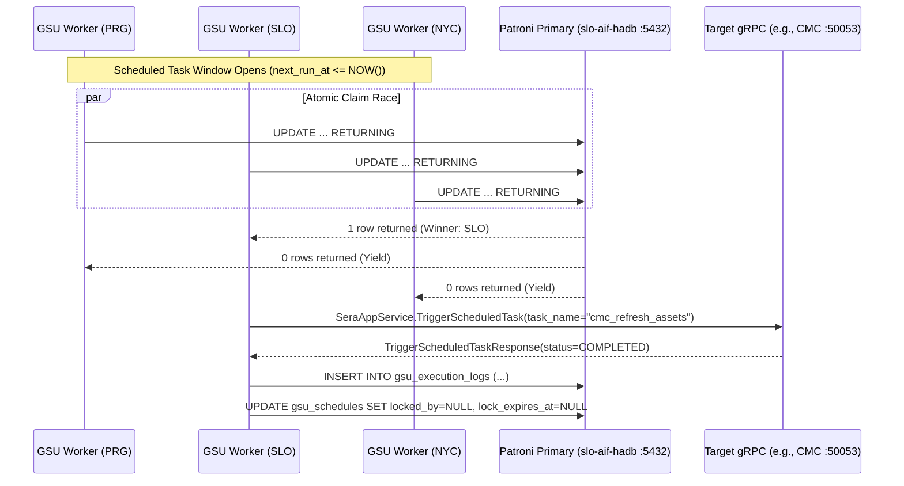

# Global Scheduling Utility (GSU) - Architecture & Design Document

**Doc_Type:** Architecture & Design  
**Category:** (U) Utility  
**Name:** Global Scheduling Utility  
**Acronym:** GSU  
**Version:** 0.2.0  
**Date:** 2026-10-31  
**Author:** Martin Kecka & Gemini AI  
**Status:** Active  

---

## 1. Introduction & Purpose 📜

The **Global Scheduling Utility (GSU)** is a highly available, decentralized master clock and cron execution engine for the SERA/GIA AI ecosystem. Operating across the Prague (`PRG`), Slough (`SLO`), and New York (`NYC`) data centers, the GSU provides a unified platform service for triggering distributed background jobs, cron tasks, and data synchronization pipelines across **any registered ecosystem deployment** (Admin modules, Analyzers, Assistants, Connectors, Gateways, Ingestors, Orchestrators, Processors, Retrievers, and Utilities).

### The Core Problem Solved: Split-Brain Prevention
As services transition from single-node deployments to multi-region active-active clusters across PRG, SLO, and NYC, standard uncoordinated in-process cron daemons and timers face severe operational risks:
- **Split-Brain / Double Execution:** Concurrent workers in multiple regions firing the same upstream synchronization or batch mutation at the same second.
- **Upstream Rate-Limiting Stampedes:** Multiple instances pounding rate-limited external APIs (e.g. CMD GraphQL, NetBox, ServiceNow, Oracle ERP) simultaneously.
- **Duplicated Work:** Redundant compute, token spend, or database locking contention.

GSU acts as an **opt-in coordination engine** for tasks requiring strict **single-flight global execution**. By utilizing an **"Inversion of Control"** pattern via the universal `sera_standard.proto` contract, GSU remains completely agnostic to task business logic. It handles the distributed "when" while target services handle the domain-specific "what".

Distributed coordination is handled strictly through atomic PostgreSQL row-level claims (`UPDATE ... RETURNING`) backed by the global 7-node Patroni database cluster, completely eliminating external regional caching dependencies (e.g. Valkey) for scheduling state.

---

## 2. Architecture & Ecosystem Integration 🏗️

The GSU operates as a headless utility service. To support the ecosystem's migration path, GSU is designed to operate in two progressive deployment topologies:
1. **Current (Host / Systemd Phase):** Runs on host instances alongside current deployments, addressing targets via `127.0.0.1:<port>` or host FQDNs (e.g., `cmc-grpc.service` on port `50053`, `hmu-grpc.service` on port `50101`).
2. **Target (Multi-Cluster Kubernetes Phase):** Deployed as active-active worker pods across all three Kubernetes regional clusters (`PRG`, `SLO`, `NYC`), addressing target microservices via cluster DNS (`<acronym>-grpc.default.svc.cluster.local:<port>`).

### 2.1. Core Architectural Principles
- **Inversion of Control (IoC):** Target services implement the standardized `SeraAppService.TriggerScheduledTask` RPC. GSU triggers an opaque `task_name` with optional trace metadata; the target application routes it internally to its appropriate local handler.
- **Opt-In Split-Brain Prevention:** Microservices decide which tasks require global single-flight guarantees (e.g. upstream asset caching, inventory sweeps, periodic aggregations) and register them with GSU. Purely local node-level monitors remain autonomous inside their respective services.
- **Database Clock Authority:** All schedule due-time evaluations and lock comparisons use Patroni PostgreSQL's `NOW()`, eliminating inter-region clock-skew vulnerabilities.
- **Decentralized Active-Active Workers:** All regional GSU instances are identical and permanently active. There is no complex leader election protocol (Raft/Paxos) between GSU workers—the atomic row claim against Patroni acts as the dynamic, per-task leader election.
- **Global Write / Regional Read Routing:** Claims and audit writes target the global Patroni primary write VIP (`slo-aif-hadb:5432`). Schedule inspections, CLI queries, and health checks utilize local regional read VIPs (`<region>-aif-ha:5433`).

### 2.2. Ecosystem Integration & Data Flow

```mermaid
graph TD
    subgraph Global_Patroni_Cluster ["Global Patroni PostgreSQL Cluster (7 Nodes: SLO / PRG / NYC)"]
        WRITE_VIP["Global Write VIP: slo-aif-hadb.slo.gt-t.net:5432\n(Directs to Primary in SLO)"]
        SLO_READ["SLO Read VIP: slo-aif-ha.slo.gt-t.net:5433"]
        PRG_READ["PRG Read VIP: prg-aif-ha.prg.gt-t.net:5433"]
        NYC_READ["NYC Read VIP: nyc-aif-ha.nyh.gt-t.net:5433"]
    end

    subgraph PRG_Region ["PRG Data Center"]
        GSU_PRG["GSU Worker (PRG)"]
        GSU_PRG -->|Atomic Claim & Run Log| WRITE_VIP
        GSU_PRG -.->|Poll Schedules / Status| PRG_READ
    end

    subgraph SLO_Region ["SLO Data Center"]
        GSU_SLO["GSU Worker (SLO)"]
        GSU_SLO -->|Atomic Claim & Run Log| WRITE_VIP
        GSU_SLO -.->|Poll Schedules / Status| SLO_READ
    end

    subgraph NYC_Region ["NYC Data Center"]
        GSU_NYC["GSU Worker (NYC)"]
        GSU_NYC -->|Atomic Claim & Run Log| WRITE_VIP
        GSU_NYC -.->|Poll Schedules / Status| NYC_READ
    end

    subgraph Targets ["Target Microservices (Systemd Ports or K8s Service DNS)"]
        T_CONN["Connectors (e.g., CMC :50053, NBC, ORC)"]
        T_UTIL["Utilities (e.g., HMU :50101, OMU :50104, AMU)"]
        T_ASST["Assistants / Ingestors / Processors (LDA, BSI, etc.)"]
    end

    GSU_PRG ==="TriggerScheduledTask (Winning Worker Only)"===> Targets
    GSU_SLO ==="TriggerScheduledTask (Winning Worker Only)"===> Targets
    GSU_NYC ==="TriggerScheduledTask (Winning Worker Only)"===> Targets

    ADMIN["SAM Web UI / GSU CLI"] -->|Manage Schedules| WRITE_VIP
    AMU["AMU / HMU Telemetry"] -->|DeepHealth Probe| GSU_SLO
```

> [!NOTE]
> Outbound triggers are mutually exclusive: for any due schedule occurrence, exactly one regional worker wins the atomic row claim and dispatches the RPC.

### 2.3. Target Addressing & Deployment Landscape

GSU can target any registered deployment exposing a standard `*-grpc` service. Endpoints are configured in `gsu_schedules.target_endpoint` and support both current and future hosting models:

| Environment | Endpoint Format Example | Description |
| :--- | :--- | :--- |
| **Local Host / Systemd (Current)** | `127.0.0.1:50053` or `ukslo-crp-ai01.slo.gt-t.net:50053` | Direct gRPC socket on host virtual machine |
| **Kubernetes Regional (Future)** | `<acronym>-grpc.default.svc.cluster.local:<port>` | In-cluster CoreDNS service address |
| **Cross-Region VIP** | `<region>-aif-<service>.gt-t.net:<port>` | Regional HAProxy ingress |

#### Illustrative Scheduling Use Cases by Deployment Category:
- **Connectors (e.g., CMC, NBC, ORC):** Periodic upstream cache pre-warming (e.g., CMD customer asset refreshes in `core/rule_generator.py`) and ERP token rotations without exceeding API rate quotas.
- **Utilities (e.g., HMU, OMU, AMU):** Periodic multi-cluster usage aggregation (e.g., HMU daily token usage rollups) and cross-cluster inventory reconciliation.
- **Ingestors (e.g., BSI, RMI, CFI):** Replacing uncoordinated internal polling loops with unified, staggered ingestion windows.
- **Assistants & Processors (e.g., LDA, CAA, LDP):** Nightly document re-indexing, orphaned batch cleanup, and compliance digest generation.

---

## 3. Module File Map 📂

- `global_scheduling_utility.py`: Main executable entrypoint; boots configuration, database connection pools, cron loop, and inbound gRPC server.
- `bootstrap_helper.py`: Standard SERA virtual environment bootstrapper and dependency verifier.
- `requirements.txt`: Package dependencies (`grpcio`, `protobuf`, `sqlalchemy`, `asyncpg`, `apscheduler`, `croniter`, `click`, `pyyaml`).
- `config/settings.yaml`: Master configuration defining cluster identity, Patroni write/read DSNs, and polling frequencies.
- `core/scheduler.py`: Evaluates CRON expressions, queries due schedules, and manages atomic claim acquisition.
- `core/dispatcher.py`: Dynamic gRPC channel pool manager; dispatches `TriggerScheduledTask` RPCs and processes synchronous vs. asynchronous responses.
- `core/database/`: SQLAlchemy async engine, connection lifecycle, and declarative ORM models (`GsuSchedule`, `GsuExecutionLog`).
- `grpc_api/`: Inbound standard `SeraAppService` implementation for DeepHealth monitoring, version reporting, and documentation inspection.
- `cli/gsu_cli.py`: Interactive Click CLI for listing schedules, inspecting cross-cluster locks, and performing manual task triggers.
- `docs/gsu_design.md`: Architecture & design document.
- `docs/CHANGELOG.yaml`: Standard module changelog.

---

## 4. Core Processing Lifecycle ⚙️

1. **Boot & Schedule Ingestion:** On startup in any cluster (`PRG`, `SLO`, or `NYC`), GSU connects to Patroni and loads active schedules into memory. In-memory schedules are refreshed every `schedule_reload_interval` seconds so updates made via SAM or CLI take effect dynamically.
2. **Clock Evaluation Loop:** Every `poll_interval` seconds, the scheduler checks which active tasks have `next_run_at <= NOW()`.
3. **Atomic Claim & Lock Acquisition:** When a task window opens, workers in all active regions simultaneously execute an atomic claim against Patroni:

    ```sql
    UPDATE sera_gsu.gsu_schedules
    SET 
        locked_by       = :cluster_id,
        lock_expires_at = NOW() + (timeout_seconds * INTERVAL '1 second'),
        next_run_at     = :computed_next_cron_time,
        updated_at      = NOW()
    WHERE task_name = :task_name
      AND is_active = TRUE
      AND next_run_at <= NOW()
      AND (locked_by IS NULL OR lock_expires_at < NOW())
    RETURNING id, task_name, target_endpoint, timeout_seconds;
    ```

4. **Execution Handoff:**
    - **Winning Worker:** The single worker receiving a returned row claims exclusive rights, opens a gRPC channel to `target_endpoint`, and issues `TriggerScheduledTask` with a timeout equal to `timeout_seconds`.
    - **Yielding Workers:** Workers receiving `0` rows immediately yield and continue their polling cycle without contention.
5. **Audit & Lock Release:**
    - Upon response receipt (`COMPLETED` or `ACCEPTED_ASYNC`) or RPC failure, the winning worker records a structured log in `gsu_execution_logs`.
    - The worker releases the lock (`locked_by = NULL`, `lock_expires_at = NULL`). Note that `next_run_at` was already safely advanced during the atomic claim, preventing double-execution.



---

## 5. Detailed Business Logic & Rules 🧠

### 5.1. Atomic Locking & Anti-Split-Brain Logic
- **Single Flight via Postgres:** Locking logic occurs inside PostgreSQL ACID transactions via `UPDATE ... RETURNING`. This guarantees that even if network latency between data centers fluctuates, Patroni acts as the single arbiter.
- **Simultaneous `next_run_at` Advancement:** Because `next_run_at` is updated to the next cron interval *inside the claim statement*, no two workers can claim the same interval even if a lock expires or an RPC times out later.
- **Fail-Safe TTL Expiration:** `lock_expires_at` protects against worker crashes. If a winning worker drops offline mid-execution, its lock expires after `timeout_seconds`, allowing failover recovery on the next polling cycle.

### 5.2. Task Naming & Scoping Convention
- `task_name` MUST be globally unique across the ecosystem and SHOULD follow the pattern `<acronym>_<action>` (e.g. `cmc_refresh_assets`, `hmu_sync_usage_stats`, `nba_reconcile_devices`).
- The `target_acronym` field identifies the owner deployment in the AMU registry.

### 5.3. Trigger Execution Contract (Synchronous vs. Asynchronous)
The `TriggerScheduledTask` RPC contract supports two execution modes:
- **Synchronous (`COMPLETED`):** For fast tasks (execution duration `< 30s`), the target service processes the work within the RPC lifecycle and returns `COMPLETED`.
- **Asynchronous (`ACCEPTED_ASYNC`):** For heavy tasks (e.g., deep database indexing, large file parsing, rolling patching), the target accepts the request, dispatches it to its internal worker pool/thread, and immediately returns `ACCEPTED_ASYNC` with a `remote_run_id`. GSU logs the acceptance and frees the connection; completion tracking is managed by the target's internal state.

### 5.4. Missed Execution Policy (Coalescing)
If an extended cluster-wide outage causes a task to miss multiple scheduled windows, GSU **coalesces** missed executions upon recovery. It executes the task once and advances `next_run_at` relative to the current time, preventing a damaging burst of backlogged calls.

---

## 6. AI, LLM & Machine Learning Execution 🤖

Not applicable for this module. GSU is a deterministic, low-latency scheduling control plane.

---

## 7. Data Models, State, Storage & Auditing 🗄️

GSU stores its operational tables in Patroni under the dedicated `sera_gsu` schema.

### Table: `sera_gsu.gsu_schedules`
| Column | Type | Constraints / Details |
| :--- | :--- | :--- |
| `id` | UUID | Primary Key, default `gen_random_uuid()` |
| `task_name` | String(100) | Unique, indexed (e.g., `cmc_refresh_assets`) |
| `target_acronym` | VARCHAR(20) | Foreign identifier matching AMU registry (e.g., `CMC`, `HMU`) |
| `target_endpoint` | String(255) | Socket address: `127.0.0.1:50053` or `cmc-grpc.default.svc.cluster.local:50053` |
| `cron_expression` | String(100) | Standard 5-field CRON expression (evaluated in UTC) |
| `timeout_seconds` | Integer | Max allowed execution time / lock TTL (default: `300`) |
| `is_active` | Boolean | Administrative toggle (default: `TRUE`) |
| `next_run_at` | DateTime (UTC) | Next scheduled trigger time; indexed |
| `locked_by` | VARCHAR(20) | Region claiming execution (`PRG`, `SLO`, `NYC`, or `CLI`); Nullable |
| `lock_expires_at` | DateTime (UTC) | Expiration timestamp for automatic lock eviction; Nullable |
| `created_at` | DateTime (UTC) | Record creation timestamp |
| `updated_at` | DateTime (UTC) | Last state transition timestamp |

### Table: `sera_gsu.gsu_execution_logs`
| Column | Type | Constraints / Details |
| :--- | :--- | :--- |
| `execution_id` | UUID | Primary Key, propagated as `x-trace-id` |
| `task_name` | String(100) | References `gsu_schedules.task_name` |
| `executed_by_cluster` | VARCHAR(20) | Region where the winning worker ran (`PRG`, `SLO`, `NYC`) |
| `trigger_source` | VARCHAR(20) | Source of trigger: `SCHEDULER` or `MANUAL_CLI` |
| `start_time` | DateTime (UTC) | Execution dispatch timestamp |
| `end_time` | DateTime (UTC) | RPC completion or timeout timestamp |
| `status` | VARCHAR(20) | Outcome: `SUCCESS`, `FAILED`, `TIMEOUT`, `ACCEPTED_ASYNC` |
| `remote_run_id` | String(100) | Target-provided identifier for async executions; Nullable |
| `response_message` | Text | Error traces or target confirmation message |

---

## 8. APIs, Observability & Communication Contracts 📡

### 8.1. Ecosystem Standard RPC Contract (`sera_standard.proto`)
The standardized gRPC service contract to be added to `sera_standard.proto`:

```protobuf
syntax = "proto3";

package sera.standard.v1;

service SeraAppService {
    // Standard ecosystem inspection
    rpc GetAppInfo(google.protobuf.Empty) returns (AppInfoResponse);
    rpc GetDeepHealth(google.protobuf.Empty) returns (DeepHealthResponse);
    rpc GetFeedback(google.protobuf.Empty) returns (FeedbackResponse);
    rpc GetChangelog(google.protobuf.Empty) returns (ChangelogResponse);
    rpc GetDocs(google.protobuf.Empty) returns (DocsResponse);

    // Universal GSU Task Trigger Contract
    rpc TriggerScheduledTask(TriggerScheduledTaskRequest) returns (TriggerScheduledTaskResponse);
}

message TriggerScheduledTaskRequest {
    string task_name = 1;
    string run_id = 2;
    map<string, string> parameters = 3;
}

enum TaskExecutionStatus {
    TASK_EXECUTION_STATUS_UNSPECIFIED = 0;
    COMPLETED = 1;
    ACCEPTED_ASYNC = 2;
    FAILED = 3;
}

message TriggerScheduledTaskResponse {
    TaskExecutionStatus status = 1;
    string message = 2;
    string remote_run_id = 3;
}
```

### 8.2. Inbound Service & Telemetry
GSU implements `SeraAppService` on port `50120`, allowing AMU and HMU to monitor:
- Patroni connectivity state (write VIP and regional read VIP reachability).
- Active schedules count and current lock hold status.
- Scheduler loop heartbeat timestamp.

### 8.3. Outbound Metadata & Call Tracing
All outbound `TriggerScheduledTask` RPCs attach standard gRPC metadata headers:
- `x-client-id: GSU`: Identifies caller provenance for target audit logs.
- `x-trace-id: <execution_id>`: Enables cross-module log correlation in OpenTelemetry/ELK.

---

## 9. User Interface & Visualizations 🖥️

GSU is a headless backend engine. Schedule administration, execution history, and manual overrides are exposed via the **Sera Admin Module (SAM)** web interface under a dedicated **Global Scheduler** management view.

---

## 10. Background Services & Workers 🛠️

- **Scheduler Poller Loop:** Asynchronous loop polling `gsu_schedules` every 10 seconds for tasks ready for execution.
- **Registry Synchronizer:** Reloads active schedule definitions from Patroni every 60 seconds.
- **Stale Lock Reclamation Sweep:** Asynchronous cleaner that queries locks where `lock_expires_at < NOW()`, clearing the expired lock and logging a `TIMEOUT` audit event.

---

## 11. CLI, Tooling & Testing 💻

The `gsu_cli.py` administrative tool provides operator intervention capabilities:

```bash
# List all schedules, next run timestamps, and current lock states
python gsu_cli.py list

# Forcibly trigger a task immediately (bypasses cron timing; acquires lock with locked_by=CLI)
python gsu_cli.py trigger <task_name>

# Inspect recent execution history for a specific task
python gsu_cli.py history <task_name> --limit 20

# Force-clear a stuck lock in emergency situations
python gsu_cli.py locks clear <task_name>
```

---

## 12. Configuration, Security & Infrastructure Topology 🔒

### 12.1. Master Configuration (`settings.yaml`)

| Setting Key | Purpose | Default / Production Value |
| :--- | :--- | :--- |
| `database.write_dsn` | Global Patroni write VIP (Primary leader) | `postgresql://...@slo-aif-hadb.slo.gt-t.net:5432/sam_admin_prod_db` |
| `database.read_dsn` | Regional Patroni read VIP (Local replica) | `postgresql://...@<region>-aif-ha.<region>.gt-t.net:5433/sam_admin_prod_db` |
| `gsu.cluster_identity` | Regional datacenter identifier | Injected via env (`SLO`, `PRG`, or `NYC`) |
| `gsu.poll_interval` | Polling loop frequency (seconds) | `10` |
| `gsu.schedule_reload_interval` | Schedule registry cache refresh (seconds) | `60` |
| `grpc.port` | Inbound `SeraAppService` listener | `50120` |

### 12.2. Patroni Cluster & VIP Topology
GSU connects across the 7-node hybrid Patroni cluster:
- **Global Write VIP:** `slo-aif-hadb.slo.gt-t.net:5432` -> routes directly to the active Patroni primary leader (currently `slo-aif-psql01`).
- **Regional Read VIPs (Port :5433):**
  - SLO: `slo-aif-ha.slo.gt-t.net:5433`
  - PRG: `prg-aif-ha.prg.gt-t.net:5433`
  - NYC: `nyc-aif-ha.nyh.gt-t.net:5433`

### 12.3. Security & Privilege Boundaries
- **No Direct Mutation Privileges:** GSU holds no host SSH credentials, Vault administrative roles, or business database access. It only interacts with the `sera_gsu` schema in Patroni and communicates via standard gRPC.
- **Identity Enforcement:** Target services verify `x-client-id: GSU` on `TriggerScheduledTask` RPCs to restrict execution triggers.

---

## 13. Error Handling & Resilience 🛡️

- **Patroni Primary Failover:** If the SLO primary node becomes unavailable, Patroni promotes a standby leader (in PRG or NYC). During the promotion window, GSU claim queries pause harmlessly; upon write VIP convergence, scheduling resumes automatically with zero double-execution risk.
- **Target Microservice Failure:** If a target service rejects connections (`Connection Refused`) or times out, GSU catches the gRPC exception, logs `status = FAILED`, releases the lock, and leaves `next_run_at` at its next scheduled interval.
- **Worker Crash During Run:** If a GSU worker dies after claiming a task, `lock_expires_at` prevents permanent deadlock. Once the TTL passes, the lock cleaner frees the task and subsequent cycles execute normally.

---

## 14. Roadmap & Implementation Strategy 🗺️

- **Phase 0 (Contract Definition):** Update `assets/protos/sera_standard/sera_standard.proto` to include `TriggerScheduledTask`, and re-generate stubs across common asset paths.
- **Phase 1 (GSU Core Development & Host Pilot):**
  - Implement GSU repository (`core/scheduler.py`, `core/dispatcher.py`, `core/database/`).
  - Deploy initial GSU daemon on host (`ukslo-crp-ai01`) alongside existing services.
  - Pilot onboarding: Integrate `TriggerScheduledTask` into a representative target (e.g., CMC asset refresh `rule_generator.py`) and verify atomic claim behavior.
- **Phase 2 (Multi-Region Kubernetes Deployment):**
  - Containerize GSU and deploy active-active worker pods across PRG, SLO, and NYC Kubernetes clusters as services migrate.
  - Onboard additional deployments needing split-brain protection across categories.
- **Phase 3 (SAM Control Plane Integration):**
  - Expose CRUD APIs in SAM for `sera_gsu.gsu_schedules`.
  - Embed the "Global Scheduler" management and execution audit view in the SAM web dashboard.
