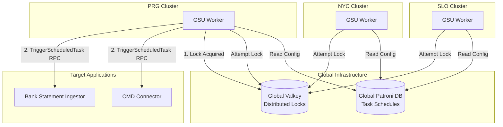

# Global Scheduling Utility (GSU) - Architecture Document

**Doc_Type:** Architecture
**Category:** Utility
**Name:** Global Scheduling Utility
**Acronym:** GSU
**Version:** 0.1.0
**Date:** 2026-08-19
**Author:** Martin Kecka & Gemini AI
**Status:** Draft

## 1. Introduction & Purpose

The Global Scheduling Utility (GSU) is a highly available, decentralized master clock for the SERA/GIA ecosystem. Operating simultaneously across the Prague (PRG), Slough (SLO), and New York (NYC) data centers, the GSU is responsible for triggering distributed background jobs, cron tasks, and data synchronization pipelines across the 27+ microservices in the ecosystem. 

By utilizing a strict "Inversion of Control" pattern via the universal `sera_standard.proto` contract, the GSU remains entirely agnostic to the business logic of the tasks it schedules. It acts solely as a trigger mechanism, utilizing a shared Valkey cache for distributed locking to prevent split-brain execution and API rate-limiting stampedes.

## 2. Architecture & Ecosystem Integration

The GSU operates as a headless utility service. It integrates directly with the global Patroni PostgreSQL cluster for schedule configuration and the global Valkey cluster for distributed locking. It communicates outbound to target microservices (e.g., CMC, BSI, RMI) exclusively via the `SeraAppService` gRPC interface.

## 3. Module File Map

*   `gsu_main.py`: The application entry point. Initializes the scheduler loop and loads configurations.
*   `config/settings.yaml`: Defines connections to Patroni, Valkey, and logging parameters.
*   `core/scheduler.py`: The main loop evaluating cron expressions against the current UTC time.
*   `core/lock_manager.py`: Implements the Valkey-based distributed locking mechanism.
*   `core/dispatcher.py`: Handles dynamic gRPC connections to target services and executes the `TriggerScheduledTask` RPC.
*   `grpc_api/`: Contains the standard `sera_standard.proto` stubs and the inbound GSU gRPC server for DeepHealth reporting.
*   `models/database.py`: SQLAlchemy/asyncpg models for interacting with the Patroni schedule configuration tables.
*   `cli/gsu_cli.py`: Administrative CLI for manual task triggering and lock management.

## 4. Core Processing Lifecycle

1.  **Boot & Sync:** Upon startup in any cluster, the GSU connects to the global Patroni database and loads the active `gsu_schedules` registry into memory.
2.  **Clock Evaluation Loop:** The scheduler continually evaluates loaded CRON expressions against the current UTC timestamp.
3.  **Lock Acquisition (The Race):** When a task is due (e.g., `refresh_cmd_assets`), the GSU workers in PRG, SLO, and NYC simultaneously attempt to write a lock key to Valkey (e.g., `SETNX gsu_lock:refresh_cmd_assets <cluster_id> EX 300`).
4.  **Execution Handoff:**
    *   The single worker that successfully acquires the Valkey lock proceeds to execution. The others yield and return to the polling loop.
    *   The winning worker establishes a gRPC channel to the target service defined in the schedule (e.g., `cmc-grpc.default.svc.cluster.local:50053`).
    *   It invokes `TriggerScheduledTask(task_name="refresh_cmd_assets")`.
5.  **Audit & Release:** Upon receiving the `TriggerScheduledTaskResponse` (success or failure), the winning worker writes an execution log to Patroni and explicitly deletes the Valkey lock, freeing the task for its next cycle.

## 5. Detailed Business Logic, Rules & HITL

*   **Distributed Locking Mechanics:** 
    *   The Valkey lock key MUST use the format `gsu_lock:<task_name>`.
    *   The lock MUST include a strict Time-To-Live (TTL) expiration matching the maximum allowed execution time of the task (defaulting to 300 seconds). This acts as a fail-safe; if a GSU worker crashes mid-execution, the lock naturally expires, allowing the next cycle to proceed.
*   **Trigger Contract:** The GSU mandates that all target services implement the universal `SeraAppService.TriggerScheduledTask` RPC. The GSU relies on the target application's internal `local_task_handler.py` to route the string `task_name` to the correct internal Python function.
*   **Missed Execution Tolerance:** If all 3 clusters fail to acquire a lock (e.g., global Valkey outage), the GSU will record a missed execution in Patroni and attempt a retry based on the task's configured `retry_policy` (default: 3 retries, 60-second linear backoff).

## 6. AI, LLM & Machine Learning Execution

Not applicable for this module.

## 7. Data Models, State, Storage & Auditing

The GSU maintains its configuration and execution history in the global Patroni PostgreSQL cluster under a dedicated `sera_gsu` schema.

*   **Table: `gsu_schedules`**
    *   `id` (UUID, PK)
    *   `task_name` (String, Unique) - e.g., `refresh_cmd_assets`
    *   `target_endpoint` (String) - e.g., `cmc-grpc.default.svc.cluster.local:50053`
    *   `cron_expression` (String)
    *   `timeout_seconds` (Int)
    *   `is_active` (Boolean)
*   **Table: `gsu_execution_logs`**
    *   `execution_id` (UUID, PK)
    *   `task_name` (String, FK)
    *   `executed_by_cluster` (String) - e.g., `PRG`
    *   `start_time` (Timestamp)
    *   `end_time` (Timestamp)
    *   `status` (Enum: SUCCESS, FAILED, TIMEOUT)
    *   `response_message` (Text)

Ephemeral state (locks) strictly resides in Valkey.

## 8. APIs, Observability & Communication Contracts

*   **Outbound Communication:** Utilizes `sera_standard_pb2_grpc.SeraAppServiceStub` to dispatch `TriggerScheduledTaskRequest` payloads to target modules.
*   **Inbound Communication:** Exposes its own standard `SeraAppService` gRPC server on port `50120` to fulfill `GetAppInfo` and `GetDeepHealth` probes for AMU visibility.
*   **Tracing:** Injects standard correlation IDs (`x-trace-id`) into the gRPC metadata when triggering tasks to ensure logs can be traced from the GSU down into the executing worker's output.

## 9. User Interface (UI) & User Journey

Not applicable for this module. Management of GSU schedules will be embedded as a dedicated tab within the Sera Admin Module (SAM) UI, interacting directly with the Patroni configuration tables.

## 10. Background Services & Workers

*   **Scheduler Loop:** A continuous asynchronous loop (running via `asyncio` or `APScheduler`) that evaluates the delta between the current UTC time and the active `cron_expression` records in memory. Runs continuously as long as the pod is alive.

## 11. CLI, Tooling & Testing

*   `python gsu_cli.py trigger <task_name>`: Bypasses the cron schedule, forcibly acquires the Valkey lock, and fires the gRPC request immediately. Used for debugging or manual operational overrides.
*   `python gsu_cli.py locks clear <task_name>`: Manually wipes a stuck lock from Valkey in the event of a catastrophic failure.

## 12. Configuration, Security & Identity

| Variable | Purpose | Default |
| :--- | :--- | :--- |
| `database.dsn` | Global Patroni connection string | `postgresql://...` |
| `valkey.url` | Global Valkey connection string | `valkey://...` |
| `gsu.cluster_identity` | Hardcoded identifier for the deployment region | `UNKNOWN` (must be overridden in Kube deployment to `NYC`, `PRG`, or `SLO`) |
| `gsu.poll_interval` | Frequency in seconds to reload schedules from DB | `60` |

Identity forwarding is enforced by attaching the `x-client-id: GSU` metadata header to all outbound `TriggerScheduledTask` RPC calls.

## 13. Error Handling & Resilience

*   **Valkey Unavailability:** If Valkey cannot be reached, the GSU worker degrades to a safe state and refuses to trigger any tasks to prevent concurrent execution collisions.
*   **Target Unavailable:** If the `target_endpoint` fails to accept the gRPC connection, the GSU logs a `FAILED` execution with `Connection Refused`, releases the lock, and relies on the next cron cycle or manual intervention.
*   **Zombie Locks:** All locks are created with an explicit expiration (`EX` argument in Valkey). Deadlock scenarios are mathematically impossible beyond the configured timeout window.

## 14. Roadmap, Tech Debt & Migration Strategy

*   **Current Status:** Concept drafted to shift asset refresh logic out of individual connectors (e.g., CMC).
*   **Next Steps:** Implement the core repository, deploy to the DEV Kubernetes namespaces across all three data centers, and test Valkey lock contention under load.
*   **Phase 2:** Update the Sera Admin Module (SAM) API to expose CRUD operations over the `gsu_schedules` Patroni table, providing a centralized "Ecosystem Scheduler" UI pane.