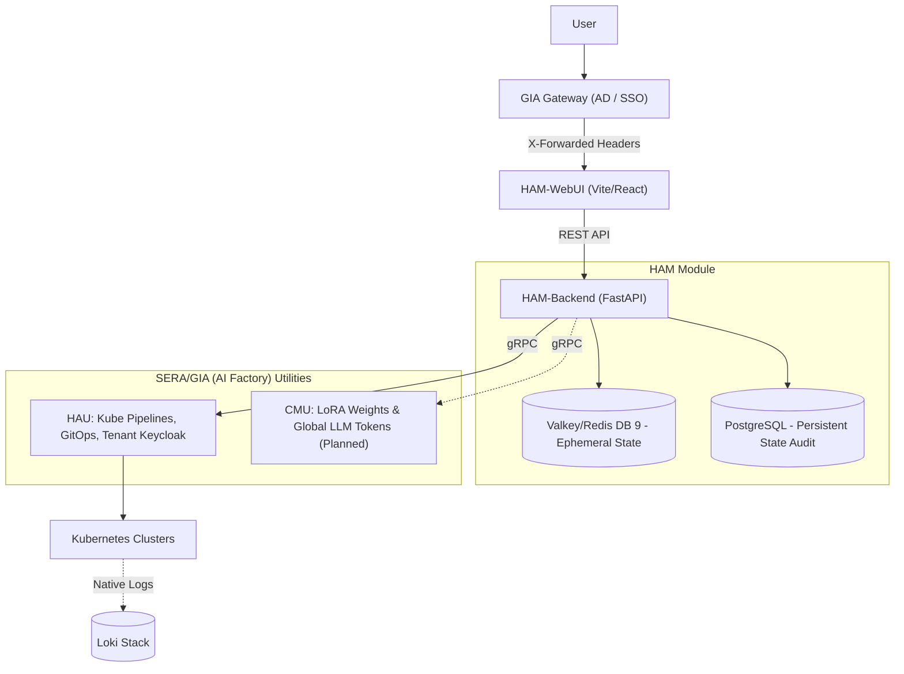

# HALO Admin Module (HAM) - Architecture & Design Document

**Doc_Type:** Architecture
**Category:** (AM) Admin Module
**Name:** HALO Admin Module
**Acronym:** HAM
**Version:** 0.2.0
**Date:** 2026-08-17
**Author**: Martin Kecka
**Status**: In Development

## 1. Introduction & Purpose
The HALO Admin Module (HAM) is the centralized, internal-facing WebUI and aggregator backend serving as the primary control plane for the HALO defense ecosystem. Built specifically for internal Site Reliability Engineers (SREs) and the administration team, HAM provides multi-tenant estate-level monitoring across the entire global deployment.

HAM orchestrates the visualization of complex infrastructure telemetry, fulfilling the critical operational requirement for estate-wide dashboards showing customer-segregated views, multi-tenant Kubernetes topologies, localized vLLM inference endpoints, and active infrastructure components. HAM does not perform localized heavy computation or edge data ingestion; rather, it acts as the supreme orchestration layer, securely exposing multi-tenant states, GitOps release cycles, and feature configurations through a single pane of glass.

## 2. Architecture & Ecosystem Integration
HAM is engineered on a strict Aggregator (Backend-for-Frontend) pattern. The FastAPI backend does not duplicate the heavy lifting of localized infrastructure management. Instead, it maintains a lightweight footprint, serving the React frontend while fanning out gRPC requests to the headless SERA/GIA (AI Factory) utility swarm running on the physical hardware nodes.

* **HAU (Halo Admin Utility):** HAM interfaces with HAU to manage individual tenant Kubernetes deployments, execute GitOps configuration pushes, configure the tenant-specific Halo Keycloak instances, and monitor the underlying Morpheus data processing pipelines.
* **CMU (Configuration Management Utility) (Planned):** HAM will interface with CMU exclusively for global AI asset orchestration, specifically handling the dynamic deployment of LoRA weights and the provisioning of global LLM authentication tokens required by the individual tenants.



## 3. Module File Map

```text
/ai/halo_admin_module/
├── cli/                            
│   ├── commands/                   
│   │   ├── cache_cmds.py           # Domain-specific CLI commands for manually flushing the Redis cache
│   │   └── module_cmds.py          # Standard module operational status and health commands
│   └── ham_cli.py                  # Main CLI entry point utilizing Click to group sub-commands
├── config/                         
│   └── settings.yaml               # Standard ecosystem configuration defining the main source of truth for all variables
├── core/                           
│   ├── connectors/                 
│   │   └── hau_connector.py        # gRPC client logic to communicate with the downstream HAU service for GitOps execution
│   ├── database/                   
│   │   ├── database.py             # Database engine and SQLAlchemy session factory initialization
│   │   ├── default_rules.py        # Default governance rules for automated state transitions
│   │   └── models.py               # SQLAlchemy ORM data models representing persistent state audit logs
│   ├── io_handlers/                
│   │   ├── redis_handler.py        # Handles high-speed telemetry and ephemeral state retrieval from Valkey/Redis
│   │   ├── sql_reader.py           # Handles reading operational state from the PostgreSQL database
│   │   └── sql_writer.py           # Handles persisting operational state transitions into PostgreSQL
│   └── llm_interface.py            # Handles programmatic interactions with reasoning models for diagnostic tasks
├── docs/                           
│   ├── CHANGELOG.yaml              # Track changes and version history
│   └── ham_design.md               # Main architecture document describing the module design
├── grpc_api/                       
│   ├── generate_stubs.py           # Python script to compile .proto files into stubs
│   ├── sera_standard_service.py    # Required SERA standard implementation (AppInfo, DeepHealth) for network probes
│   └── services.py                 # Core gRPC service implementations
├── rest_api/                       
│   ├── routers/                    
│   │   ├── configuration.py        # FastAPI resource handling feature catalog and toggle endpoints
│   │   ├── docs.py                 # FastAPI resource handling documentation retrieval
│   │   ├── gitops.py               # FastAPI resource handling GitOps orchestrations and releases
│   │   ├── inventory.py            # FastAPI resource handling multi-tenant topology endpoints
│   │   └── users.py                # FastAPI resource handling user access and permissions
│   ├── dependencies.py             # Shared API dependencies for JWT validation and RBAC parsing
│   ├── main.py                     # FastAPI application initialization and middleware setup
│   └── schemas.py                  # Pydantic models for REST request/response validation
├── scripts/                        # Maintenance and one-off testing scripts (e.g., debug_llm_payload.py)
├── ui/                             # Vite/React frontend application for the admin dashboard
│   ├── public/                     # Static frontend assets (e.g., favicon, launcher-icon)
│   ├── src/                        
│   │   ├── components/             # Reusable global UI components (MarkdownRenderer, Mermaid diagrams, Glossaries)
│   │   ├── constants/              # Static frontend configurations and glossary definitions
│   │   ├── features/               # Dedicated React sub-components grouped by feature area (configuration, documentation, gitops, inventory)
│   │   ├── pages/                  # Top-level React view components pointing to features (e.g., InventoryPage.jsx)
│   │   ├── services/               # REST API caller functions to interact with the FastAPI backend
│   │   ├── theme.js                # Material UI theme definitions (colors, typography)
│   │   └── App.jsx                 # Root React application component and routing layout
│   ├── index.html                  # Main HTML entry point for the Vite app
│   ├── package.json                # Frontend package dependencies and build scripts
│   └── vite.config.js              # Vite configuration, including proxy setup to the Python FastAPI backend
├── utils/                          
│   ├── config_loader.py            # Standardized function to load settings.yaml
│   └── logging_setup.py            # Standardized logging definition setup
├── bootstrap_helper.py             # Standard initialization script managing virtual environments and dependencies
├── deploy.sh                       # Standard script for deploying or restarting the systemd services
├── halo_admin_module.py            # Main application entry point that bootstraps the FastAPI/gRPC and CLI
├── README.md                       # High-level overview of the module with links to core documentation
└── requirements.txt                # Python backend package dependencies
```

## 4. Core Processing Lifecycle
* **Bootstrapping:** The FastAPI backend initializes, injecting environment variables, and establishing the SQLAlchemy connection pools to the PostgreSQL database.
* **State Caching:** The `gitops_daemon` background task executes an immediate sweep via the HAU connector, pre-warming the Valkey/Redis cache with macro-level ecosystem topology, container tags, and branch structures.
* **Request Authentication:** Inbound REST requests from the React UI are intercepted by `get_current_user`. The upstream GIA Gateway (which handles AD/SSO authentication) injects identity headers (`X-Forwarded-Full-Name`, `X-Forwarded-Groups`) which are parsed to resolve strict RBAC parameters (e.g., `can_promote_release`).
* **Aggregated Response:** Depending on the route, HAM either serves the payload instantly from the Redis cache (for high-frequency telemetry) or proxies a synchronous gRPC call to HAU. Operational state transitions (e.g., triggering a release) are captured and persisted into the PostgreSQL database before the HTTP response is returned.

## 5. Detailed Business Logic & Rules
HAM governs the lifecycle of the ecosystem through strict state management rather than complex, distributed log streaming.
* **Release Version Control:** HAM manages the progression of code through distinct release statuses (Draft, Testing, Approved, Released, Retired). The orchestrator ensures that every container tag promoted through the UI generates an immutable `GitReleaseAuditLog` record.
* **Customer Deployment Rules:** HAM defines the deployment rings (Internal, Alpha, Beta, Production). Configuration payloads dictate which customers receive specific releases, allowing administrators to gate releases and apply customer-specific deployment scheduling.
* **Configuration & Feature Toggles:** Features are registered in the `FeatureCatalog`. HAM allows operators to enable/disable features globally or per-customer without executing a hard release. This encompasses scheduled feature activation, feature rollout testing, and a comprehensive audit history of every toggle change.
* **State-Driven Auditing:** Rather than relying on disparate log streams, HAM tracks the definitive State of the ecosystem. Actions like deployments, configuration changes, and feature toggle adjustments are recorded as discrete state transitions within the PostgreSQL database, providing a bulletproof audit trail of user activity.

## 6. AI, LLM & Machine Learning Execution
HAM utilizes the global AI factory reasoning models (Gemma-4-31B) to augment the operational efficiency of the administration team.
* **Automated Changelog Synthesis:** When an SRE promotes a branch to a core environment, HAM orchestrates HAU to execute a map-reduce LLM pipeline against the raw Git diffs, automatically generating highly structured, semantic Markdown release notes.
* **Diagnostic Reasoning:** Telemetry threshold breaches are compiled into JSON snapshots and evaluated by the LLM at Temperature 0.0 to guarantee deterministic classification. The LLM extracts the severity level and formulates actionable remediation steps, appending them directly to the failure state in the database.

## 7. Data Models, State & Storage
HAM rejects the anti-pattern of building overlapping log-streaming pipelines. Kubernetes natively captures pod execution logs and streams them to the centralized Loki stack. HAM’s storage architecture is strictly focused on high-speed telemetry and immutable state tracking.
* **Persistent State (PostgreSQL):** The `ham_admin_prod_db` is the definitive source of truth for historical governance. It stores the `DeploymentAuditLog`, `GitReleaseAuditLog`, `FeatureCatalog`, and `TenantCustomization`. If an SRE requires deep-dive raw execution logs for a crashed pod, HAM provides the contextual identifiers (Namespace, Pod Name, Timestamp), but the SRE queries Loki directly for the raw stream.
* **Ephemeral Telemetry (Valkey/Redis DB 9):** Utilized exclusively for high-frequency dashboard reads. This prevents active multi-tenant queries from cascading down to the heavy-lifting utilities, allowing the UI to render real-time topology and pipeline health instantly.

## 8. APIs, Observability & Communication Contracts
* **REST API (Ingress):** Exposed exclusively to the internal HAM-WebUI. Strict schema validation is enforced via Pydantic models.
* **gRPC Boundaries (Egress):** HAM communicates with downstream utilities (HAU, CMU) via structured Protobuf contracts, ensuring backward compatibility and minimal serialization overhead.
* **Observability:** Ecosystem health is exposed to external monitoring platforms via the standard SERA/GIA `GetDeepHealth` and `GetAppInfo` gRPC endpoints, evaluating the underlying PostgreSQL connections, Redis vitality, and downstream gRPC socket stability.

## 9. User Interface (UI) & Visualizations
The HAM-WebUI (Vite/React) is designed to fulfill complex managed-service provider implementations, translating raw data into actionable intelligence across five primary pages:

* **Multi-Tenant Estate-Level Dashboards (`InventoryPage.jsx`):** A centralized UI to monitor computational topology across the ecosystem. It features location-based Datacenter groupings (e.g., SLO, NYC) and tracks Deployments, Pods, and Services with native `TIER` and `CATEGORY` tags.
* **GitOps Command Center (`GitOpsPage.jsx`):** A unified APM view tracking microservices, active branches, and container release histories. It provides dynamic Git release and retry pipeline functionality, 1-click promotion, and deep audit telemetry.
* **Feature Catalog (`ConfigurationPage.jsx`):** A dedicated interface managing the ecosystem Feature Catalog, mapping available product features against specific tenant deployments with GitOps dependency mappings and pricing matrices.
* **Documentation (`DocumentationPage.jsx`):** Dynamically groups ecosystem documents by frontmatter `Doc_Type` using Material UI section headers, natively parsing and rendering rich architecture documents and SVG flowcharts.
* **Releases (`ReleasesPage.jsx`):** Seamlessly aggregates changelog events across all HALO projects into a single chronological velocity dashboard.

## 10. Background Services & Workers
* **`gitops_daemon`:** A persistent `asyncio` background task within the FastAPI event loop. Utilizing Redis-backed distributed locking, it awakens at randomized intervals to trigger HAU's Git inventory synchronization. This ensures the Redis cache is constantly warm with the latest GitLab repository states without requiring manual UI refreshes.

## 11. CLI, Tooling & Testing
The `ham_cli.py` utility provides localized administrative execution modes, grouped by domain:

* **Core Services**:
  * `start-api-server`: Bootstraps the FastAPI REST backend using Uvicorn.
  * `start-grpc-server`: Bootstraps the internal SERA/GIA standard gRPC service.
* **Cache (`ham cache`)**:
  * `clear`: Manually flushes the Valkey/Redis cache and resets all daemon cooldown locks, forcing a clean synchronization pass on the next UI request.
* **Module (`ham module`)**:
  * `status`: Retrieves internal operational status for the HAM module.

## 12. Configuration, Security & Hardware Affinity

| Environment / Configuration Variable | Purpose | Default Value |
| :--- | :--- | :--- |
| `system_services.api.port` | Bound network port for the FastAPI REST layer | `7899` |
| `database.write_dsn` | Connection string for persistent state tracking | `postgresql://...` |
| `redis.url` | Endpoint for high-frequency ephemeral telemetry | `redis://.../9` |
| `llm_engines.primary.model` | The designated reasoning model for autonomous diagnostics | `google/gemma-4-31B-it` |
| `auth.client_id` | Keycloak OpenID Connect authentication scope | `gia-test` |

**Hardware Affinity:** The HALO ecosystem operates on localized, on-premise hardware. Scaling mechanisms are strictly bound by physical H100 GPU availability within the respective data centers (e.g., PRG, SLO, NYC), rather than infinite virtual cluster replication.

## 13. Future Enhancements & Roadmap
* **AI-Driven Alarm & Event Management:** Implementing the full GIA-standard diagnostic engine and incident lifecycle architecture into HAM. This system will autonomously detect, analyze, and categorize telemetry anomalies across the HALO ecosystem without requiring manual SRE intervention. The implementation roadmap includes:
    * **Intelligent Event Classification:** Dynamically segregating telemetry breaches based on a `requires_ai_analysis` database rule. Critical HALO ecosystem issues (e.g., `KAFKA_CONSUMER_STALLED`, `EDGE_COLLECTOR_OFFLINE`, `GITOPS_SYNC_FAILED`, `TENANT_KEYCLOAK_UNREACHABLE`) will trigger high-priority `ALARMs`, while minor anomalies (e.g., `UI_WIDGET_CRASH`, `REDIS_MEMORY_WARNING`) will be routed as informational `EVENTs`.
    * **LLM Diagnostic Engine:** When an ALARM is triggered, the backend `DiagnosticService` will compile rich contextual snapshots (Kafka consumer lags, active edge collector heartbeats, GitOps commit states, Morpheus pipeline logs, and Redis/NetBox availability) and dispatch them to the global reasoning model (e.g., Gemma-4-31B) at Temperature 0.0. The LLM will deterministically extract severity levels, provide root-cause analysis, and generate actionable remediation steps.
    * **Advanced UI Integration:** Building dedicated forensic components, including an `IncidentAnalysisDialog` for deep-dive LLM alarm triage and an `EventTimelineDialog` for scrolling historical metric timelines. Active AI diagnoses will be natively surfaced via interactive, color-coded badges directly on the Inventory and GitOps dashboard headers.
    * **Automated Lifecycle & Resilience:** Engineering automated backend recovery sweeps that constantly evaluate the health matrix and systematically clear resolved incidents (e.g., resolving an `EDGE_COLLECTOR_OFFLINE` alarm once the collector reconnects and streams Netflow data). This includes "Fail-Open" logic during aggregator network blips to permanently eradicate massive waves of false-positive alarms.
* **Inventory Estate Aggregation:** Expanding the `InventoryPage` to fully realize the Multi-Tenant Estate-Level Dashboard vision. This will include explicitly rendering customer-segregated views that aggregate active Kubernetes components, edge network collector states, and localized physical hardware node utilization across the global footprint.
* **Full Tenant Provisioning (End-to-End):** Transitioning the current manual GitOps repository scaffolding into a fully automated, 1-click UI workflow. HAM will orchestrate HAU to dynamically generate the Kustomize overlays, allocate storage, and scaffold the tenant namespaces seamlessly.
* **Location Management & Routing:** Enhancing the database schema to robustly map customer locations, specific sites, and broader regions (EMEA, Americas, APAC). This includes assigning specific edge collectors to locations and displaying real-time collector heartbeat and connectivity status on the dashboard.
* **Advanced Deployment Automation:** Integrating automated rollback support based on post-deployment health checks, container redeployment controls, and refined maintenance window scheduling.
* **CMU Integration:** Expanding the gRPC integration to orchestrate CMU for the automated provisioning of custom LoRA weights and global LLM usage tokens as new tenants are brought online.