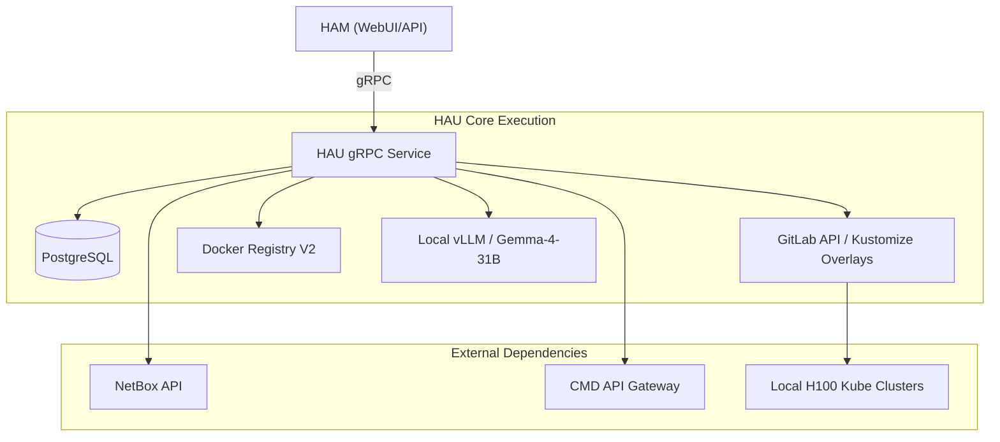

# HALO Admin Utility (HAU) - Architecture & Design Document

**Doc_Type:** Architecture
**Category:** (U) Utility
**Name:** HALO Admin Utility
**Acronym:** HAU
**Version:** 0.1.6
**Date:** 2026-08-17
**Author:** Martin Kecka
**Status**: In Development

## 1. Introduction & Purpose 📜

The **HALO Admin Utility (HAU)** serves as the "Workstream 2: Administration & Operations Portal." It provides GTT with the primary operational control plane to provision, govern, monitor, and support all customer tenants within the HALO ecosystem.

**Business Outcome:** GTT obtains a single administration portal to onboard customers, provision tenants, deploy collectors, manage releases, monitor platform health, control feature availability, support customers, and manage the entire customer lifecycle through to billing.

HAU is the headless execution engine and operational workhorse of the HALO ecosystem. While the HALO Admin Module (HAM) serves as the brain and presentation layer, HAU operates as the muscle. It strictly handles backend infrastructure provisioning, programmatic GitOps automation, NetBox API auditing, and semantic AI-driven changelog generation.

Unlike the internal SERA/GIA utilities (AMU, OMU, CMU), HAU manages external, customer-facing deployments, collectors, and AI inference pipelines (like Morpheus and Triton). Because HALO operates outside the standard SERA/GIA ecosystem, it implements its own independent monitoring, UI, and deployment abstractions, natively interacting with the physical, on-premise hardware infrastructure to deploy localized AI workloads and enforce structural compliance across all customer tenants.

---

## 2. Architecture & Ecosystem Integration 🏗️

HAU operates as an isolated, stateless microservice exposing a high-performance gRPC interface. It receives orchestration commands from the HAM frontend and translates them into physical repository mutations, direct Kubernetes state changes, or API gateway queries. The utility is engineered to execute complex, multi-stage workflows synchronously.

**Core Architectural Principles:**
1. **Reused Utility Patterns:** HAU heavily borrows architectural concepts from the SERA/GIA ecosystem:
    * **AMU Pattern:** GitOps-style configuration pushes to deployed environments and release management.
    * **CMU Pattern:** Logical configuration management, managing tenant feature flags, and product configurations.
    * **HMU Pattern:** Heavy infrastructure telemetry aggregation (tracking Kubernetes, AI pipelines, and LLM model performance).
2. **Decoupled Execution & UI:** HAU serves as the headless execution engine (structured exactly like standard SERA/GIA utilities with a Click CLI and gRPC server). The web interface is completely offloaded to a dedicated **HALO Admin Module (HAM)** (FastAPI + React frontend), mirroring the SAM paradigm.
3. **CMD as Source of Truth:** Core customer, tenant, and billing lifecycle data is authoritative in CMD. HAU integrates directly with CMD to drive downstream provisioning.
4. **Tenant Diagnostics Aggregation:** HAU actively queries the tenant's Halo Backend via REST (`/api/diagnostics/health`) to retrieve internal dependency states and executes targeted PromQL queries against the Kubernetes Prometheus operator to fetch AI pipeline throughput and anomaly metrics.




## 3. Module File Map 📂

To maintain ecosystem consistency, the administration plane is decoupled. HAU is the backend Python microservice living in `/ai/utilities/halo_admin_utility`, acting as the execution engine for GitOps commits, state introspection, and background monitoring.

```text
/ai/utilities/halo_admin_utility/
├── cli/                            # Command line interface grouped by domain
│   ├── commands/                   
│   │   ├── changelog_cmds.py       # Domain-specific CLI commands for semantic changelog generation
│   │   ├── features_cmds.py        # Domain-specific CLI commands to upsert and list feature catalogs
│   │   ├── git_cmds.py             # Domain-specific CLI commands for managing Git releases, deletions, and pipelines
│   │   ├── inventory_cmds.py       # Domain-specific CLI commands for syncing and displaying tenant inventory
│   │   ├── module_cmds.py          # Standard module operational status and health commands
│   │   └── netbox_cmds.py          # Domain-specific CLI commands for cross-referencing NetBox audits
│   └── hau_cli.py                  # Main CLI entry point utilizing Click to group sub-commands
├── config/                         
│   └── settings.yaml               # Standard ecosystem configuration defining the main source of truth for all variables
├── core/                           
│   ├── clients/                    
│   │   ├── netbox_client.py        # Dedicated external API client for interacting with the NetBox
│   │   └── vault_client.py         # Dedicated external API client for securely fetching secrets from Vault
│   ├── connectors/                 
│   │   └── cmc_connector.py        # gRPC client logic to communicate with the CMD Connector for tenant architecture data
│   ├── database/                   
│   │   ├── database.py             # Database engine and SQLAlchemy session factory initialization
│   │   └── models.py               # SQLAlchemy ORM data models representing tenants, customizations, and audit logs
│   ├── io_handlers/                
│   │   ├── sql_reader.py           # Handles reading operational state and configuration from the PostgreSQL database
│   │   └── sql_writer.py           # Handles writing and upserting data (e.g. features, telemetry) into PostgreSQL
│   ├── managers/                   
│   │   ├── container_registry_manager.py # Logic for interacting with the Docker Registry V2
│   │   ├── git_inventory_manager.py      # Synchronizes and caches Git branch and image tag inventory
│   │   ├── gitlab_manager.py             # Wrapper for general GitLab API operations
│   │   ├── git_pipeline_manager.py       # Logic for creating Merge Requests and triggering/polling CI pipelines
│   │   ├── kube_manager.py               # Interacts with Kubernetes clusters via standard API to introspect workloads
│   │   ├── netbox_audit_manager.py       # Cross-references NetBox data against CMD for A-Site audits
│   │   └── prometheus_manager.py         # Executes targeted PromQL queries against cluster Prometheus instances
│   ├── orchestrators/              
│   │   ├── changelog_orchestrator.py # Manages the multi-step map-reduce LLM pipeline for changelog generation
│   │   ├── delete_orchestrator.py    # Orchestrates safe deletion of features across Git and Kubernetes
│   │   ├── inventory_orchestrator.py # Orchestrates the synchronization of Kubernetes states into the local DB
│   │   └── release_orchestrator.py   # Governs the entire GitOps release cycle and Kustomize generation
│   └── llm_interface.py            # Handles programmatic interaction with the localized vLLM instances for reasoning
├── docs/                           
│   ├── CHANGELOG.yaml              # Track changes and version history
│   └── hau_design.md               # Main architecture document describing the module design
├── grpc_api/                       
│   ├── protos/                     # Local .proto definitions for the utility
│   │   └── hau.proto               # Domain-specific gRPC definitions
│   ├── generate_stubs.py           # Python script to compile .proto files into stubs
│   ├── hau_service.py              # Domain-specific gRPC service implementation for GitOps and inventory
│   ├── sera_standard_service.py    # Required SERA standard implementation (AppInfo, DeepHealth)
│   └── services.py                 # Traffic cop routing gRPC payloads to orchestrators
├── prompts/                        
│   ├── changelog_prompt.py         # LLM prompt template for semantic changelog extraction
│   ├── extract_features_prompt.py  # LLM prompt template for extracting feature matrices
│   ├── git_commit_prompt.py        # LLM prompt template for standardizing Git commit messages
│   └── merge_changelog_prompt.py   # LLM prompt template for merging chunked file diffs
├── scripts/                        # Maintenance and one-off scripts (e.g., kustomize builders, data migration)
├── utils/                          
│   ├── config_loader.py            # Standardized function to load settings.yaml
│   └── logging_setup.py            # Standardized logging definition setup
├── bootstrap_helper.py             # Standard initialization script managing virtual environments and dependencies
├── halo_admin_utility.py           # Main application entry point that bootstraps the service and CLI
├── README.md                       # High-level overview of the utility with links to core documentation
└── requirements.txt                # Python package dependencies
```

---

## 4. Core Processing Lifecycle & Sub-Systems ⚙️

### 4.1. Core Processing
* **Bootstrapping:** The module loads `settings.yaml` and initializes the gRPC server pool using `concurrent.futures.ThreadPoolExecutor`.
* **Connection Pooling:** SQLAlchemy establishes a persistent connection pool to the underlying PostgreSQL database. State is strictly maintained within the relational database.
* **Request Handling:** Inbound gRPC requests intercept the `x-client-id` metadata. The `HauServiceServicer` routes payloads to the designated orchestrators.
* **Synchronous Execution:** Workflows (such as GitOps deployments or container retagging) are executed sequentially within the thread pool. The orchestrators yield execution states back to the client as stream responses to maintain real-time CLI/UI feedback. External background task queues are explicitly avoided to maintain tight, synchronous execution loops.

### 4.2. Tenant Lifecycle & Billing (CMD Integration)
* **Tenant Management:** View all customer tenants with drill-down details sourced from CMD.
* **Auto Tenant Provisioning:** Automatically provision new tenants from approved TADs.
* **Go-Live Governance:** Manage the onboarding completion checklist and go-live approvals.
* **Billing Readiness:** Strict state boundary to prevent billing from starting until onboarding and handover checks are fully complete.

### 4.3. Infrastructure Provisioning & Inventory
* **Collector Provisioning Orchestration (Planned):** Triggers external API calls to the dedicated infrastructure team's provisioning endpoints to deploy standard, centrally-managed Docker image collectors in the correct customer region, maintaining a live inventory of those deployment states.
* **HA & Connectivity:** Configure and display HA collector pairs. Deploy virtual firewalls where collectors communicate over the internet, and configure IPsec connectivity where required.

### 4.4. Configuration & Feature Management (CMU/AMU Patterns)
HAU acts as the central orchestration "brain" that governs deployment state and configuration. HAU generates standard Kubernetes manifests and commits them to a dedicated control directory within the `halo-repository`. This incorporates a Geolocation Routing Layer to manage isolated customer tenants across global sites:

The complete folder structure and operational patterns for the repository are detailed within the Halo repository's concept documentation (`deployment/docs/ecosystem/repo_concept.md`).

**Deployment Flow (GitLab CI pipeline trigger):**
For the initial phase, to bypass strict ArgoCD linting rules on legacy monolithic manifests, deployments are executed via GitLab CI:
1. **Manifest Generation:** HAU dynamically generates Kustomize overlays, feature flags, and Kubernetes secrets based on the TAD (Tenant Architecture Document) and customer state in CMD.
2. **State Commit:** HAU commits these Kubernetes manifests to the specific tenant folder within `/halo-repository/deploy/clusters/`.
3. **Manifest Introspection (Routing):** Before triggering deployment, HAU parses the manifests to read the `halo/target-cluster` annotation (e.g., `slo-hal-clu01` or `slo-aif-nvclu01`). Because the exact cluster name intrinsically includes the location (`slo`, `prg`, `nyc`), this single self-describing annotation naturally solves both workload type targeting and geolocation routing.
4. **Pipeline Trigger:** When an operator clicks "Deploy" in the HAU dashboard, HAU triggers a specific GitLab CI deployment pipeline via REST API, passing the target tenant ID and the explicitly determined target cluster name as a variable.
5. **Runner Execution:** The GitLab Runner, serving as the execution "muscle", picks up the job, authenticates directly to the target Kubernetes cluster provided in the variable, and executes `kubectl apply -k` (or equivalent) to deploy the manifests.
6. **Status Polling:** HAU polls the GitLab API to display real-time pipeline execution status back to the operator in the UI.

**ArgoCD and strict automated GitOps remain the future target state once the application stack matures and manifests pass strict validation.**

* **Configuration Management:** Push configuration changes to deployed environments.
* **Tenant Feature Management:** Enable/disable features per tenant based on TAD. Support different product configurations per customer.
* **Release & Upgrade Management:** Controlled rollout of new functionality to selected customers. Schedule and execute tenant upgrades, tracking HALO release versions fleet-wide.

### 4.5. AI & Monitoring Operations (HMU Pattern)
* **AI Training Management:** Manage the AI burn-in and learning period before customer handover.
* **Tenant Operations Dashboard:** Show onboarding status, collector health, tenant health, and deployment status.
* **Monitoring & Telemetry:** Monitor pipelines (e.g., Netflow, Syslog DFP), integrations, and overall platform health (vLLM, local Netbox/Redis). Monitoring Kafka via OMU is **(Planned)**.
* **Monitoring Integration:** Forward actionable monitoring events (like UI crashes or backend degraded states) into external operational platforms (e.g., ME3 monitoring platform) via standard stateless webhooks/snmp/api, ensuring HAU remains decoupled from third-party API changes.

### 4.6. User Administration & Access Control (RBAC)
* **Audit Logging:** All administrative actions (triggering deployments, toggling features, editing billing states) are logged against the authenticated user ID for security and compliance.

---

## 5. Detailed Business Logic & Rules 🧠

* **GitOps Release Orchestration:** HAU orchestrates the automated promotion of code from `dev` to `main`. It compares branches, creates merge requests via the GitLab API, monitors CI/CD pipelines, automatically retags Docker V2 containers upon success (without a rebuild), establishes an immutable Git Tag, and pushes generated semantic YAML into a native GitLab Release payload.
* **Inventory Synchronization:** Retrieves active Kubernetes workloads across physical nodes (Deployments, Pods, ConfigMaps, Ingresses) and reconciles them against the GitLab Container Registry to map live tags to localized namespaces.
* **Internal NetBox Auditing:** Queries the internal NetBox purely for internal auditing and validation (cross-referencing custom fields like `cmd_slid`, `cmd_gnid` against the CMD API Gateway to identify misaligned network codes or missing A-Site IP configurations). The actual synchronization of data from the internal NetBox down into the isolated HALO tenant's NetBox is handled natively by the HALO application itself, keeping HAU decoupled from tenant data-plane syncs.
---

## 6. AI, LLM & Machine Learning Execution 🤖

HAU leverages localized AI factory reasoning models (e.g., Gemma-4-31B) specifically for GitOps automation. 
* **Semantic Changelog Generation:** HAU executes a `git diff HEAD^1 HEAD` on incoming merge requests. The raw code diff is injected into the prompt. Identifiers inside changelogs are dynamically loaded from configuration, explicitly avoiding hardcoded utility names.
* **Map-Reduce Architecture:** To prevent context window collapse on massive commits (>20k tokens), the `ChangelogOrchestrator` chunks file diffs into 500-line blocks. It executes an extraction prompt (Map) across all blocks concurrently, and then merges the extracted features (Reduce) into a clean, standardized semantic YAML format.
* **Determinism:** The LLM client (`vLLMClient`) enforces a low temperature (0.2) to maintain strict formatting and prevent hallucinations during documentation generation. This guarantees exact semantic intent is documented even if developer commit messages are vague.
* **Human-in-the-Loop (HITL) Release Validation:** HAU intercepts merges, generates semantic YAML via LLM for UI review, and only upon operator approval commits to `CHANGELOG.yaml` and initiates the orchestration pipeline.
* **LLM-Driven Incremental Documentation Auto-Updates:** HAU uses a Semantic Section Replacement architecture. The LLM evaluates if an update is needed based on the generated changelog, rewrites only the affected section, and a Python parser dynamically splices it back into the Markdown file.

---

## 7. Data Models, State & Storage 🗄️

HAU fundamentally rejects file-system-based state management. All tracking is managed through the highly relational `ham_admin_prod_db` PostgreSQL database. It manages state for provisioning and inventory that complements CMD.

### 7.1. Core Entities
* **HaloTenant & TenantCustomization**: Maps overarching namespace structures to explicit JSON configuration payloads. Tracks lifecycle from Onboarding -> AI Burn-in -> Go-Live -> Billing.
* **GitProject, GitBranch, GitContainer**: Persists the high-speed cache of the GitLab repository hierarchy, linking branches with active container images and pre-releases.
* **GitReleaseAuditLog**: An immutable ledger recording every GitOps orchestration event, tracking the actor, action, associated merge request ID, container footprint scaling, job telemetry, and success/failure status.
* **FeatureCatalog**: Dynamically tracks `product_category`, `ui_grouping`, `gitops_dependencies`, and complex `pricing_tiers` matrices for Halo ecosystem features.

### 7.2. Tenant Policy & Customization Architecture

HAU separates **Discovered State** (live Kubernetes telemetry) from **Desired Configuration** (governance and policy rules). 
The `TenantCustomization` architecture establishes HAU as the absolute Source of Truth for tenant behavior, enabling the "Rubber Band" sandbox model, accurate UI categorization, and automated lifecycle management.

#### Database Schema
The database schema uses a 1:1 relational model tying the discovered `HaloTenant` to a strict configuration definition (`TenantCustomization`).

| Column | Type | Purpose / Allowable Values |
| :--- | :--- | :--- |
| `tenant_id` | `String (FK)` | One-to-One mapping to `HaloTenant`. |
| `tenant_category` | `String` | Visually groups the tenant in the UI (`INTERNAL`, `CUSTOMER`). |
| `tenant_tier` | `String` | Defines the operational blast radius (`SANDBOX`, `STAGING`, `PRODUCTION`, `SYSTEM_CORE`). |
| `update_policy` | `String` | Deployment governance (`AUTO_LATEST`, `GATED_RELEASE`, `MANUAL_ONLY`). |
| `owner` | `String` | The designated GitLab user or SysEng owner responsible for the tenant. |
| `purpose` | `String` | Brief description of the tenant's existence (solves sandbox garbage collection). |
| `maintenance_window` | `String` | CRON or schedule string for acceptable disruption periods. |
| `configuration_payload`| `JSON` | A dynamic blob holding all non-discoverable configurations (e.g., custom vanity domains, infrastructure quotas, environment variables, application toggles). |
| `component_versions` | `JSON` | Stores explicit component container version pins for tenant environments. |

#### Strict Synchronization Boundaries & Category Inference
The `InventoryOrchestrator` handles background synchronization with Kubernetes clusters but is strictly barred from modifying deployment policies or categories.
* **Best-Effort Inference**: When the orchestrator discovers a brand-new namespace, it runs a keyword string-match on the namespace name. If it detects keywords like `corp`, `core`, or `dev`, it sets the initial `tenant_category` to `INTERNAL`. Otherwise, it defaults to `CUSTOMER`. It sets fail-safe defaults for the rest (`tenant_tier = UNKNOWN`, `update_policy = MANUAL_ONLY`).
* **Immutability & Permanent Overrides**: The sync logic *only* updates live telemetry (active pods, image tags, cluster IP). It never overwrites the `tenant_category`, `update_policy`, `tenant_tier`, or `owner`. If the UI is used to correct a miscategorized tenant (e.g., changing `halo-democorp` to `INTERNAL`), that UI action becomes the permanent Source of Truth, completely eliminating the need for complex `is_overridden` flags.

#### The "Rubber Band" Sandbox Workflow
This architecture natively supports flexible, self-cleaning developer sandboxes by combining the `TenantCustomization` state with the `ReleaseOrchestrator`.

1. **Baseline Execution**: A developer sandbox is configured with `update_policy = AUTO_LATEST` tracking the `dev` branch.
2. **Manual Override (Stretch)**: The developer uses the UI to deploy a specific feature branch container to their namespace. The orchestrator rewrites the Kustomize overlay to pin the feature image. The sandbox diverges from the baseline.
3. **Auto Snap-Back (Release)**: The `ReleaseOrchestrator` concludes the CI/CD pipeline, retrieves all tenants where `update_policy == AUTO_LATEST` (and matching the target environment), rewrites their Kustomize manifests to the new merged `dev` tag, and deploys. The manual override is wiped out, and the environment snaps back to the standardized baseline.

### 7.3. Feature Catalog & Auto-Sync Workflow

To decouple the UI from raw frontend environment variables, HAU implements a `FeatureCatalog` database table. When a developer builds a new UI capability, they update a `feature-manifest.yaml` in the frontend repo. Upon merge, HAU's `ReleaseOrchestrator` fetches this YAML and upserts the definitions into the database, instantly populating the HAM UI provisioning screen with descriptions and infrastructure dependencies with zero administrative overhead.

---

## 8. APIs, Observability & Communication Contracts 📡

* **Ingress (gRPC):**
  * **SERA Standard:** Exposes standard contracts (`GetAppInfo`, `GetDeepHealth`) for overarching ecosystem tools to monitor the internal health of the HAU microservice itself.
  * **Domain Specific:** Exposes execution endpoints (`GitRelease`, `InventorySync`, `NetboxAuditTenant`, `UpsertFeature`, and `GetTenantDeepHealth`) utilized by the HAM frontend. HAU actively queries the tenant's Halo Backend (`/api/diagnostics/health`) to retrieve dependency states (Redis, Kafka, UI crashes), and executes targeted PromQL queries against the cluster's Prometheus server to extract isolated telemetry (throughput, AI anomaly loss) natively from the Morpheus pipelines.
* **Egress (REST/GraphQL/gRPC):** Executes high-volume outgoing requests to GitLab via GraphQL (utilizing cursor-based pagination to bypass node limits), standard REST calls to NetBox and the Docker V2 Registry, and gRPC queries to the central CMD database via the `cmc_connector`.

---

## 9. User Interface (UI) & Visualizations 🖥️

Not applicable for this module.

---

## 10. Background Services & Workers 🛠️

HAU utilizes native Python `ThreadPoolExecutor` capabilities to manage concurrent API requests, particularly when executing bulk NetBox audits or parallelizing GraphQL fetches. External background task queues (e.g., Celery) are explicitly omitted; synchronous execution loops are highly sufficient given the architecture's workload volumes, eliminating unnecessary infrastructure complexity.

---

## 11. CLI, Tooling & Testing 💻

The `hau_cli.py` provides a robust, developer-centric interface for localized command execution grouped by domain:

* **Core Services**:
  * `start-grpc-server`: Boots the primary networking interface.
  * `init-db`: Automates the generation of PostgreSQL tables via SQLAlchemy metadata (use `--force` to wipe and reset).
* **GitOps (`hau git`)**:
  * `release`: Exposes a direct CLI wrapper for the GitOps orchestration engine, capable of initiating dry-runs and tracking pipelines.
  * `retry`: Retries failed GitLab pipelines and resumes release orchestration.
  * `sync-inventory`: Fetches and bulk-upserts the entire GitLab repository hierarchy into the local PostgreSQL database.
  * `inventory`: Presents a unified topological tree of GitLab resources, seamlessly linking branches with built container images.
  * `audit`: Extracts formatted, highly detailed YAML telemetry for any release.
  * `delete`: Safely deletes feature branches and container registry tags with inventory safety checks.
* **Changelogs (`hau changelog`)**:
  * `generate`: Triggers automated semantic changelog extraction for a specific branch.
  * `sync`: Efficiently updates semantic release notes by fetching missing versions.
  * `backfill`: Streams the historical generation of semantic YAML documentation for legacy repositories.
* **Inventory (`hau inventory`)**:
  * `list`: Displays a deep hierarchical view of computational resources per tenant namespace.
  * `delete-orphaned`: Manually purges orphaned or decommissioned tenants and their associated customizations.
* **Features (`hau features`)**:
  * `list`: Outputs the dynamic configuration catalog.
  * `upsert`: Dynamically manipulates feature toggles and pricing tiers.
* **NetBox (`hau netbox`)**:
  * `audit-tenant`: Queries NetBox directly for devices and VMs to identify misaligned network codes or mismatched tenants.

---

## 12. Configuration, Security & Hardware Affinity 🔒

| Environment Variable | Purpose | Default Value |
| :--- | :--- | :--- |
| `system_services.grpc.port` | Bound network port for the gRPC listener | `50121` |
| `database.write_dsn` | Connection string for persistent state tracking | `postgresql://...` |
| `external_services.gitlab.project_path` | Target boundary for GitLab operations | `ai/halo` |
| `llm_engines.primary.model` | The designated reasoning model for changelogs | `google/gemma-4-31B-it` |

**Hardware Affinity & Scaling:** Scaling mechanisms are strictly bounded by physical, on-premise hardware availability. Deployments explicitly target localized H100 physical hardware clusters in specific regions (e.g., Prague, NYC, SLO). HAU relies on accurate configuration mapping to deploy pods to available hardware, explicitly rejecting assumptions regarding infinite cloud elasticity.

---

## 13. Future Enhancements & Roadmap 🚀

### 13.1. Component-Level GitOps Release Orchestration
To enable seamless and granular upgrades across multiple tenants, HAU will act as a true GitOps Release Orchestrator leveraging the GitLab Container Registry. Each application component will have its independent container versioning lifecycle. By rewriting the `images:` block in a specific tenant's `kustomization.yaml`, HAU will support Phased / Canary Rollouts natively.

### 13.2. Dynamic Tenant Scaffolding (GitOps Automation)
Instead of operators manually copying Kustomize overlays, HAU will natively auto-generate the complete GitOps directory structure for new tenants upon receiving a gRPC provisioning request.
* **Deterministic Structure Generation:** Auto-scaffold `/tenants/<region>/<tenant-name>/` creating explicit `app/` and `gpu/` sub-directories.
* **Unified Smart Patching:** Write unified, multi-target patches to reduce file count.
* **Secretless GitOps:** Ensure environmental secrets are injected at runtime via Vault, never written as raw Kustomize patches.

### 13.3. Intelligent LLM Codebase Validation
HAU will evolve from passive changelog generation to active semantic code review. HAU will evaluate `git diffs` during the merge request phase to detect logical flaws, security vulnerabilities, or architectural anti-patterns that standard static analysis tooling misses, acting as an automated "Senior Developer".

### 13.4. Human-in-the-Loop (HITL) Release Validation
To ensure absolute accuracy in customer-facing release notes, HAU will split the release workflow:
1. **Merge Interception:** Intercepts the merge, generates semantic YAML via LLM, and returns it to the UI without committing.
2. **Validation:** The operator validates/tweaks the YAML in the UI. Upon approval, HAU atomic-commits the YAML to `CHANGELOG.yaml`, creates the MR, and orchestrates the pipeline.

### 13.5. LLM-Driven Incremental Documentation Auto-Updates
Leveraging the strict 13-point mandatory documentation structure, HAU will use a Semantic Section Replacement architecture. The LLM evaluates if an update is needed based on the generated changelog, completely rewrites *only* the affected specific section, and a Python parser dynamically splices it back into the Markdown file using regex header matching.

### 13.6. Full Halo Component Monitoring & Telemetry Aggregation
HAU implements a comprehensive monitoring architecture to provide visibility into all HALO components:
1. **Halo Backend & Dashboard:** HAU actively polls the tenant's Halo Backend (`/api/diagnostics/health`) via localized REST queries to retrieve internal Redis/Kafka connection states and global React `ErrorBoundary` crashes.
2. **Morpheus AI Pipelines:** HAU executes isolated PromQL queries against the cluster's Prometheus server using the tenant's namespace to extract native throughput (`morpheus_pipeline_events_processed_total`) and AI anomaly loss telemetry for the UI.
3. **Infrastructure Abstraction:** Core shared infrastructure (Netbox, collectors, NetApp) is monitored via standard ServiceMonitors and aggregated by the ecosystem's native infrastructure monitoring utilities (HMU) to maintain HAU's strict focus on tenant-level application telemetry.