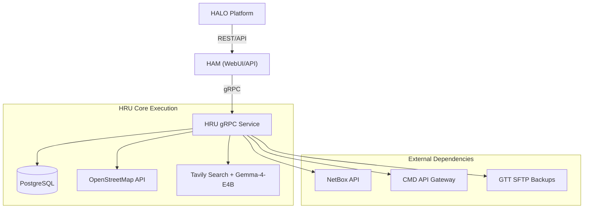

# HALO Repository Utility (HRU) - Architecture & Design Document

**Doc_Type:** Architecture
**Category:** (U) Utility
**Name:** HALO Repository Utility
**Acronym:** HRU
**Version:** 0.1.6
**Date:** 2026-09-25
**Author:** Martin Kecka
**Status**: Active

## 1. Introduction & Purpose 📜

The **HALO Repository Utility (HRU)** acts as the secure central backend for physical infrastructure and device configuration management within the HALO ecosystem. Its primary purpose is to offload network-specific logic (e.g., NetBox auditing, physical firewall backups, and geographic coordinate mapping) from the broader application pipelines, ensuring the HALO ecosystem has a dedicated, scalable repository for infrastructure validation.

**Business Outcome:** GTT obtains a consolidated infrastructure source of truth capable of natively synchronizing NetBox asset data, cross-referencing it with CMD metadata, resolving geographical mapping, and securely tracking configuration states via SFTP backups.

HRU is a headless execution engine. It strictly handles backend infrastructure data aggregation, programmatic configurations syncing, AI-driven coordinate mapping, and NetBox auditing. HRU acts as the backend data provider for the HALO Admin Module (HAM), which in turn serves as the unified API layer that the broader HALO platform queries to retrieve infrastructure state.

---

## 2. Architecture & Ecosystem Integration 🏗️

HRU operates as a robust, stateless Python microservice exposing high-performance gRPC interfaces. It performs targeted bulk data aggregation and processing on demand.

**Core Architectural Principles:**
1. **Decoupled Execution & API Layer:** HRU serves purely as the headless data aggregation layer via gRPC. Upstream, the HALO Admin Module (HAM) acts as the API and UI layer which the broader HALO application interfaces with.
2. **NetBox & CMD as Sources of Truth:** HRU uses NetBox as its authoritative source for devices, prefixes, and sites, while integrating directly with CMD to fetch and enrich tenant SLIDs, GNIDs, and client metadata.
3. **Targeted SFTP State Tracking:** HRU doesn't download the entire 20TB SFTP backup repository. It intelligently filters the SFTP server by targeting only active, recognized hardware (firewalls, switches, routers), pulling and hashing changes, and retaining versioned histories locally in PostgreSQL.
4. **AI Geocoding Fallbacks:** HRU seamlessly integrates OpenStreetMap (Nominatim) for standard geocoding and falls back to Tavily & Gemma-4-E4B for complex address reasoning and mapping.



---

## 3. Module File Map 📂

HRU follows the strict structural conventions of the SERA/GIA ecosystem, utilizing a domain-driven layout for CLI commands, core logic, and external connectivity.

```text
/ai/utilities/halo_repository_utility/
├── cli/                            # Command line interface grouped by domain
│   ├── commands/                   
│   │   ├── cmd_cmds.py             # CLI commands for CMD metadata enrichment and auditing
│   │   ├── config_cmds.py          # CLI commands for SFTP config backup syncing
│   │   ├── module_cmds.py          # Standard module operational status and health commands
│   │   ├── netbox_cmds.py          # CLI commands for syncing and displaying NetBox inventory
│   │   └── site_cmds.py            # CLI commands for geocoding and site code mapping
│   ├── hru_cli.py                  # Main CLI entry point utilizing Click to group sub-commands
│   └── utils.py                    # Shared CLI formatting and streaming utilities
├── config/                         
│   └── settings.yaml               # Standard ecosystem configuration defining external service credentials
├── core/                           
│   ├── clients/                    
│   │   ├── geo_client.py           # Client for OpenStreetMap Nominatim geocoding
│   │   ├── netbox_client.py        # Dedicated client for interacting with the NetBox REST API
│   │   ├── ssh_client.py           # SSH/SFTP client leveraging Paramiko for config backups
│   │   └── tavily_client.py        # Client for Tavily web search integration
│   ├── connectors/                 
│   │   └── cmc_connector.py        # gRPC client logic to communicate with the CMD Connector
│   ├── database/                   
│   │   ├── database.py             # Database engine and SQLAlchemy session factory initialization
│   │   └── models.py               # SQLAlchemy ORM data models representing devices, sites, and config repos
│   ├── io_handlers/                
│   │   ├── sql_reader.py           # Handles reading operational state from PostgreSQL
│   │   └── sql_writer.py           # Handles writing and upserting data into PostgreSQL
│   ├── managers/                   
│   │   ├── cmd_manager.py          # Logic for enriching devices with CMD GNID/SLID data
│   │   ├── config_manager.py       # Logic for managing remote SFTP configuration discovery and retention
│   │   ├── netbox_audit_manager.py # Logic for cross-referencing NetBox data against expected policies
│   │   └── netbox_manager.py       # Interacts with NetBox to sync hardware and inventory states
│   ├── llm_interface.py            # Manages interaction with the Gemma model via SERA endpoints
│   ├── locode_generator.py         # Deterministic UN/LOCODE-based site generator using spatial scoring
│   └── sync_configs.py             # Orchestrates the SFTP configuration backup pull workflow
├── docs/                           
│   ├── CHANGELOG.yaml              # Track changes and version history
│   └── hru_design.md               # Main architecture document describing the module design
├── grpc_api/                       
│   ├── protos/                     
│   │   └── hru.proto               # Domain-specific gRPC definitions
│   ├── generate_stubs.py           # Script to compile .proto files into stubs
│   ├── hru_service.py              # gRPC service implementation for HRU's endpoints
│   ├── sera_standard_service.py    # Required SERA standard implementation (AppInfo, DeepHealth)
│   └── services.py                 # Traffic cop routing gRPC payloads
├── static/
│   └── mapping.json                # Device categorization rules (routers, switches, compute, firewalls)
├── prompts/                        
│   └── geo_prompt.py               # LLM prompt templates for spatial and geographic reasoning
├── scripts/                        # Maintenance and one-off scripts (e.g., debug tools)
├── utils/                          
│   ├── config_loader.py            # Standardized function to load settings.yaml
│   └── logging_setup.py            # Standardized logging definition setup
├── bootstrap_helper.py             # Initialization script managing virtual environments and dependencies
├── halo_repository_utility.py      # Main application entry point that bootstraps the service and CLI
├── README.md                       # High-level overview of the utility
└── requirements.txt                # Python package dependencies
```

---

## 4. Core Processing Lifecycle & Sub-Systems ⚙️

### 4.1. Core Processing
* **Bootstrapping:** The module loads `settings.yaml` and initializes the gRPC server pool using `concurrent.futures.ThreadPoolExecutor`.
* **Connection Pooling:** SQLAlchemy establishes a persistent connection pool to the underlying PostgreSQL database. State is strictly maintained within the relational database.
* **Synchronous Execution:** Workflows (such as NetBox syncs or SFTP config downloads) are executed synchronously. The orchestrators yield execution states back to the client as stream responses to maintain real-time CLI/UI feedback. External task queues are explicitly avoided to maintain tight, synchronous execution loops.

### 4.2. Infrastructure Provisioning & Inventory (NetBox)
* **NetBox Sync:** Orchestrated by the `netbox_manager`. HRU fetches Tenant data, Sites, Clusters, VLANs, VRFs, Prefixes, Devices, VMs, and IP Addresses, mapping the complex relationships locally into PostgreSQL.
* **Hardware Categorization:** Devices are evaluated against regex patterns in `static/mapping.json` using exact models (C88x, C89x, C11xx, FortiGate, etc.) and roles to accurately assign them to `firewall`, `switch`, `router`, `compute`, `management`, or `load-balancer` categories.
* **Prefix Generation:** Missing parent prefixes are generated dynamically from IP interfaces during sync, ensuring accurate IP tracking.

### 4.3. Tenant Lifecycle (CMD Integration)
* **CMD Sync:** Executed by `cmd_manager`. Device records are enriched with CMD GNID/SLID metadata, client details, and physical facility data.
* **Automatic Locode Generation:** Devices mapped to generic locations (e.g., CST) are reparented into specifically generated geographic sites (e.g., `US-DAL1`) using address data and locode mapping.

### 4.4. Configuration Backup Engine (SFTP)
* **Targeted Backup Retrieval:** `config_manager` uses `paramiko` to SSH into GTT SFTP servers and issues a `find` command based on known device hostnames.
* **Robust File Handling:** Retains a multi-file version history grouped by date string to gracefully handle complex vendor backup behaviors (like Palo Alto dropping both `.tgz` and `.xml` files simultaneously).
* **Missing Pending Auto-Healing:** Safely logs days where expected backups are absent as `missing_pending`, and implements a self-healing mechanism that automatically cleans them up if the backups are pushed out-of-band at a later date.

---

## 5. Detailed Business Logic & Rules 🧠

* **NetBox Device Validation:** HRU validates physical devices against expected CMD state, detecting missing configurations, unassigned VRFs, and invalid segment assignments.
* **Intelligent Site Suffixing:** The `locode_generator` automatically assigns multi-tenant auto-suffixes (e.g., `US-DAL1`, `US-DAL2`) to physical facilities derived from their precise latitude and longitude, preventing site code collisions across retail footprints.
* **Configuration State Tracking:** The `ConfigRepo` model maintains the full timeline of backups, computing local `sha256sum` hashes to identify exact diff boundaries across time.

---

## 6. AI, LLM & Machine Learning Execution 🤖

HRU leverages web-augmented AI specifically for complex geographical resolution:
* **Tavily Web Search Integration:** When standard geocoding APIs fail to locate obscure physical address strings (common in retail environments), HRU initiates a targeted Tavily web search to find corporate directory data or facility coordinates.
* **Gemma-4-E4B Reasoning:** The raw address data and web search context are injected into a highly structured reasoning prompt. The Gemma model executes deterministic mapping to extract normalized cities, regions, and latitude/longitude pairs. 
* **Determinism:** The LLM client enforces a low temperature to ensure output adheres strictly to expected JSON structures, preventing hallucinated site mapping.

---

## 7. Data Models, State & Storage 🗄️

HRU fundamentally avoids stateful filesystem reliance for metadata, maintaining highly relational models in PostgreSQL.

### 7.1. Core Entities
* **Site, Cluster, Tenant, VRF, Prefix, VLAN, IPAddress**: Mirrors the NetBox source of truth, optimized for rapid querying and cross-referencing.
* **Device**: The central hardware entity. Stores hardware profiles, tenant slugs, and CMD IDs, alongside foreign keys binding it to the network topology.
* **ConfigRepo**: A relational ledger tracking every localized configuration backup file, its date, local path, and computed file hash.

---

## 8. APIs, Observability & Communication Contracts 📡

* **Ingress (gRPC):**
  * **SERA Standard:** Exposes standard contracts (`GetAppInfo`, `GetDeepHealth`).
  * **Domain Specific:** Exposes dedicated endpoints utilized by downstream tools and CLIs: `NetboxAudit`, `NetboxDevice`, `CmdAudit`, `CmdDevice`, `SiteAudit`, `SiteDevice`, `SiteSyncGPS`, and `ConfigSync`.
* **Egress (REST/gRPC/SFTP):**
  * Executes standard REST calls to NetBox.
  * gRPC queries to the central CMD database via `cmc_connector`.
  * External REST API calls to OpenStreetMap and Tavily.
  * Direct SSH/SFTP connections via `paramiko`.

---

## 9. User Interface (UI) & Visualizations 🖥️

Not applicable for this module. All user interfaces (e.g., Configuration Analyzers, diff tools, and Site Mappers) are delegated to upstream platforms like the HALO Admin Module (HAM), which acts as the unified API and visualization layer for the broader HALO application.

---

## 10. Background Services & Workers 🛠️

HRU functions primarily as an on-demand processor. Bulk sync operations are executed via explicit CLI commands or triggered externally via gRPC streams. It utilizes native Python `ThreadPoolExecutor` capabilities to manage concurrent API requests during intensive operations (like batch geocoding or multi-device SFTP fetching).

---

## 11. CLI, Tooling & Testing 💻

The `hru_cli.py` provides a robust, developer-centric interface for localized command execution grouped by domain:

* **Core Services**:
  * `start-grpc-server`: Boots the primary networking interface.
  * `init-db`: Automates the generation of PostgreSQL tables via SQLAlchemy metadata.
* **NetBox (`hru netbox`)**:
  * `sync`: Executes the full ingestion of a tenant's NetBox topology.
  * `audit`: Renders comprehensive tabular summaries of categorized inventory.
  * `device`: Provides deep, structured inspection of an individual device's physical and operational state.
* **CMD (`hru cmd`)**:
  * `sync`: Enriches the local HRU device cache with authoritative CMD Segment and GNID data.
  * `audit`: Audits validation matches/mismatches across the tenant fleet.
  * `device`: Provides a targeted view of a specific device's CMD validation status.
* **Site (`hru site`)**:
  * `sync-gps`: Uses OpenStreetMap and Tavily+LLM to precisely geocode site addresses and generate deterministic LOCODEs.
  * `audit`: Renders tabular views of site-level facility geography.
  * `device`: Inspects the precise coordinate map for a specific site.
* **Config (`hru config`)**:
  * `sync`: Iterates over mapped hardware and pulls missing configurations from the SFTP backups securely.

---

## 12. Configuration, Security & Hardware Affinity 🔒

| Environment Variable | Purpose |
| :--- | :--- |
| `system_services.grpc.port` | Bound network port for the gRPC listener |
| `database.write_dsn` | Connection string for persistent PostgreSQL state tracking |
| `external_services.netbox.*` | Authentication token and URL for the NetBox REST API |
| `external_services.tavily.*` | API key and endpoint for Tavily integrations |
| `external_services.backup_sync.*` | Authentication credentials and host configuration for the GTT SFTP servers |

---

## 13. Future Enhancements & Roadmap 🚀

### 13.1. Dynamic Delta Diffing Engine
HRU will implement a dynamic configuration diffing engine leveraging Python's `difflib`. Instead of pre-computing diffs locally (which wastes storage on untouched files), HRU will dynamically compute the delta between any two `ConfigRepo` hashes dynamically on-the-fly when explicitly requested by a frontend visualization tool like HAM, exposing an API endpoint such as `GetConfigDiff(device_id, timestamp_a, timestamp_b)`.