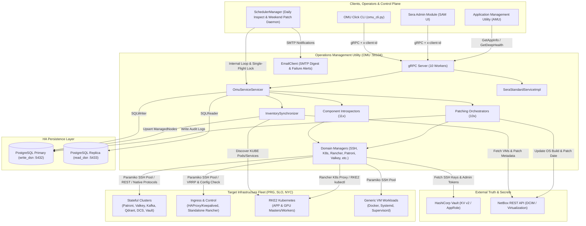
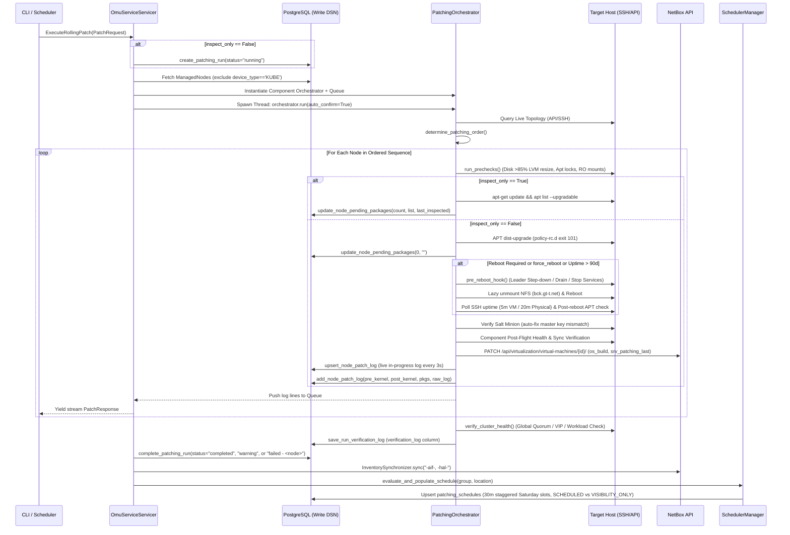

# Operations Management Utility (OMU) - Architecture & Design Document

**Doc_Type:** Architecture & Design
**Category:** (U) Utility
**Name:** Operations Management Utility
**Acronym:** OMU
**Version:** 0.4.6
**Date:** 2026-10-31
**Author:** Martin Kecka & Gemini AI
**Status:** Active

---

## 1. Introduction & Purpose 📜

The **Operations Management Utility (OMU)** is a dedicated administrative microservice and CLI control plane within the SERA/GIA AI ecosystem engineered to govern **Zero-Downtime Fleet Patching**, **Cluster Topology Introspection**, and **Infrastructure Inventory Synchronization** across multi-region data centers (`slo`, `prg`, `nyc`).

Operating as an autonomous, standalone control plane, OMU provides engineers and operators with an interactive Click CLI for rolling upgrades, stateful failovers, and remote fleet management. Concurrently, it serves as the core fleet operations backend engine powering the **Sera Admin Module (SAM)** web interface. OMU acts as the high-privilege Day-2 fleet operator executing rolling OS upgrades across stateful infrastructure, ensuring zero customer downtime.

OMU persists its operational state and execution audit trails in HA PostgreSQL (`sam_admin_prod_db`) and synchronizes infrastructure inventory directly with NetBox and Rancher.

Its primary operational capabilities include:
- **Zero-Downtime Rolling OS Patching:** Sequential orchestration of host package upgrades (`apt-get dist-upgrade`), in-place daemon suppression (`policy-rc.d`), LVM root volume auto-resizing, and reboot coordination.
- **Stateful Cluster Consensus & Failover Hooks:** Pre-reboot leader step-down and dynamic failovers across distributed consensus systems (Patroni PostgreSQL, Apache Kafka KRaft, etcd/DCS, Valkey/Sentinel, Qdrant, Vault Raft, HAProxy/Keepalived VRRP, and RKE2 Kubernetes master/worker cordon & drain).
- **Automated Infrastructure Inventory Synchronization:** Bi-directional synchronization between NetBox DCIM/Virtualization APIs, Rancher Kubernetes cluster workloads, and local PostgreSQL `managed_nodes`.
- **Autonomous Weekend Patching Scheduler & Drift Evaluator:** Dynamic post-inspection evaluation of kernel updates and 30-day patch age across all groups, populating a staggered 30-minute weekend execution queue (`patching_schedules`) with single-flight execution locking, visibility-only auto-rollover for disabled groups, and built-in SMTP email reporting (Friday digest, immediate failure alerts, and Sunday summary).
- **Keepalived VRRP Topology & Failover Pre-Check:** Read-only inspection of Keepalived VRRP configurations and VIP allocations (`haproxy config-explorer`) strictly to verify peer takeover readiness during load balancer OS maintenance (contrasting with CMU's configuration authoring and deployment ownership).
- **Execution Auditing & Log Streaming:** Real-time gRPC log streaming via thread-safe queues, with detailed host kernel transition and package upgrade persistence in PostgreSQL (`patching_runs`, `node_patch_logs`), in-progress live node log flushes every 3 seconds, dedicated cluster health verification log isolation (`patching_runs.verification_log`), and flat-file fallback.

---

## 2. Architecture & Ecosystem Integration 🏗️

OMU operates on a client-server architecture, exposing dual gRPC servicers backed by a multi-worker thread pool (`omu-grpc.service`), while providing operators with a standalone Click CLI and autonomous background inspection daemons.

### 2.1. Dual Servicer & Core Architectural Principles
- **Dual Servicer Model:**
  1. **`OmuService` (`omu.proto`):** Domain servicer exposing RPCs for live fleet introspection, streaming rolling OS patching (`ExecuteRollingPatch`), inventory synchronization (`SyncInventory`), summary metrics, autonomous schedule management (`GetSchedules`, `ManageSchedule`), and execution audit log retrieval.
  2. **`SeraAppService` (`sera_standard.proto`):** Implements the universal SERA ecosystem standard contract (maintained centrally by AMU) for self-reporting OMU's metadata, deep health matrix, documentation, and changelog.
- **The Privilege Boundary:** Alongside CMU, OMU is an isolated administrative utility permitted to hold root-level SSH credentials (`syseng_ansible`), database administrative credentials, and Vault AppRole tokens required to mutate host state.
- **Autonomous Introspection ("Check Before Mutate"):** Retains localized, synchronous introspection logic directly against target infrastructure (Patroni REST APIs, Kafka KRaft quorums, Redis keyspaces, etcd maintenance endpoints) without depending on external observability engines, preventing cyclic dependencies during cold-starts or network partitions.
- **Zero-Downtime Orchestration:** Destructive maintenance strictly follows distributed consensus rules. Leaders are failed over, Kubernetes workloads are safely drained (`cordon`/`drain`), and nodes are verified healthy post-reboot before the orchestrator touches the next node in the topology.
- **Autonomous Standalone Operation:** Functions as a complete standalone system with direct SSH connection pooling (Paramiko), background daily inspection and weekend scheduling daemons (`SchedulerManager`), built-in SMTP reporting (`EmailClient`), and an interactive Click CLI.
- **SAM Fleet Operations Backend:** Powers the fleet patching dashboard, live audit log streams, and inventory summaries within the **Sera Admin Module (SAM)** UI.
- **High-Availability Persistence Isolation:** Utilizes split read/write SQLAlchemy connection pools (`write_dsn` on `:5432` and `read_dsn` on `:5433`) with `pool_pre_ping=True` and connection-hold prevention.
- **Dynamic Call Tracing & Provenance:** Automatically intercepts and logs `x-client-id` metadata headers (`[SAM]`, `[CLI]`, `[OMU]`) across all RPCs for end-to-end operation auditing.

### 2.2. Ecosystem Integration & Data Flow



---

## 3. Module File Map 📂

```plaintext
/ai/utilities/operation_management_utility
├── operation_management_utility.py       # Main executable entrypoint; loads YAML config, sets up logging, launches Click CLI
├── bootstrap_helper.py                   # Virtual environment bootstrapper and dependency verifier
├── requirements.txt                      # Python package dependencies (grpcio, protobuf, sqlalchemy, paramiko, hvac, kubernetes, redis, psycopg2, click, pyyaml, requests)
├── README.md                             # High-level repository overview and links to master SERA Guides
├── config/
│   ├── __init__.py                       # Config package marker
│   └── settings.yaml                     # Master configuration (ports, database DSNs, Vault/NetBox credentials, Rancher clusters, HAProxy VIPs, strategy & scheduler settings)
├── cli/
│   ├── __init__.py                       # CLI package marker
│   ├── omu_cli.py                        # Root Click group (NestedHelpGroup), server launcher, and subcommand registration
│   ├── utils.py                          # gRPC channel builders, MetadataClientInterceptor, JSON printer, and patch stream execution helpers
│   └── commands/
│       ├── __init__.py                   # CLI commands package marker
│       ├── audit_cmds.py                 # `audit runs`, `audit logs`, and `audit clear-stuck` commands for execution inspection
│       ├── dcs_cmds.py                   # `dcs status`, `dcs inspect`, and `dcs patch` for etcd clusters
│       ├── generic_cmds.py               # `generic status`, `generic inspect`, and `generic patch` for standalone/generic VMs
│       ├── haproxy_cmds.py               # `haproxy status`, `haproxy inspect`, and `haproxy patch` for HAProxy/Keepalived fleets
│       ├── inventory.py                  # `inventory sync`, `inventory summary`, `inventory modify`, and `inventory updates`
│       ├── k8s_cmds.py                   # `k8s status`, `k8s inspect`, and `k8s patch` for RKE2 APP and GPU clusters
│       ├── kafka_cmds.py                 # `kafka status`, `kafka inspect`, and `kafka patch` for Apache Kafka KRaft clusters
│       ├── keycloak_cmds.py              # `keycloak status` for Keycloak pod and OIDC latency auditing
│       ├── module_cmds.py                # `module info` and `module check-health` querying OMU's own SeraAppService
│       ├── patroni_cmds.py               # `patroni status`, `patroni inspect`, and `patroni patch` for PostgreSQL HA clusters
│       ├── qdrant_cmds.py                # `qdrant status`, `qdrant inspect`, and `qdrant patch` for Qdrant vector clusters
│       ├── rancher_cmds.py               # `rancher status`, `rancher inspect`, and `rancher patch` for standalone Rancher servers
│       ├── schedule_cmds.py              # `schedule list`, `schedule evaluate`, `schedule set`, `schedule remove`, and `schedule email`
│       ├── ssh_cmds.py                   # `ssh verify` and `ssh execute` for ad-hoc remote command execution
│       ├── status_cmds.py                # `status all` executing sequential global fleet audits across all components
│       ├── valkey_cmds.py                # `valkey status`, `valkey inspect`, and `valkey patch` for Valkey/Sentinel clusters
│       └── vault_cmds.py                 # `vault status`, `vault inspect`, and `vault patch` for HashiCorp Vault Raft clusters
├── core/
│   ├── __init__.py                       # Core package marker
│   ├── inventory_sync.py                 # InventorySynchronizer: Correlates NetBox VMs and Rancher K8s workloads into managed_nodes
│   ├── clients/
│   │   ├── __init__.py                   # Clients package marker
│   │   ├── email_client.py               # Built-in SMTP email dispatcher for Friday digest, failure alerts, and Sunday summary reports
│   │   ├── netbox_client.py              # REST client wrapper for NetBox virtualization, DCIM, and IPAM APIs
│   │   └── vault_client.py               # AppRole authentication engine with Vault KV v2 secret retrieval
│   ├── database/
│   │   ├── __init__.py                   # Database package marker
│   │   ├── database.py                   # SQLAlchemy engine initialization, QueuePool pooling, and get_db_session context manager
│   │   └── models.py                     # Declarative ORM models: ManagedNode, PatchingRun, NodePatchLog, and PatchingSchedule
│   ├── io_handlers/
│   │   ├── __init__.py                   # IO handlers package marker
│   │   ├── sql_reader.py                 # Read-only queries for nodes, groups, strategies, schedules, and audit logs
│   │   └── sql_writer.py                 # Mutation abstractions for upserting nodes, schedules, recording updates, and writing patch logs
│   ├── introspectors/
│   │   ├── __init__.py                   # Introspectors package marker
│   │   ├── base_introspector.py          # Abstract base class for concurrent health checks, FQDN resolution, and VIP checks
│   │   └── *_introspector.py             # 11 component introspectors (dcs, generic, haproxy, k8s, kafka, keycloak, patroni, qdrant, rancher, vault, valkey)
│   ├── managers/
│   │   ├── __init__.py                   # Managers package marker
│   │   ├── dcs_manager.py                # HTTP client querying etcd health and maintenance status
│   │   ├── haproxy_manager.py            # SSH manager parsing keepalived configs, VIP bindings, and haproxy.cfg
│   │   ├── k8s_manager.py                # Kubernetes client wrapper with Rancher API proxy, token refresh, and cordon/drain ops
│   │   ├── kafka_manager.py              # SSH manager querying kafka-metadata-quorum.sh and kafka-topics.sh
│   │   ├── keycloak_manager.py           # Read-only REST helper for Keycloak health checks and OIDC token testing
│   │   ├── patroni_manager.py            # PostgreSQL psycopg2 manager for pg_stat_replication lag introspection
│   │   ├── qdrant_manager.py             # HTTP client querying Qdrant cluster and healthz endpoints
│   │   ├── rancher_manager.py            # REST wrapper for Rancher clusters and K8s API proxy endpoints
│   │   ├── scheduler_manager.py          # SchedulerManager: Daily inspection daemon, drift evaluator, single-flight weekend executor, and email scheduler
│   │   ├── ssh_manager.py                # Paramiko SSH connection pooler with in-memory keys and sudo password scrubbing
│   │   └── valkey_manager.py             # Redis-py manager for 9-node global cluster auditing and sentinel failover
│   └── patching/
│       ├── __init__.py                   # Patching package marker
│       ├── patching_manager.py           # BasePatchingOrchestrator: Pre-flight checks, LVM resize, dist-upgrade, reboot polling, Salt healing
│       └── *_patching.py                 # 10 component orchestrators (dcs, generic, haproxy, k8s, kafka, patroni, qdrant, rancher, valkey, vault)
├── grpc_api/
│   ├── __init__.py                       # gRPC API package marker
│   ├── generate_stubs.py                 # Compiles omu.proto and sera_standard.proto into generated stubs directory
│   ├── omu_service.py                    # OmuServiceServicer: Fleet introspection, rolling patch worker streaming, schedule management, and inventory sync
│   ├── sera_standard_service.py          # Implementation of SeraAppService (GetAppInfo, GetDeepHealth, GetFeedback, GetChangelog, GetDocs)
│   ├── services.py                       # Bootstraps gRPC server thread pool, binds servicers, reflection, and background daemons
│   └── protos/
│       ├── omu.proto                     # Protobuf contract for omu.OmuService
│       └── sera_standard.proto           # Master ecosystem Protobuf contract for sera.standard.v1.SeraAppService
├── scripts/                             # Dumping ground for one-time operational, repair, and test scripts (ephemeral, not part of runtime)
├── utils/
│   ├── __init__.py                       # Shared utils package marker
│   └── logging_setup.py                  # MultiProcessSafeDailyLogger with 14-day rotation (omu.log, omu_err.log) and console routing
├── discovery/
│   └── inventory.json                    # Local NetBox VM JSON inventory cache for offline/standalone diagnostics
├── logs/
│   └── patching_history.log              # Local flat-file append log tracking historical node patch completions
└── docs/
    ├── CHANGELOG.yaml                    # Local machine-readable release history for OMU
    └── omu_design.md                     # Symlink -> /ai/assets/guides/utilities_guides/omu_design.md
```

---

## 4. Core Processing Lifecycle ⚙️

### 4.1. Boot & Server Initialization Sequence
1. **Bootstrap & Config Load:** `operation_management_utility.py` executes `bootstrap_helper.bootstrap_and_reexecute_if_needed()`, loads `config/settings.yaml`, and initializes `setup_logging(config)`.
2. **Stub Verification:** When invoked with `start-grpc-server` (or any CLI command), `check_and_generate_stubs(config)` compares the modification timestamps (`mtime`) of `omu.proto` and `sera_standard.proto` against `/ai/assets/protos/operation_management_utility/generated/`. If regenerated during server start, the process replaces itself via `os.execv(sys.executable, [sys.executable, "-u"] + sys.argv)` to load the fresh bytecode cleanly.
3. **Database Engine Setup:** `initialize_database(config)` creates two distinct SQLAlchemy connection pools (`pool_size=10`, `max_overflow=20`, `pool_pre_ping=True`) bound to `write_dsn` (`:5432`) and `read_dsn` (`:5433`), then calls `init_db()` (`Base.metadata.create_all`).
4. **Servicer & Vault Token Hydration:** `OmuServiceServicer.__init__` authenticates to Vault via `VaultClient` using AppRole credentials and dynamically fetches regional Rancher bearer tokens (`rancher/{loc}/system/gia_ai`), merging them into `self.config['rancher_clusters']`.
5. **Background Daemon Launch:** `OmuServiceServicer` starts `SchedulerManager.start_background_tasks()`, spawning the daemon thread `_scheduler_daemon`.
6. **gRPC Binding:** `serve()` registers `OmuServiceServicer`, `SeraStandardServiceImpl`, `HealthServicer`, and Server Reflection onto `0.0.0.0:50104` with `max_workers=10`.

### 4.2. Rolling Patching, Inspection & Dynamic Schedule Population Lifecycle


---

## 5. Detailed Business Logic, Rules & HITL 🧠

### 5.1. Base OS Patching Pre-Flight & Execution Rules (`BasePatchingOrchestrator`)
* **Trigger Condition & Priority:** Executed sequentially per node inside `perform_os_patching(hostname, ip)` before any package modifications occur.
* **Step-by-Step Logic:**
  1. **LVM Root Auto-Resize (Skipped if `inspect_only=True` or `device_type=='physical'`):** Checks `df -h / /boot /var/log /tmp`. If any mount exceeds **85%** usage, the check fails—except for `/` on virtual machines (`vm`), where OMU queries `vgs --noheadings -o vg_free --units G vg0S`. If `vg0S` has `>= 12.0G` free (preserving an 8GB reserve), OMU executes `lvextend -L +4G -r /dev/mapper/vg0S-root` up to **3 times** (max 12GB expansion) until usage drops to `<= 85%`. On physical bare-metal servers (where root partitions are already allocated to maximum disk capacity), LVM auto-resize is skipped and the pre-check halts immediately if `/` exceeds **85%**.
  2. **Apt/Dpkg Lock Eradication:** Checks `fuser /var/lib/dpkg/lock-frontend /var/lib/dpkg/lock /var/lib/apt/lists/lock`. If locked, waits 10s per attempt for 12 attempts (120s total). On the 12th attempt, inspects holding PIDs via `ps -o args=,etimes= -p {pid}`. If the process is an `apt`/`dpkg` routine or its elapsed time (`etimes`) exceeds **3600 seconds (1 hour)**, OMU forcibly kills the process tree (`kill -9`, `pkill -9 -f`) and repairs state via `dpkg --configure -a`. If locked by an unknown critical process under 1 hour old, pre-flight aborts.
  3. **Read-Only Filesystem Check (Skipped if `inspect_only=True`):** Runs `grep ' ro,' /proc/mounts | grep -v loop`. Restricts read-only detection strictly to real block devices (`/dev/*`) while excluding loop mounts, preventing false-positive aborts caused by immutable container overlay snapshots (`overlay /tmp/containerd-mount*`). Halts immediately if any read-only host block device is detected.
  4. **In-Place Upgrade Suppression & Live Audit Logging:** Creates a temporary `/usr/sbin/policy-rc.d` returning `exit 101` alongside `DEBIAN_FRONTEND=noninteractive`, `NEEDRESTART_MODE=a`, `NEEDRESTART_SUSPEND=1`, and `UCF_FORCE_CONFFOLD=1` so `apt-get dist-upgrade` never restarts stateful daemons mid-transaction before the orchestrator's `pre_reboot_hook` runs. If `/etc/apt/sources.list.d/runner_gitlab-runner.list` exists, refreshes its GPG key prior to `apt-get update || true`. Throughout execution, the orchestrator initializes the `node_patch_logs` record as soon as a node starts (`PRE-KERNEL = In Progress`) and flushes live captured output every 3 seconds to PostgreSQL (`SQLWriter.upsert_node_patch_log`), enabling operators to monitor in-flight node progress via `omu audit logs <run_id> --raw`.
  5. **Reboot Decision Matrix & Hardware-Aware Polling:** A node reboots if `force_reboot=True`, `upgraded_count > 0`, `/var/run/reboot-required` exists, or `uptime > 90 days` (`7,776,000` seconds). Otherwise, `skip_reboot=True`. Virtual machines sleep `10s` and poll SSH for up to `5 minutes` (`60 * 5s`), whereas physical bare-metal servers sleep `30s` and poll SSH for up to `20 minutes` (`240 * 5s`) to accommodate hardware BIOS/POST initialization.
  6. **NFS Lazy Unmount:** Prior to `reboot`, inspects `/proc/mounts` for `bck.gt-t.net` and runs `umount -l` to prevent systemd shutdown hangs.
  7. **Salt Minion Self-Healing:** Post-reboot, executes `salt-call test.ping`. If output contains `"Invalid master key"` or `"master key has changed"`, moves `/etc/salt/pki/minion/minion_master.pub` to `minion_master.pub_old`, restarts `salt-minion`, and re-verifies.

### 5.2. Component-Specific Ordering & Failover Logic
| Component | Group | Dynamic Ordering Strategy | Pre-Reboot Failover / Eviction Hook | Post-Reboot Verification & Global Check |
| :--- | :--- | :--- | :--- | :--- |
| **Patroni** | `aif_psql` | Non-primary sites first (alphabetical), primary site last. Within each site: `REPLICA` / `SYNC_STANDBY` $\rightarrow$ `STANDBY_LEADER` $\rightarrow$ `PRIMARY`. | Ensures `softdog` kernel module is loaded and unblacklisted. If `PRIMARY`, selects a local `SYNC_STANDBY` (or `REPLICA`) and runs `patronictl switchover --force`, polling up to 120s for role swap. | Verifies `/dev/watchdog` exists and `:8008/patroni` returns `state == RUNNING` (up to 300s). |
| **Valkey** | `aif_rds` | If `Global`: all `SLAVE` $\rightarrow$ `UNKNOWN` $\rightarrow$ `MASTER`. If `Local`: grouped by site (`SLAVE` $\rightarrow$ `MASTER`). | If `:6379` role is `MASTER`, connects to Sentinel (`:26379`), resolves master name, and issues `SENTINEL FAILOVER <name>`, sleeping 15s. | Polls TCP `:6379` (150s) and `:26379` (150s). Global check ensures all 9 nodes report `MASTER` or `SLAVE`. |
| **Kafka** | `aif_kaf` | Queries `kafka-metadata-quorum.sh`. `FOLLOWER` nodes first, controller `LEADER` last (grouped by site if `Local`). | Pre-flight requires `URP == 0`. Stops `kafka` systemd service. If node was `LEADER`, polls a healthy sibling up to 60s (`12 * 5s`) to confirm a new `LeaderId` is elected. If election fails, restarts `kafka` and aborts! | Waits for `kafka` service active (60s), then polls `kafka-topics.sh --under-replicated-partitions` up to 600s (`120 * 5s`) until `URP == 0`. |
| **Qdrant** | `aif_qdr` | Priority 1: Nodes in non-leader sites. Priority 2: Followers in leader's site. Priority 3: Raft `Leader`. | Standard OS reboot. | Polls `:6333/healthz` (150s) and `/cluster` (150s) until `status == enabled` and `raft_info.role` is `leader` or `follower`. |
| **DCS (etcd)** | `aif_dcs` | Queries `:2379/v3/maintenance/status`. `FOLLOWER` nodes first, `LEADER` last. | If `LEADER`, finds a healthy follower, resolves its hex ID via `etcdctl member list`, and runs `etcdctl move-leader <hex_id>`, polling 30s to confirm transfer. | Polls `:2379/health` for `health == true` (60s). |
| **Vault** | `aif_vlt` | Non-leader sites first, leader site last. Within site: `FOLLOWER` (`standby=true`) $\rightarrow$ `LEADER`. | If `LEADER`, stops `vault` via systemd (if VM) or calls `PUT /v1/sys/step-down` with `X-Vault-Token`. | Polls `https://{ip}:8200/v1/sys/health` (300s) for `RUNNING` (unsealed & initialized). Performs a live KV v2 read test on `syseng/syseng_ansible`. |
| **HAProxy** | `aif_ha` | Sorted alphabetically by `hostname`. | Pre-flight requires both `haproxy` and `keepalived` active. Stops `keepalived`, sleeps 5s, verifies `ip -br a` dropped all VIPs, and verifies site peer nodes picked up every dropped VIP before stopping `haproxy`. **Failover Error Recovery:** If `keepalived` or `haproxy` fails to stop or peer takeover check fails, triggers `restore_services()` via `systemctl reset-failed` and `systemctl start keepalived haproxy` to ensure the host is not abandoned in a degraded or split state before halting. | Polls `haproxy` and `keepalived` active (150s). Global check waits 15s for VRRP preemption and verifies every node holds its exact `state MASTER` VIPs. |
| **Rancher** | `aif_rancher` | Sorted by `(site, hostname)`. | Pre-flight verifies `/v3/clusters` reachability, checks container `RestartPolicy` (`unless-stopped`/`always`), and logs TLS cert `notAfter` date. Stops `docker` daemon gracefully to flush embedded K3s etcd state. | Waits for `docker` active (60s), then polls Rancher API up to 600s (`60 * 10s`) until all downstream managed clusters report `Ready == True`. |
| **K8s (RKE2)** | `aif_app_*`, `aif_gpu_*`, `hal_app_*` | Workers: sorted by `(site, hostname)`. Masters: queries `rke2-etcd` lease in `kube-system`; `FOLLOWER` masters first, `LEADER` master last per site. | **Cross-Site Keycloak Gate (`aif_*` only):** Before starting a new site on `aif_*` groups, queries `keycloak status --grpc`; if the target site holds the *only* `UP` Keycloak instance globally, halts immediately (unless `inspect_only`).<br/>**Capacity Check:** Calculates pool CPU, Memory, and Pod reservations excluding target node; aborts if reservations exceed **90%** of remaining pool capacity.<br/>**Dynamic PVC Auto-Expansion & Pre-Drain PDB Deadlock Remediation:** Audits volume capacity of mounted PVCs. If usage exceeds **85%** or if peer pods in a PodDisruptionBudget (`disruptionsAllowed: 0`) are crashing (CrashLoopBackOff) due to volume exhaustion, automatically expands the PVC (< 100Gi: +20% with min +5Gi floor; $\ge$ 100Gi: +10%, rounded up to integer Gi), ensures `allowVolumeExpansion: true` on the StorageClass, restarts crashed pods, and waits up to 120s for PDB disruptions to be allowed.<br/>**PDB Disruptions Verification:** Inspects all PDBs protecting pods on the node; if any allow 0 disruptions, polls up to 60s for stabilization.<br/>**Drain Execution:** Resolves K8s node name (short hostname or FQDN), enables `rke2-server`/`rke2-agent`, then runs `kubectl cordon` and bounded `kubectl drain --ignore-daemonsets --delete-emptydir-data --force --grace-period=60 --timeout=900s` with eviction output streamed to the run log. Auto-uncordons on failure. | Polls `kubectl get node` for `Ready == True` (300s for VMs, 600s for physical nodes). For masters, polls `/healthz/etcd` (180s). Runs `kubectl uncordon`. For masters, polls `kube-system` and `cattle-system` pods on the node (180s) until all non-job pods report `Ready`. **Post-Flight Workload Stabilization:** Polling loop runs for 60s (`12 * 5s`) before comparing pre-patch vs post-patch namespace pod counts to eliminate transient false-positive pod drop warnings. |
| **Generic** | `aif_dev`, `aif_air`, `aif_dbutl`, `aif_mon` | Sorted by `(site, hostname)`. | Pre-flight discovers running Docker containers, non-excluded systemd services, and `RUNNING` `supervisord` tasks. Stops `supervisorctl`, discovered systemd units, and `docker`. | Polls up to 60s (`30 * 2s`) for all discovered Docker containers, systemd services, and supervisord tasks to return to running state; issues forced `start`/`restart` commands if any fail to auto-recover. |

### 5.3. Autonomous Weekend Patching Scheduler & Drift Evaluation (`SchedulerManager`)
* **Immediate Post-Inspection Population (`evaluate_and_populate_schedule`):** Right after any group inspection (`inspect_only=True`) or patching run completes, `SchedulerManager` inspects all non-excluded VM/physical nodes in the group and evaluates two drift rules:
  1. **Kernel Drift:** `pending_updates_list` contains kernel packages (`linux-image`, `linux-headers`, `linux-generic`, `linux-modules`).
  2. **Patch Age Drift:** `last_patched` is older than `max_patch_age_days` (default `30` days) or `'Never'`.
* **Staggered 30-Minute Weekend Slots:** Qualifying groups are inserted into `patching_schedules` starting Saturday `01:00 UTC` in 30-minute increments (`01:00`, `01:30`, `02:00`, `02:30`, etc.) in the natural order inspections complete.
* **Active vs. Visibility-Only ("Blind") Entries:**
  * Groups/sites where nodes have `auto_patch=True` receive `status="SCHEDULED"` and are executed automatically when their weekend window arrives.
  * Groups/sites where nodes have `auto_patch=False` receive `status="VISIBILITY_ONLY"`, providing full fleet visibility in `schedule list` and the Friday digest email while skipping automatic execution. Once their scheduled weekend window passes, `SchedulerManager` automatically rolls their `scheduled_for` timestamp forward by `+7 days` to the next weekend.
* **Strict Single-Flight Execution (`_patching_lock`):** A global threading lock ensures **never more than 1 patching run executes concurrently**. If `aif_psql` takes 40 minutes, the next scheduled group (`01:30 UTC`) waits for the lock to release and starts immediately afterward.
* **Execution Order & Slot Protection:** When `SchedulerManager._scheduler_daemon` runs, it processes due weekend schedules (`_process_due_schedules()`) *before* executing daily inspections and schedule re-evaluations. Future schedule slots (`scheduled_for > now`) are strictly preserved (`preserve_existing_slot=True`), ensuring active windows are not overwritten or pushed +7 days prior to execution.
* **Failure Handling & Next-Weekend Rescheduling:** If an automated weekend patching run fails on a node (`status: failed - <hostname>`), `SchedulerManager._execute_scheduled_patching()` dispatches an immediate failure alert email with the failed node and execution log tail, and automatically reschedules the group to the next available slot in next weekend's queue (`_compute_next_available_weekend_slot()`). `evaluate_and_populate_schedule()` and `SQLWriter.upsert_patching_schedule()` preserve only future slots (`scheduled_for > now`) and advance past/expired slots, preventing failed runs from being perpetually re-armed into immediate retry loops within the same window.
* **Warning Status & Schedule Queue Clearing:** If all nodes in a group patch and reboot cleanly (0 pending packages), but post-flight cluster health verification detects degraded workloads, unready nodes, or VIP imbalances, the run concludes with status `"warning"`. Because all nodes are fully patched to the latest kernel, `SchedulerManager` clears the schedule entry from `patching_schedules` to prevent redundant re-execution, while dispatching a dedicated alert email containing the post-flight cluster verification log.
* **Built-In Email Reporting (`EmailClient`):**
  * **Friday Pre-Flight Digest (`friday_digest_hour_utc: 14`):** Sends an HTML + plaintext summary of all weekend schedules, clearly separating active `auto_patch=True` groups from visibility-only `auto_patch=False` groups and listing affected VMs.
  * **Immediate Failure Alert:** Dispatches an alert email immediately if an automated weekend patching run fails or ends in warning, clearly distinguishing between node-level patch failures and post-flight cluster health warnings, and attaching the dedicated `verification_log` without duplicating stream tails.
  * **Sunday Weekend Summary (`sunday_summary_hour_utc: 20`):** Sends a summary of all completed weekend runs (with kernel transitions) and rolled-over visibility schedules.

### 5.4. State Changes & Terminal Outputs
* **`PatchingRun.status` Enum Values:**
  - `"running"`: Patching run is currently active.
  - `"completed"`: All nodes patched and rebooted cleanly, and post-flight cluster verification passed with 100% healthy quorum and workloads.
  - `"warning"`: All nodes patched and rebooted cleanly to latest kernel (0 pending packages), but post-flight cluster health verification detected degraded workloads, unready pods, or VIP imbalances.
  - `"failed - <hostname>"`: OS patching, pre-flight check, failover, or post-reboot recovery failed on the specified node. Execution halted immediately to protect cluster quorum.
  - `"failed - init"` / `"failed - no nodes"` / `"failed - exception"`: Initialization, node resolution, or unhandled runtime failure.
* **HITL & Learning Loops:** Not applicable for this module. When invoked via gRPC (`ExecuteRollingPatch`), OMU executes autonomously (`auto_confirm=True`) and halts deterministically upon any pre-flight, failover, or post-flight verification failure.

---

## 6. AI, LLM & Machine Learning Execution 🤖

*Not applicable for this module.* OMU is a deterministic infrastructure orchestration utility and does not execute neural network or LLM inference workflows.

---

## 7. Data Models, State, Storage & Auditing 🗄️

OMU persists state in PostgreSQL (`sam_admin_prod_db`) using SQLAlchemy declarative models defined in `core/database/models.py`.

### 7.1. Database Schema (`managed_nodes`, `patching_runs`, `node_patch_logs`, `patching_schedules`)

| Table Name | Column | Type | Constraints / Defaults | Description |
| :--- | :--- | :--- | :--- | :--- |
| **`managed_nodes`** | `hostname` | `String(255)` | `PRIMARY KEY` | Short hostname (e.g., `slo-aif-psql01`, `nyc-aif-kcl01`). |
| | `site` | `String(50)` | `NULLABLE` | 3-letter site code (`SLO`, `NYC`, `PRG`, `DAL`). |
| | `fqdn` | `String(255)` | `NULLABLE` | Fully qualified domain name (or Rancher `cluster_id` for `kube` devices). |
| | `netbox_id` | `Integer` | `NULLABLE` | Internal NetBox VM/Device ID used for PATCH updates. |
| | `device_type` | `String(50)` | `default="vm"` | `"vm"`, `"physical"`, or `"kube"`. |
| | `namespace` | `String(100)` | `NULLABLE` | Kubernetes namespace for `kube` devices (`keycloak`, `vault`). |
| | `group` | `String(100)` | `NULLABLE` | Logical patching group (e.g., `aif_psql`, `aif_app_k8worker`). |
| | `strategy` | `String(50)` | `NOT NULL` | Assigned strategy (e.g., `"Patroni Patching"`, `"Generic Patching"`). |
| | `is_excluded` | `Boolean` | `default=False` | Automatically `True` for `aif_vs`, `aif_gpu_k8worker`, and `kube` device types. |
| | `auto_patch` | `Boolean` | `default=False` | Controls whether the node/group is enabled for autonomous weekend execution (`True`) vs visibility-only scheduling (`False`). |
| | `pending_updates_count` | `Integer` | `NULLABLE` | Count of upgradable APT packages from last inspection. |
| | `pending_updates_list` | `Text` | `NULLABLE` | Newline-delimited list of pending APT packages. |
| | `cluster_type` | `String(50)` | `NULLABLE` | `"Global"`, `"Local"`, or `"Single Node"`. |
| | `last_inspected` | `DateTime` | `NULLABLE` | UTC timestamp of last `inspect_only` execution. |
| | `kernel` | `String(100)` | `NULLABLE` | Running OS kernel version (`os_build` from NetBox). |
| | `last_patched` | `String(50)` | `NULLABLE` | Date string (`YYYY-MM-DD`) of last package upgrade (`srv_patching_last`). |
| | `health_mode` | `String(50)` | `default="UNKNOWN"` | Polling optimization tag (`"API"`, `"SSH"`, or `"UNKNOWN"`). |
| **`patching_runs`** | `run_id` | `String(36)` | `PRIMARY KEY` | UUIDv4 identifier for the patching run. |
| | `group` | `String(100)` | `NOT NULL` | Target patching group name. |
| | `trigger_source` | `String(100)` | `NOT NULL` | Originator identifier (`"grpc-cli"` or `"scheduler-auto"`). |
| | `started_at` | `DateTime` | `NOT NULL` | UTC start timestamp. |
| | `completed_at` | `DateTime` | `NULLABLE` | UTC completion timestamp. |
| | `status` | `String(50)` | `NOT NULL` | Terminal status string (`"completed"`, `"warning"`, `"failed - <node>"`). |
| | `verification_log` | `Text` | `NULLABLE` | Captured output of post-flight cluster health verification (`verify_cluster_health()`), isolated from node-specific logs. |
| **`node_patch_logs`** | `log_id` | `String(36)` | `PRIMARY KEY` | UUIDv4 identifier for the node log entry. |
| | `run_id` | `String(36)` | `FK(patching_runs.run_id)` | Cascaded foreign key to parent `PatchingRun`. |
| | `hostname` | `String(255)` | `FK(managed_nodes.hostname)` | Cascaded foreign key to `ManagedNode`. |
| | `pre_kernel` | `String(100)` | `NULLABLE` | Kernel string (`uname -r`) prior to patching (`"In Progress"` while running). |
| | `post_kernel` | `String(100)` | `NULLABLE` | Kernel string (`uname -r`) after patching/reboot. |
| | `packages_upgraded` | `Integer` | `NULLABLE` | Total APT packages upgraded during the run. |
| | `skipped_reboot` | `Boolean` | `default=False` | `True` if reboot was bypassed. |
| | `raw_execution_log` | `Text` | `NULLABLE` | Complete captured stdout/stderr stream for the node, created at node start and flushed/upserted every 3 seconds for live streaming. |
| **`patching_schedules`** | `schedule_id` | `String(36)` | `PRIMARY KEY` | UUIDv4 identifier for the schedule queue entry. |
| | `group` | `String(100)` | `NOT NULL` | Target patching group (e.g., `aif_dcs`, `aif_psql`). |
| | `location` | `String(50)` | `default="ALL"` | Site scope (`"ALL"`, `"SLO"`, `"NYC"`, `"PRG"`, `"DAL"`). |
| | `component` | `String(50)` | `NOT NULL` | Resolved orchestrator component (`dcs`, `patroni`, `kafka`, etc.). |
| | `scheduled_for` | `DateTime` | `NOT NULL` | Assigned 30-minute staggered UTC weekend execution slot. |
| | `status` | `String(50)` | `default="SCHEDULED"` | `"SCHEDULED"`, `"VISIBILITY_ONLY"`, `"RUNNING"`, or `"FAILED"`. |
| | `auto_patch` | `Boolean` | `default=False` | Mirrors whether automatic execution is enabled for this group/location. |
| | `trigger_reason` | `Text` | `NULLABLE` | Summary of drift criteria (`Kernel update`, `Age > 30d`, node counts). |
| | `affected_nodes` | `Text` | `NULLABLE` | Comma-separated list of hostnames requiring patching. |
| | `last_run_id` | `String(36)` | `NULLABLE` | Most recent `PatchingRun.run_id` associated with this schedule. |
| | `created_at` / `updated_at` | `DateTime` | `NOT NULL` | Creation and last modification UTC timestamps. |

### 7.2. Local Filesystem State & Cache
- **Offline Inventory Cache (`discovery/inventory.json`):** Caches raw NetBox VM and Device JSON records locally to support offline fleet queries and CLI diagnostic sweeps (`ssh verify --inventory-file`) during NetBox API maintenance or network partitions.
- **Append-Only Patching Log (`logs/patching_history.log`):** Flat-file audit log recording host-by-host patch completions, timestamps, kernel transitions, and package counts in real time alongside database persistence.

### 7.3. Session Concurrency & Stream Queuing
- **Connection Pool Isolation:** Maintains separate SQLAlchemy `QueuePool` instances for write transactions (`write_dsn` on `:5432`) and read queries (`read_dsn` on `:5433`) with `pool_size=10`, `max_overflow=20`, and `pool_pre_ping=True`.
- **Live Stream Queuing:** `ExecuteRollingPatch` bridges the long-running background orchestrator thread and the gRPC response generator using a thread-safe `queue.Queue`. Log lines and status transitions are pushed to the queue and yielded over the stream while actively validating `context.is_active()`.

---

## 8. APIs, Observability & Communication Contracts 📡

OMU exposes two gRPC services on port `50104` with gRPC Server Reflection and standard `grpc.health.v1.Health` enabled. The CLI injects the metadata header `x-client-id: OMU` via `MetadataClientInterceptor`.

### 8.1. `omu.OmuService` RPC Contracts (`omu.proto`)
| RPC Method | Request Message | Response Message | Execution Behavior |
| :--- | :--- | :--- | :--- |
| `ExecuteRollingPatch` | `PatchRequest` (`component`, `group`, `location`, `inspect_only`, `force_reboot`) | `stream PatchResponse` (`run_id`, `success`, `message`) | Spawns background orchestrator thread under single-flight `_patching_lock`, streams execution logs, syncs NetBox post-run, and immediately evaluates/populates `patching_schedules`. |
| `IntrospectFleet` | `IntrospectRequest` (`component`, `location`) | `IntrospectResponse` (`success`, `report_json`) | Synchronously audits the requested fleet component using `ThreadPoolExecutor` and returns a serialized JSON report containing `health_mode`, `nodes`, and `vips`. |
| `SyncInventory` | `SyncRequest` (`query`) | `SyncResponse` (`success`, `message`, `nodes_synced`) | Pulls VMs and physical devices matching `query` (default `"-aif-, -hal-"`) from NetBox and discovers Kubernetes workloads (`keycloak`, `vault`) via Rancher API, upserting `managed_nodes`. |
| `GetInventorySummary` | `SummaryRequest` (`include_details`, `group`, `strategy`, `device_type`) | `SummaryResponse` (`total_nodes`, `patched_today`, `pending_patch`, `pending_nodes`) | Aggregates fleet patching completion metrics (excluding `is_excluded=True` and `device_type='kube'`) and returns detailed node metadata including `auto_patch`. |
| `ModifyNode` | `ModifyNodeRequest` (`hostname`, `group`, `location`, `strategy`, `is_excluded`, `health_mode`, `auto_patch`) | `ModifyNodeResponse` (`success`, `message`, `nodes_updated`) | Updates patching strategy, exclusion flag, `auto_patch` status, or `health_mode` (`API`/`SSH`/`UNKNOWN`) for a single node, site, or entire group, re-evaluating `patching_schedules` when `auto_patch` or `is_excluded` changes. |
| `GetSchedules` | `GetSchedulesRequest` (`group`, `location`) | `GetSchedulesResponse` (`success`, `schedules`) | Queries `patching_schedules` ordered by `scheduled_for ASC` and returns all active and visibility-only weekend slots. |
| `ManageSchedule` | `ManageScheduleRequest` (`action`, `group`, `location`, `scheduled_for`, `auto_patch`, `email_type`) | `ManageScheduleResponse` (`success`, `message`, `affected_count`) | Executes schedule management actions: `"evaluate"` (recomputes drift & slots), `"set"` (adapts window time and/or toggles `auto_patch`), `"delete"` (removes entry), or `"send_email"` (dispatches `"friday"`, `"sunday"`, or `"failure"` email). |
| `GetAuditRuns` | `AuditRunsRequest` (`limit`) | `AuditRunsResponse` (`runs`) | Returns the most recent `limit` (default 50) `PatchingRun` records ordered by `started_at DESC`. |
| `GetAuditLogs` | `AuditLogsRequest` (`run_id`) | `AuditLogsResponse` (`logs`, `verification_log`, `status`) | Returns all `NodePatchLog` entries (including `raw_execution_log`), post-flight cluster `verification_log`, and terminal run `status` for a specific `run_id`. |
| `GetHAProxyConfig` | `GetHAProxyConfigRequest` (`group`, `location`) | `GetHAProxyConfigResponse` (`success`, `configs`) | Read-only dependency inspection: concurrently fetches `/etc/haproxy/haproxy.cfg` across all HAProxy nodes in `group` via SSH strictly to verify Keepalived VRRP topology and VIP peer takeovers prior to node reboots. |

### 8.2. `sera.standard.v1.SeraAppService` Contract (`grpc_api/sera_standard_service.py`)
OMU implements the universal SERA standard contract (`sera.standard.v1.SeraAppService`), centrally maintained and deployed by the Application Management Utility (AMU). It provides standardized endpoints (`GetAppInfo`, `GetDeepHealth`, `GetFeedback`, `GetChangelog`, `GetDocs`) enabling AMU and the SAM UI to self-discover OMU's metadata, deep TCP socket dependency health matrix, changelog history, and design documentation without requiring custom integration logic.

---

## 9. User Interface (UI) & Visualizations 🖥️

*Not applicable for this module.* OMU is a headless backend microservice and CLI utility; visual dashboards and administrative UI views are rendered upstream by the Sera Admin Module (SAM).

---

## 10. Background Services & Workers 🛠️

| Worker / Thread Name | Trigger & Schedule | Concurrency & Locking | Operational Logic & Retry Policy |
| :--- | :--- | :--- | :--- |
| **`SchedulerManager._scheduler_daemon`** | Daemon thread started on gRPC server boot. Sleeps `300s` initially, then loops every `600s` (10 minutes). | Single background daemon thread per server instance; enforces `self._patching_lock` for single-flight patching. | 1. **Daily Inspections:** Sweeps groups where any node has `last_inspected == None` or `> 24h` (`inspect_only=True`).<br/>2. **Dynamic Schedule Population:** Evaluates kernel updates & >30-day patch age post-inspect and assigns 30-min staggered Saturday slots (`01:00`, `01:30`, ...) in `patching_schedules`.<br/>3. **Weekend Execution & Rollover:** Runs due `auto_patch=True` schedules sequentially (1 at a time), reschedules failed runs to next weekend's queue, and rolls past-due `auto_patch=False` visibility entries forward by `+7d`.<br/>4. **Email Reporting:** Dispatches Friday digest, immediate failure alerts, and Sunday summary emails via `EmailClient`. |
| **`ExecuteRollingPatch.run_patching`** | Spawned on-demand per `ExecuteRollingPatch` gRPC call. | Acquires `SchedulerManager._patching_lock` when `inspect_only=False` so manual and scheduled patches never run concurrently. | Runs `orchestrator.run(auto_confirm=True)`. Regardless of whether the client disconnects (`not context.is_active()`), the background thread continues to completion, updates `PatchingRun.status`, syncs NetBox, and refreshes `patching_schedules`. |
| **`BaseIntrospector._run_concurrent_checks`** | Invoked during `IntrospectFleet` and `GetHAProxyConfig`. | `ThreadPoolExecutor` (`max_workers=5` to `15` depending on component). | Executes non-blocking parallel SSH, HTTP, or SQL health checks across all nodes in a component group. |

---

## 11. CLI, Tooling & Testing 💻

The OMU CLI (`operation_management_utility.py`) is built on `click` using a custom `NestedHelpGroup` that renders all top-level groups and nested subcommands in a single `--help` view. All status, summary, schedule, and audit commands support `--grpc` to emit raw JSON payloads.

### 11.1. CLI Command Reference

| Command Group | Commands & Key Options | Operational Description |
| :--- | :--- | :--- |
| **Root (`cli`)** | `start-grpc-server`<br/>`init-db [--force]` | Starts the OMU gRPC server on port `50104`.<br/>Initializes (or recreates with `--force`) PostgreSQL tables. |
| **`module`** | `module info [--grpc]`<br/>`module check-health [--grpc]` | Calls OMU's own `SeraAppService.GetAppInfo` and `GetDeepHealth`. |
| **`inventory`** | `inventory sync [--query <str>]`<br/>`inventory summary [--group <grp>] [--strategy <strat>] [--type <t>] [--grpc]`<br/>`inventory modify [--hostname <h> \| --group <g>] [--location <loc>] [--strategy <s>] [--exclude true\|false] [--auto-patch true\|false] [--health-mode API\|SSH\|UNKNOWN]`<br/>`inventory updates <hostname>` | Synchronizes NetBox VMs/Devices (default query `"-aif-, -hal-"`) and Rancher K8s workloads into `managed_nodes`.<br/>Aggregates patching completion metrics (including `AUTO` column).<br/>Updates node/group strategies, exclusion, `auto_patch`, and polling modes.<br/>Displays pending updates for a specific node. |
| **`schedule`** | `schedule list [--group <g>] [--location <loc>] [--grpc]`<br/>`schedule evaluate [--group <g>] [--location <loc>]`<br/>`schedule set --group <g> [--location <loc>] [--time "YYYY-MM-DD HH:MM"] [--auto-patch true\|false]`<br/>`schedule remove --group <g> [--location <loc>]`<br/>`schedule email --type <friday\|sunday\|failure> [--group <g>] [--location <loc>]` | Displays the dynamic weekend patching schedule queue.<br/>Evaluates kernel/30-day drift and populates 30-min weekend slots.<br/>Adapts a group's scheduled window time or toggles `auto_patch`.<br/>Removes an entry from `patching_schedules`.<br/>Dispatches on-demand Friday digest, Sunday summary, or failure alert emails. |
| **`status`** | `status all` | Executes sequential global fleet audits across all 11 component domains. |
| **Component Audits** | `<component> status [--location <loc>] [--grpc]`<br/>`haproxy config-explorer [--group <grp>] [--location <loc>] [--detailed]` | Audits live topology and health for `patroni`, `valkey`, `kafka`, `qdrant`, `dcs`, `vault`, `haproxy`, `rancher`, `k8s`, `keycloak`, or `generic`. |
| **Component Patching** | `<component> <inspect\|patch> [--group <grp>] [--location <loc>] [--force-reboot]` | Executes pre-flight inspection (`inspect`) or rolling zero-downtime OS upgrade (`patch`) across target cluster topology. |
| **`audit`** | `audit runs [--limit 50] [--grpc]`<br/>`audit logs <run_id> [--raw] [--grpc]`<br/>`audit clear-stuck` | Lists historical patching runs with color-coded status (`green` completed, `yellow` warning, `red` failed).<br/>Retrieves node execution logs (raw stdout/stderr or parsed) and displays the dedicated `🌍 CLUSTER POST-FLIGHT VERIFICATION LOG` section if post-flight checks ran.<br/>Purges orphaned runs stuck in running/failed states. |
| **`ssh`** | `ssh verify [--inventory-file <path>] [--group all] [--limit 0]`<br/>`ssh execute --cmd "<command>" [--group all] [--limit 0] [--sudo]` | Verifies SSH key reachability and in-memory auth across fleet.<br/>Executes concurrent ad-hoc commands with sudo password scrubbing. |

### 11.2. CLI Quick Execution Examples

```bash
# Server & Database Lifecycle
python3 operation_management_utility.py start-grpc-server
python3 operation_management_utility.py init-db [--force]

# SERA Standard Module Introspection
python3 operation_management_utility.py module info [--grpc]
python3 operation_management_utility.py module check-health [--grpc]

# Inventory & Metadata Management
python3 operation_management_utility.py inventory sync [--query "-aif-, -hal-"]
python3 operation_management_utility.py inventory summary [--group <grp>] [--strategy <strat>] [--type <physical|vm|kube>] [--grpc]
python3 operation_management_utility.py inventory modify [--hostname <host> | --group <grp>] [--location <loc>] [--strategy <strat>] [--exclude true|false] [--auto-patch true|false] [--health-mode API|SSH|UNKNOWN]
python3 operation_management_utility.py inventory updates <hostname>

# Autonomous Weekend Patching Schedule Management
python3 operation_management_utility.py schedule list [--group <grp>] [--location <loc>] [--grpc]
python3 operation_management_utility.py schedule evaluate [--group <grp>] [--location <loc>]
python3 operation_management_utility.py schedule set --group aif_dcs [--location slo] [--auto-patch true] [--time "2026-10-31 01:00"]
python3 operation_management_utility.py schedule remove --group <grp> [--location <loc>]
python3 operation_management_utility.py schedule email --type <friday|sunday|failure>

# Global & Component Status Audits
python3 operation_management_utility.py status all
python3 operation_management_utility.py patroni status [--grpc]
python3 operation_management_utility.py valkey status [--location <loc>] [--grpc]
python3 operation_management_utility.py kafka status [--location <loc>] [--grpc]
python3 operation_management_utility.py qdrant status [--grpc]
python3 operation_management_utility.py dcs status [--grpc]
python3 operation_management_utility.py vault status [--grpc]
python3 operation_management_utility.py haproxy status [--grpc]
python3 operation_management_utility.py haproxy config-explorer [--group aif_ha] [--location <loc>] [--detailed]
python3 operation_management_utility.py rancher status [--location <loc>] [--grpc]
python3 operation_management_utility.py k8s status [--location <loc>] [--grpc]
python3 operation_management_utility.py keycloak status [--grpc]
python3 operation_management_utility.py generic status [--group <grp>] [--grpc]

# Fleet Inspection & Rolling OS Patching
python3 operation_management_utility.py <patroni|valkey|kafka|qdrant|dcs|haproxy> <inspect|patch> [--group <grp>] [--location <loc>] [--force-reboot]
python3 operation_management_utility.py vault <inspect|patch> [--force-reboot]
python3 operation_management_utility.py rancher <inspect|patch> [--location <loc>] [--force-reboot]
python3 operation_management_utility.py k8s <inspect|patch> --group <aif_app_k8master|aif_app_k8worker|aif_gpu_k8master|aif_gpu_k8worker|hal_app_k8master|hal_app_k8worker> [--location <loc>] [--force-reboot]
python3 operation_management_utility.py generic <inspect|patch> [--group <grp> | --all] [--location <loc>] [--force-reboot]

# Execution Auditing & SSH Diagnostics
python3 operation_management_utility.py audit runs [--limit 50] [--grpc]
python3 operation_management_utility.py audit logs <run_id> [--raw] [--grpc]
python3 operation_management_utility.py audit clear-stuck
python3 operation_management_utility.py ssh verify [--inventory-file discovery/inventory.json] [--group all] [--limit 0]
python3 operation_management_utility.py ssh execute --cmd "<command>" [--group all] [--limit 0] [--sudo]
```

---

## 12. Configuration, Security & Hardware Affinity 🔒

### 12.1. Configuration Reference (`config/settings.yaml`)
| YAML Key Path | Purpose & Usage | Default / Configured Value |
| :--- | :--- | :--- |
| `module_info.acronym` | Module identifier injected into gRPC metadata (`x-client-id`) and DeepHealth. | `"OMU"` |
| `system_services.grpc.host` / `port` / `max_workers` | Bind address, port, and thread pool size for the gRPC server. | `"0.0.0.0"` / `50104` / `10` |
| `logging.directory` / `level` | Target path for daily rotating logs (`omu.log`, `omu_err.log`) and log verbosity. | `"/ai/assets/logs/omu_utility"` / `"INFO"` |
| `paths.proto_source_dir` | Relative path to OMU protobuf definitions. | `"grpc_api/protos"` |
| `paths.sera_proto_source_dir` | Shared path to `sera_standard.proto`. | `"/ai/assets/protos/sera_standard"` |
| `paths.generated_stubs_path` | Output path for compiled `_pb2.py` and `_pb2_grpc.py` stubs. | `"/ai/assets/protos/operation_management_utility/generated"` |
| `database.write_dsn` | Primary PostgreSQL RW connection string via HAProxy Write VIP. | `"postgresql://...@slo-aif-hadb.slo.gt-t.net:5432/sam_admin_prod_db"` |
| `database.read_dsn` | Local PostgreSQL RO connection string via HAProxy Read VIP. | `"postgresql://...@slo-aif-ha.slo.gt-t.net:5433/sam_admin_prod_db"` |
| `external_services.netbox.url` / `verify_ssl` | NetBox API endpoint and TLS verification toggle. | `"https://netbox.gt-t.net"` / `false` |
| `external_services.vault.url` / `role_id` / `secret_id` | HashiCorp Vault endpoint and AppRole credentials. | `"https://vault-aif.gt-t.net:8200"` |
| `rancher_clusters.<prg|slo|nyc>` | Regional Rancher URLs and target APP (`-aif-clu01`), GPU (`-aif-nvclu01`), and HAL (`-hal-clu01`) cluster names. | `prg`, `slo`, `nyc` blocks |
| `haproxy.hosts` / `services` / `db_write` | Regional HAProxy VIP FQDNs and target ports (`6334`, `6379`, `5433`, `5432`) for reachability checks. | `slo`, `nyc`, `prg` VIPs |
| `keycloak.auth_url` / `client_id` / `client_secret` | OIDC token endpoint and test client credentials for measuring authentication latency. | `"https://keycloak-aif.gt-t.net/realms/aif-llm/..."` |
| `vault_paths.*` | KV v2 secret paths for `netbox`, `qdrant_admin`, `valkey_admin`, `psql_admin`, `syseng_ansible`, and `rancher_admin`. | `"secret/..."` paths |
| `inventory.patching_strategies` | Maps `aif_*` and `hal_*` group names to their human-readable strategy names during NetBox sync. | 17 group-to-strategy mappings |
| `scheduler.*` | Controls drift threshold (`max_patch_age_days: 30`), weekend slot interval (`slot_interval_minutes: 30`), Saturday start (`weekend_start_hour_utc: 1`), and `email` SMTP settings (`smtp.bigip.gtt.net`). | `30d`, `30m` slots, Sat `01:00 UTC` |

### 12.2. Security, Credential Sanitization & Privilege Isolation
* **In-Memory SSH Key Handling:** `VaultClient.get_syseng_credentials()` fetches the `openssh_private_key` and `password` from `secret/syseng/syseng_ansible` directly into memory, loading it into Paramiko via `io.StringIO` (supporting RSA and Ed25519 keys) without ever writing private keys to disk.
* **Sudo Password Sanitization:** `SSHManager.run_sudo_command` pipes `sudo_password` to `sudo -S -p '' bash -c ...` with `get_pty=False` (preventing `/var/log/wtmp` login spam) and actively scrubs any occurrence of `self.sudo_password` from `stdout` streams before logging or yielding over gRPC.
* **Dynamic Token Refresh:** `K8sManager._get_api_client` wraps Kubernetes `ApiClient.call_api` with an interceptor (`call_api_with_retry`) that catches HTTP `401`/`403` exceptions and automatically re-fetches fresh Rancher tokens from Vault without restarting the daemon.

### 12.3. Hardware Affinity & Execution Boundaries
* OMU is a lightweight CPU-bound control-plane service running locally via `systemd` (`omu-grpc.service`) on application nodes, requiring zero dedicated GPU hardware for its own execution.
* For Kubernetes fleet operations, OMU specifically targets and orchestrates GPU worker nodes (`aif_gpu_k8worker`), inspecting `nvidia.com/gpu` allocatable capacity thresholds to ensure GPU workloads are safely drained without causing capacity deadlock in upstream AI pipelines.

---

## 13. Error Handling & Resilience 🛡️

1. **Zero-Tolerance Rolling Halt:** In `BasePatchingOrchestrator.run()`, if `patch_node(node)` returns `False` for any reason (pre-flight failure, failover timeout, SSH reboot timeout, or service recovery failure), OMU immediately halts the rolling sequence (`🛑 Halting rolling patch due to failure`) to prevent cascading cluster quorum loss.
2. **Cross-Site Authentication Circuit Breaker:** During Kubernetes patching (`K8sPatchingOrchestrator`), transitioning to a new geographical site triggers `_get_all_keycloak_health()`. If the target site holds the *only* remaining `UP` Keycloak instance globally, the orchestrator aborts before cordoning any nodes to prevent a global SSO outage.
3. **Kafka Pre-Reboot Rollback:** If stopping the Kafka service on a KRaft controller leader fails to trigger a new leader election on a sibling node within 60 seconds, `KafkaPatchingOrchestrator.pre_reboot_hook` actively rolls back by executing `systemctl start kafka` on the leader and aborting the reboot.
4. **Kubernetes Drain Rollback:** If `kubectl drain` fails or times out on a Kubernetes node, `K8sPatchingOrchestrator` immediately issues `kubectl uncordon` to restore scheduling on the node before aborting.
5. **Orphaned Run Cleanup:** If the OMU process is forcibly terminated mid-patch, operators can run `audit clear-stuck` to purge runs stuck in `'running'` or `'failed - init'` states along with their child `node_patch_logs` records.
6. **HAProxy Failover Error Recovery:** If `keepalived` or `haproxy` fails to stop cleanly or peer VIP takeovers fail during `pre_reboot_hook()`, `HAProxyPatchingOrchestrator` immediately invokes `restore_services()` (`systemctl reset-failed` and `systemctl start keepalived haproxy`) before halting, ensuring the node is restored to full active service instead of remaining in a degraded state.
7. **Kubernetes PVC Auto-Expansion & Pre-Drain PDB Deadlock Remediation:** If pods on a Kubernetes node or peer pods in a PodDisruptionBudget are crash-looping due to PVC storage exhaustion, `K8sPatchingOrchestrator` dynamically expands the PVC (`+20%` / `+10%`), ensures `allowVolumeExpansion: true`, and restarts affected pods prior to cordoning and draining, preventing indefinite PDB-eviction deadlocks.
8. **Kubernetes Drain Timeout & Auto-Uncordon:** `kubectl drain` is executed with a strict `--timeout=900s` limit and streams eviction progress in real time. If evictions fail to complete within 15 minutes, the orchestrator aborts and automatically uncordons the node to restore cluster scheduling.

---

## 14. Future Enhancements & Roadmap 🚀

The following capabilities define the future architectural state of OMU, extending its role as the definitive control plane for zero-downtime fleet patching and resolving technical debt.

### 14.1. Protocol Buffer & Database Namespace Alignment (`omu_*`)
Because SAM administrative utilities share the `sam_admin_prod_db` PostgreSQL database, standardize OMU's SQLAlchemy tables with a strict `omu_` prefix (`omu_managed_nodes`, `omu_patching_runs`, `omu_node_patch_logs`, `omu_patching_schedules`) to guarantee zero namespace collisions and safe schema maintenance across utilities.

### 14.2. Pre-Patch Automated VM Snapshot & Backup Verification
Prior to executing `pre_reboot_hook` and `dist-upgrade` on high-risk virtual machine clusters (Patroni, DCS, Vault), integrate OMU with the virtualization platform API (VMware / Proxmox / NetBox) to automatically trigger an ephemeral snapshot or verify that a backup has succeeded within the last 24 hours before touching the primary stateful nodes.

### 14.3. GPU Worker (`aif_gpu_k8worker`) & NVIDIA `gpu-operator` Orchestration with HMU Integration (`hmu_connector.py`)
Because GPU worker clusters (`aif_gpu_k8worker`) run with near-100% `nvidia.com/gpu` VRAM reservation across two physical nodes (`wrk01` and `wrk02`), standard Kubernetes pod eviction (`kubectl drain`) cannot reschedule displaced vLLM replicas onto a sibling node without first reducing deployment replica counts. Rather than coupling OMU to CMU for temporary replica scaling, OMU will handle all node cordoning, workload scaling, draining, and driver upgrade state checks directly via `kubectl` / K8s API (`K8sPatchingOrchestrator` & `K8sManager`), while delegating post-patch topology synchronization and synthetic inference validation to the **Health Monitor Utility (HMU)** via a dedicated `core/clients/hmu_connector.py` gRPC client:

1. **Zero-Downtime GPU Worker OS Patching Workflow (Native OMU + `kubectl`):**
   * **Cordon First (`kubectl cordon <node>`):** Marks the target GPU worker (e.g., `usnyh-aif-wrk02.nyh.gt-t.net`) `SchedulingDisabled` *prior* to scaling down deployments so the Kubernetes controller deterministically terminates pod replicas residing on the cordoned node rather than the active sibling worker.
   * **Snapshot & Scale Down (`sera-llm` Namespace):** Queries all `Deployment` objects in `sera-llm`, caches their original `.spec.replicas` counts (typically `2`), and scales multi-replica deployments down to `1` (`kubectl scale deployment <name> -n sera-llm --replicas=1`), polling until all model pods on the target node terminate cleanly.
   * **Drain & Bare-Metal OS Upgrade:** Executes `kubectl drain <node> --ignore-daemonsets --delete-emptydir-data --force`, runs the physical-aware OS `dist-upgrade` and bare-metal reboot sequence (`20m` SSH / `10m` K8s `Ready` timeout), and verifies post-reboot kernel version and `gpu-operator` daemonset pod readiness.
   * **Uncordon & Restore Scale:** Executes `kubectl uncordon <node>` and restores all `sera-llm` deployments back to their snapshotted replica counts (`--replicas=2`), waiting for pod readiness across both workers.
2. **Controlled Rolling NVIDIA `gpu-operator` Driver & CUDA Upgrade Workflow (Native OMU + `kubectl`):**
   * **Single-Node Isolation Dance:** To prevent `gpu-operator` from simultaneously upgrading drivers across both GPU workers, OMU cordons `wrk02`, scales `sera-llm` deployments down to `0` (`--replicas=0`), drains `wrk02`, and then cordons `wrk01` while uncordoning `wrk02`—forcing the `gpu-operator` upgrade controller to target only `wrk02`.
   * **Driver State & Version Verification:** Polls node label `nvidia.com/gpu-driver-upgrade-state` (waiting for `upgrade-done`) and inspects the `nvidia-driver-daemonset` container image tag in the `gpu-operator` namespace alongside `.status.nodeInfo.kernelVersion`.
   * **Staged Canary Validation & Second-Node Rollout:** Scales `sera-llm` deployments to `1` on the newly upgraded `wrk02` node and verifies inference health via HMU. Once confirmed healthy, uncordons `wrk01` to let `gpu-operator` upgrade `wrk01`, then restores all `sera-llm` deployments back to `2` replicas.
3. **Post-Patch Topology Sync & Synthetic Inference Gate (`core/clients/hmu_connector.py`):**
   * **On-Demand Topology Re-Detection (`RefreshClusterMap`):** Immediately after uncordoning and restoring replica scale, `hmu_connector.py` invokes HMU's `RefreshClusterMap` RPC (`refresh-map` on port `50101`) so physical GPU topology, `nvidia-smi` VRAM allocations, and node cordon states are immediately re-detected and populated in PostgreSQL / SAM UI (`AI Engines` tab) without waiting for HMU's 1-hour background timer.
   * **End-to-End Inference Verification (`RunHealthChecks`):** Invokes HMU's `RunHealthChecks` RPC (`model-health`) for the target site to execute full synthetic inference checks (`KUBE` / `VM` / `F5` readiness, `/v1/models` verification, and 1-token completions/embeddings probes). OMU asserts `engine_status == "OK"` with zero degraded pods before completing the node or advancing to the next worker.
