# Sera Admin Module (SAM) - Architecture Document

**Doc_Type:** Architecture  
**Category:** (AM) Admin Module  
**Name:** Sera Admin Module  
**Acronym:** SAM  
**Version:** 0.7.1  
**Date:** 2026-10-12  
**Author:** Martin Kecka & Gemini AI  
**Status:** Active  

---

## 1. Introduction & Purpose 📜

The **Sera Admin Module (SAM)** is the centralized, modular platform for monitoring, debugging, managing, and operating the entire SERA/GIA AI ecosystem across Prague, Slough, and New York data centers.

The primary goal of SAM is to replace disparate administrative tools with a single, unified, and secure "single pane of glass" interface. It enables developers, Site Reliability Engineers (SREs), and platform administrators to observe real-time hardware and inference engine telemetry, autonomously diagnose infrastructure anomalies using LLM reasoning, manage application lifecycles via GitOps, inspect knowledge base vectorizations, and govern ecosystem identities and secrets.

SAM operates on a **Backend-for-Frontend (BFF) / Aggregator** pattern:
1. **`SAM-WebUI` (React/Vite):** The graphical user interface providing multi-domain operational dashboards.
2. **`SAM-Backend` (FastAPI & gRPC):** The central aggregation server, caching layer, and autonomous SRE diagnostic engine that fans out requests to specialized, headless gRPC utility modules.
3. **Headless Utility Ecosystem:** Five active, independent gRPC utility services (`HMU`, `AMU`, `OMU`, `DIU`, `CMU`) that execute domain-specific infrastructure introspection and management.

Its primary operational capabilities include:
- **Single-Pane Observability & Hardware Telemetry:** Aggregating real-time NVIDIA DCGM GPU metrics, node OS telemetry, vLLM engine states, and 3-layer network routing across PRG, SLO, and NYC via HMU (`:50101`).
- **Autonomous SRE Reasoning & Incident Triage:** Continuous 60s rule evaluation using a dedicated Gemma-4-31B cognitive engine to deduce root causes and prescribe actionable remediation for hardware faults, traffic saturation, zombie models, and pod degradation.
- **Application Portfolio & GitOps Orchestration:** Authoritative ecosystem registry, multi-service dependency mapping, unified changelog tracking, and automated GitOps commit/rollback workflows via AMU (`:50102`).
- **Fleet-Wide Stateful Infrastructure Introspection:** Real-time cluster health, kernel auditing, and pending OS update tracking across Patroni, Valkey, Kafka, Qdrant, DCS/etcd, Vault, and Kubernetes via OMU (`:50104`).
- **Identity Lifecycle & Secrets Governance:** Streamlined provisioning and auditing of Keycloak OIDC confidential clients and native HAProxy API keys with HashiCorp Vault KV v2 secret synchronization via CMU (`:50105`).
- **Knowledge Base & RAG Pipeline Quality Assurance:** Deep hierarchical space browsing, chunk boundary inspection, synthesized Q&A analysis, and vector store validation via DIU (`:50109`).
- **Combinatorial Endpoint Benchmarking & ROI Cost Tracking:** Automated load testing across concurrency steps and financial token usage analytics against commercial frontier models (GPT-5, Claude Opus, Gemini Pro).

---

## 2. Architecture & Ecosystem Integration 🏗️

SAM sits behind the **GIA Gateway** (which handles authentication and injects identity headers) and acts as the central orchestrator for administrative telemetry and operations. To prevent overwhelming downstream infrastructure or blocking the FastAPI event loop during heavy network polling, `SAM-Backend` offloads synchronous gRPC calls to background thread pools (`asyncio.to_thread`) and buffers state in a dedicated **Valkey** caching layer.

### 2.1. Core Architectural Principles
1. **Aggregator / Backend-for-Frontend (BFF) Pattern:** `SAM-Backend` acts as the single point of contact for `SAM-WebUI`, aggregating gRPC telemetry from downstream utilities (`HMU`, `AMU`, `OMU`, `CMU`, `DIU`) and shielding the client from multi-cluster network complexity.
2. **Decoupled Asynchronous Polling & Event Loop Protection:** All blocking gRPC connector calls are offloaded via `asyncio.to_thread()`, and heavy telemetry sweeps run in isolated background daemons (`telemetry_daemon`, `gitops_daemon`, `topology_daemon`) to prevent starvation of the FastAPI event loop.
3. **Multi-Database Valkey Caching & Distributed Locks:** Leverages dual Valkey DBs (DB 16 for UI cache and leader locks; DB 17 for auxiliary data) with strict TTLs, leader election (`NX=True`), and lock refreshing on error to eliminate thundering-herd spikes on downstream nodes.
4. **Autonomous SRE Intelligence (Gemma-4-31B):** Continually correlates multi-source signals (DCGM GPU errors vs. live HTTP 200 inference checks, HAProxy routes vs. K8s pods) using a local LLM reasoning engine operating at low temperature (`0.2`) with chain-of-thought extraction.
5. **Zero-Trust Security & Granular RBAC Isolation:** Relies on GIA Gateway header injection (`x-forwarded-user`, `x-forwarded-groups`), enforces strict role-based permission gates (`can_manage_cmu_secrets`, `can_delete_events`, `can_push_amu`, `can_run_benchmarks`), and automatically strips credentials from DSNs and Vault client configs before UI caching.
6. **Universal Ecosystem Standard Compliance (`sera_standard.proto`):** Exposes `SeraAppService` on port `50103` (maintained centrally by AMU) for ecosystem discovery, TCP socket dependency health reporting, and documentation aggregation.

### 2.2. Ecosystem Integration & Data Flow

```mermaid
graph TD
    subgraph Client Layer
        User[Administrator / SRE]
        ExtClient[External API Consumer]
    end

    subgraph Gateway Layer
        GW[GIA Gateway / OAuth2 Proxy]
    end

    subgraph Sera Admin Module - SAM
        UI[SAM-WebUI - React / MUI]
        API[SAM-Backend REST API - FastAPI :7890]
        GRPC[SAM Standard gRPC Service :50103]
        Daemons[Decoupled Background Daemons]
        DiagEngine[Autonomous SRE Diagnostic Service]
        GitOps[GitOps Orchestration Service]
    end

    subgraph Persistence & Caching
        Valkey[(Valkey Cache DB 16/17)]
        PG_Write[(PostgreSQL Primary :5432)]
        PG_Read[(PostgreSQL Read Replica :5433)]
    end

    subgraph AI Factory & Security
        Vault[HashiCorp Vault :8200]
        vLLM[Primary Reasoning LLM - Gemma-4-31B-it]
    end

    subgraph Headless Utility Modules - gRPC
        HMU[HMU :50101 - Health Monitor Utility]
        AMU[AMU :50102 - Application Management Utility]
        OMU[OMU :50104 - Operation Management Utility]
        CMU[CMU :50105 - Configuration Management Utility]
        DIU[DIU :50109 - Data Inspector Utility]
    end

    User -->|HTTPS| GW
    ExtClient -->|HTTPS /api/sam/diu| GW
    GW -->|X-Forwarded-User / Groups| UI
    GW -->|X-Forwarded-User / Groups| API

    UI -->|REST / NDJSON Streams| API
    API -->|Read/Write JSON & Locks| Valkey
    API -->|SQLWriter| PG_Write
    API -->|SQLReader| PG_Read
    
    Daemons -->|Poll & Cache| HMU
    Daemons -->|Poll & Cache| AMU
    Daemons -->|Poll & Cache| OMU
    Daemons -->|Poll & Cache| CMU
    Daemons -->|Trigger| DiagEngine
    Daemons -->|Trigger| GitOps

    DiagEngine -->|AppRole Auth -> LLM Key| Vault
    DiagEngine -->|Zero/Low-Temp Inference| vLLM
    DiagEngine -->|Persist Incidents & Analyses| PG_Write

    GitOps -->|Commit & Push / Rollback| AMU
    GitOps -->|Summarize Changelogs| vLLM

    API -->|gRPC Client| HMU
    API -->|gRPC Client| AMU
    API -->|gRPC Client| OMU
    API -->|gRPC Client| CMU
    API -->|gRPC Client| DIU
    AMU -->|SeraAppService Probe| GRPC
```



### 2.3. Active Downstream Utility Modules
- **HMU (Health Monitor Utility - Port `50101`):** Interfaces with Rancher Kubernetes APIs, Prometheus TSDB, vLLM, and NVIDIA Triton Inference Servers to provide physical GPU/OS telemetry, 3-layer routing checks (F5, VM HAProxy, Kube HAProxy), combinatorial load-testing benchmarks, and token/prompt payload analytics.
- **AMU (Application Management Utility - Port `50102`):** Manages the Application Registry via the `sera_standard.proto` contract. Performs deep health aggregation, dependency boundary mapping, changelog unification, GitOps repository management, and AI Act compliance inventory tracking.
- **OMU (Operation Management Utility - Port `50104`):** Performs stateful fleet introspection across core infrastructure clusters (Patroni/PostgreSQL, Qdrant, HAProxy/Keepalived, DCS Consul/Etcd, Valkey, Kafka, Vault, Keycloak, Rancher/K8s, and Generic nodes) alongside OS kernel and APT package auditing.
- **CMU (Configuration Management Utility - Port `50105`):** Manages enterprise authentication identities across Keycloak (`aif-llm` realm) and native HAProxy API keys, coordinating secret storage in HashiCorp Vault and auditing daily request vs. ping volumes.
- **DIU (Data Inspector Utility - Port `50109`):** Queries the SERA semantic knowledge base to expose Confluence space hierarchies, document chunk boundaries, HyDE generated questions, multi-pass summaries, vision metadata, and structured tables.

---

## 3. Module File Map 📂

```plaintext
/ai/sera_admin_module
├── bootstrap_helper.py                                      # Virtual environment and dependency bootstrapper
├── deploy.sh                                                # Production build and systemd service restart script
├── README.md                                                # Repository overview and documentation links
├── requirements.txt                                         # Python package dependencies (FastAPI, gRPC, SQLAlchemy, Redis, HVAC)
├── sera_admin_module.py                                     # Primary executable entrypoint invoking the Click CLI
├── cli/
│   ├── sam_cli.py                                           # Root Click CLI group and server startup commands
│   └── commands/
│       ├── __init__.py                                      # Package marker
│       ├── benchmark_cmds.py                                # Combinatorial automated benchmark runner CLI
│       ├── cache_cmds.py                                    # Valkey UI cache and daemon lock flushing commands
│       ├── incident_cmds.py                                 # SRE incident inspection and batch AI re-analysis CLI
│       └── module_cmds.py                                   # Local SERA Standard gRPC health and info inspection
├── config/
│   └── settings.yaml                                        # Master configuration (ports, DSNs, Valkey, Vault, connectors, LLM)
├── core/
│   ├── llm_interface.py                                     # vLLM HTTP client with Vault API key auth and exponential backoff
│   ├── clients/
│   │   └── vault_client.py                                  # HashiCorp Vault AppRole client for retrieving LLM API keys
│   ├── connectors/
│   │   ├── amu_connector.py                                 # gRPC client wrapper for Application Management Utility
│   │   ├── cmu_connector.py                                 # gRPC client wrapper for Configuration Management Utility
│   │   ├── diu_connector.py                                 # gRPC client wrapper for Data Inspector Utility
│   │   ├── hmu_connector.py                                 # gRPC client wrapper for Health Monitor Utility
│   │   └── omu_connector.py                                 # gRPC client wrapper for Operation Management Utility
│   ├── database/
│   │   ├── database.py                                      # Dual-engine SQLAlchemy setup (Primary Write / Replica Read)
│   │   ├── default_rules.py                                 # Authoritative SRE EventRule definitions synced on startup
│   │   └── models.py                                        # ORM models: Incident, IncidentAnalysis, EventRule, BenchmarkRecord
│   ├── io_handlers/
│   │   ├── cache_handler.py                                 # Valkey client wrapper and CacheRegistry key/TTL definitions
│   │   ├── sql_reader.py                                    # Read-replica query handler and UTC ISO-8601 formatter
│   │   └── sql_writer.py                                    # Primary DB writer with smart timeline state deduplication
│   └── services/
│       ├── cache_service.py                                 # Partial cache merging logic for OMU inventory and AMU topology
│       ├── diagnostic_service.py                            # Autonomous SRE rule evaluation and LLM root-cause analysis engine
│       ├── gitops_service.py                                # Automated Git commit message generation and push orchestration
│       └── telemetry_formatter.py                           # Time-series bucket normalizer (60s rounding) for Recharts UI
├── docs/
│   ├── CHANGELOG.yaml                                       # Structured release history for SAM
│   └── sam_design.md                                        # Symlink to /ai/assets/guides/utilities_guides/sam_design.md
├── grpc_api/
│   ├── __init__.py                                          # Package marker
│   ├── generate_stubs.py                                    # Dynamic protoc stub compiler for module and sera_standard protos
│   ├── sera_standard_service.py                             # Implementation of SeraAppServiceServicer (GetAppInfo, GetDeepHealth, etc.)
│   └── services.py                                          # Concurrent gRPC server bootstrapper
├── prompts/
│   ├── config_drift_diag_prompt.py                          # SRE prompt for diagnosing zombie workloads and missing ingresses
│   ├── degraded_pod_prompt.py                               # SRE prompt for CrashLoopBackOff, OOMKilled, and readiness failures
│   ├── git_commit_prompt.py                                 # DevOps prompt for generating conventional Git commit messages
│   ├── gpu_diag_prompt.py                                   # SRE prompt for NVIDIA DCGM XID errors vs. live inference ground truth
│   ├── traffic_diag_prompt.py                               # SRE prompt for HAProxy queue saturation and head-of-line blocking
│   └── triton_diag_prompt.py                                # SRE prompt for Triton ONNX runtime warnings and memory pool exhaustion
├── rest_api/
│   ├── dependencies.py                                      # FastAPI header extraction and RBAC permission mapping
│   ├── main.py                                              # FastAPI app initialization, lifespan daemons, and static file mounting
│   └── routers/
│       ├── amu.py                                           # Endpoints for topology, changelogs, GitOps rollback, and agent inventory
│       ├── benchmarks.py                                    # Background thread execution and safety checks for load testing
│       ├── cmu.py                                           # Endpoints for Keycloak/HAProxy identities, Vault secrets, and audits
│       ├── diagnostics.py                                   # Endpoints for active incidents and manual AI re-analysis
│       ├── diu.py                                           # Internal endpoints for Confluence spaces, directory trees, and chunks
│       ├── docs.py                                          # Endpoints for ecosystem design docs and zip changelog downloads
│       ├── events.py                                        # Endpoints for event timeline pagination, deletion, and fast verify-resolve
│       ├── external_diu.py                                  # External HATEOAS proxy API and custom Swagger UI for DIU
│       ├── hmu.py                                           # Endpoints for AI engines, GPU/node history, prompts, and cost stats
│       ├── omu.py                                           # Endpoints for fleet introspection, patching inventory, and audit logs
│       └── users.py                                         # Endpoint for current user profile and RBAC permissions
├── scripts/                        # One-off or maintenance scripts (e.g., data migration, bulk reprocessing).
├── static/
│   └── pricing.json                                         # Commercial frontier model token pricing matrix for ROI comparison
├── ui/
│   ├── index.html                                           # Root HTML template
│   ├── package.json                                         # Node dependencies (React 18, MUI 5, TanStack Query 5, Recharts 2)
│   ├── vite.config.js                                       # Vite bundler config with base path /app/sera_admin_module/
│   └── src/
│       ├── App.jsx                                          # Main router, navigation tabs, theme selector, and "What's New" popup
│       ├── CustomThemeProvider.jsx                          # Multi-theme context provider (dark, light, pink, purple, red, blue)
│       ├── index.css                                        # Global CSS and radial gradient background effects
│       ├── main.jsx                                         # React DOM root mount
│       ├── theme.js                                         # Material-UI palette and glassmorphism component overrides
│       ├── ThemeContext.jsx                                 # React Context for theme state
│       ├── components/common/
│       │   ├── GlossaryLabel.jsx                            # Interactive tooltip wrapper for SRE terminology
│       │   └── MarkdownRenderer.jsx                         # GFM and raw HTML Markdown renderer with internal page navigation
│       ├── constants/
│       │   ├── glossary.js                                  # Definitions for SRE metrics (KV cache, Tensor core, XID, etc.)
│       │   └── hmuConstants.js                              # Ephemeral pod keys excluded from config drift detection
│       ├── features/
│       │   ├── amu/                                         # AMU UI components (Topology, Releases, Agent Inventory) and dialogs
│       │   ├── cmu/                                         # CMU UI components (Identity Manager) and Keycloak/HAProxy dialogs
│       │   ├── diu/                                         # DIU UI components (Knowledge Tree, Reading/Investigation views, Stats)
│       │   ├── documentation/                               # Documentation accordion and unified ChangelogViewer
│       │   ├── hmu/                                         # HMU UI components (Engines, Topology, Traffic, Events, Benchmarks, Cost, Prompts) and dialogs
│       │   └── omu/                                         # OMU UI components (Patroni, Kafka, Valkey, Qdrant, DCS, HAProxy, Vault, K8s, Keycloak, Generic cards) and dialogs
│       ├── pages/                                           # Top-level route wrapper pages (HMU, AMU, OMU, CMU, DIU, Docs)
│       └── services/                                        # Frontend fetch API clients (hmu, amu, omu, cmu, diu, docs, diagnostic)
└── utils/
    ├── config_loader.py                                     # YAML configuration loader
    └── logging_setup.py                                     # Uvicorn and rotating file logger setup with health-check filtering
```

---

## 4. Core Processing Lifecycle ⚙️

### 4.1. Boot & Initialization Sequence
When `sam-api.service` starts via `rest_api/main.py`, the FastAPI lifespan context manager executes the following deterministic initialization sequence:
1. **Cache Initialization:** Instantiates `CacheHandler` connecting to Valkey UI Cache (DB 16) and Aux Cache (DB 17), writing ownership keys (`__GIA_DB_OWNER__`). Wraps the handler in `CacheService`.
2. **gRPC Connector Setup:** Initializes `HMUConnector`, `AMUConnector`, `OMUConnector`, `DIUConnector`, and `CMUConnector` with 50MB max message length limits and `x-client-id: SAM` metadata headers.
3. **Vault & LLM Bootstrapping:** Instantiates `vLLMClient`. The client authenticates against HashiCorp Vault (`https://vault-aif.gt-t.net:8200`) using AppRole (`role_id` and `secret_id`) to fetch the universal HAProxy LLM API key from `secret/haproxy/global/apps/sam-prod`.
4. **Database Dual-Engine Setup:** Calls `initialize_database()`, creating separate SQLAlchemy connection pools (`pool_size=10`, `max_overflow=20`, `pool_pre_ping=True`) for the PostgreSQL Primary (`write_dsn`) and Read Replica (`read_dsn`). Executes `Base.metadata.create_all()` on the write engine and verifies replica connectivity via `ping_read_replica()`.
5. **Leader-Elected Rule Synchronization:** Acquires the distributed Valkey lock `sam:lock:startup_init` (`NX=True`, `TTL=60s`). The winning worker executes `sync_default_rules()`, upserting `SYSTEM_EVENT_DEFINITIONS` into the `event_rules` table and purging deprecated rules.
6. **Service & Daemon Spawning:** Initializes `DiagnosticService` and `GitOpsService`, then spawns three decoupled asynchronous background loops: `telemetry_daemon` (60s), `gitops_daemon` (1800s), and `topology_daemon` (3600s).

### 4.2. Request & Telemetry Processing Loop
- **Read Path:** Frontend components poll FastAPI endpoints via TanStack Query. Endpoints check Valkey via `CacheHandler.fetch_or_cache()` using `CacheRegistry` keys. On a cache hit, JSON is returned immediately (sub-2ms response time). On a cache miss, the blocking gRPC connector call is offloaded via `asyncio.to_thread()`, cached with its domain TTL, and returned.
- **Time-Series Normalization:** When historical node or model metrics are requested (`/api/hmu/node-history` or `/api/hmu/model-history`), `TelemetryFormatter` normalizes raw Prometheus timestamps by rounding down to the nearest 60-second boundary (`norm_ts = ts - (ts % 60)`), aligning disparate OS, GPU, and vLLM/Triton metrics into unified chronological dictionaries for Recharts rendering.

### 4.3. High-Concurrency Asynchronous & Streaming Request Paths
For long-running operational workflows, SAM bypasses standard request-response buffering and streams newline-delimited JSON (`application/x-ndjson`) or delegates execution to background worker threads:
1. **Streaming Physical Topology Refresh (`POST /api/hmu/refresh-topology-stream`):** Streams chunked discovery progress from HMU as it enumerates Kubernetes nodes, NetApp Trident PVCs, and remote `kubectl exec` VRAM allocations across PRG, SLO, and NYC.
2. **Multi-Environment Identity Provisioning (`POST /api/cmu/identity`):** Streams real-time progress chunks as CMU creates Keycloak OIDC clients and HAProxy native API keys sequentially across `dev`, `test`, `stag`, and `prod` clusters.
3. **Identity Teardown (`DELETE /api/cmu/identity/{client_id}`):** Streams sequential revocation and secret deletion progress across environments.
4. **Combinatorial Load Benchmarks (`POST /api/benchmarks/run`):** Spawns an isolated background thread streaming live concurrency step progression, TPS, latency quantiles, and delayed post-test infrastructure snapshots directly to the frontend `BenchmarkStreamDialog`.

---

## 5. Detailed Business Logic, Rules & HITL 🧠

### 5.1. Autonomous SRE Event Rules Engine
During every 60-second `telemetry_daemon` cycle, `DiagnosticService.run_automated_diagnostics()` evaluates live cluster telemetry against the active rules in `event_rules`.

| Incident Type | Rule Name | Trigger Condition & Priority | Cooldown | AI Analysis | Prompt Template |
| :--- | :--- | :--- | :--- | :--- | :--- |
| `HARDWARE_FAULT` | Global Hardware Failure | `gpu.xid_error_code > 0` reported by DCGM exporter on any physical GPU. | 60 min | Yes | `GPU_DIAGNOSTIC_PROMPT` |
| `HEALTH_DEGRADED` | Global Inference Unhealthy | Any location health check fails `readiness_ok`, `identity_ok`, or `inference_ok`. | 5 min | Yes | `TRAFFIC_DIAGNOSTIC_PROMPT` |
| `LATENCY_ISSUE` | High Latency / Timeouts | Any F5, VM, or Kube endpoint health check reports `latency_ms > 4000`. | 5 min | No | None |
| `TRAFFIC_SATURATION` | Global HAProxy Queue Depth | Any HAProxy backend service reports `queue_depth > 0`. | 5 min | No | None |
| `LARGE_PROMPT_DETECTED` | KV Cache / Large Prompt Warning | Engine processes a prompt with `token_count >= 32000` within the last 300 seconds. | 5 min | No | None |
| `NODE_CORDONED` | Node Maintenance (Cordoned) | Physical node name in cluster map contains `[🛑 CORDONED]`. | 60 min | No | None |
| `ZOMBIE_MODEL` | Configuration Drift (Zombie Model) | Model has `> 0` running K8s pods (excluding Triton/Morpheus) in a healthy cluster, but `0` HAProxy backend routes. | 60 min | Yes | `CONFIG_DRIFT_DIAGNOSTIC_PROMPT` |
| `DEAD_ROUTE` | Configuration Drift (Dead Route) | HAProxy advertises a backend route, but `0` pods exist. | 60 min | No | None |
| `TRITON_MEMORY_FAULT` | Triton Memory Pool Exhaustion | Triton pod error logs (tail 200) contain `"W:onnxruntime"` (evaluated once per hour via lock `sam:lock:daemon:triton_scrape`). | 60 min | Yes | `TRITON_DIAGNOSTIC_PROMPT` |
| `DEGRADED_POD` | Kubernetes Pod Degraded | Pod appears in `degraded_pods_info` (e.g., `CrashLoopBackOff`, `OOMKilled`, readiness probe failure). | 30 min | Yes | `DEGRADED_POD_DIAGNOSTIC_PROMPT` |

### 5.2. State Transitions & Smart Timeline Deduplication
1. **Fingerprinting:** Every anomaly is assigned a deterministic fingerprint: `{incident_type}::{target_id}` (e.g., `HARDWARE_FAULT::slo-aif-gpu01::0` or `ZOMBIE_MODEL::gemma-4-31b-it (SLO)`).
2. **Creation (`ACTIVE`):** If triggered and no `ACTIVE` incident exists for the fingerprint, `SQLWriter.create_incident_no_analysis()` creates a record with `status="ACTIVE"` and initializes `context_data["history_timeline"] = [{"time": "HH:MM", "val": current_value}]`. If `requires_ai_analysis` is `True`, the LLM engine is invoked immediately.
3. **Touching & Deduplication:** If triggered while already `ACTIVE`, `SQLWriter.touch_incident()` updates `last_seen_at` to UTC now. To prevent database bloat from Prometheus metric ordering variations, current values (`"A | B"`) are split by `|`, stripped, sorted alphabetically, and compared against the last timeline entry:
   - If normalized strings match, no new timeline entry is appended (the UI stretches the block's end time to `last_seen_at`).
   - If different within the same `HH:MM` minute, the latest entry is overwritten.
   - If different on a new minute, a new entry is appended (capped at the last 30 entries: `timeline[-30:]`).
4. **Auto-Resolution (`RESOLVED`):** When `is_triggered` is `False` for an `ACTIVE` incident, the engine checks if `(now - last_seen_at).total_seconds() > (rule.cooldown_minutes * 60)`. Once the cooldown elapses, `status` transitions to `"RESOLVED"` and `resolved_at` is recorded.

### 5.3. Benchmark Safety & Execution Logic
When an operator initiates a benchmark via `POST /api/benchmarks/run`:
1. **Production Load Safety Check:** The router queries live GPU and vLLM status. It maps the target model to its hosting physical nodes (scoping by datacenter `.slo.`, `.prg.`, `.nyh.` unless hitting the global `.aif.gt-t.net` F5 URL). If any GPU on a target host reports `utilization >= 100%`, the request is rejected with `HTTP 400` (`"Safety Violation: GPU X on host Y is at 100% utilization. Production load detected."`).
2. **Max Mode Auto-Sizing:** If `mode == "max"`, SAM inspects the model's live `config_json` across instances to find the highest `max_num_batched_tokens` (falling back to `4096`), setting `input_tokens` to that exact limit.
3. **Peak & Optimal Calculation:** As HMU streams `SUMMARY` chunks, `execute_benchmark_background()` calculates two distinct metrics:
   - `peak_tps`: The highest TPS achieved across all concurrency steps.
   - `max_concurrency_reached`: The highest concurrency step where the failure rate remained $\le 1\%$ (`(failures / max(1, concurrency)) <= 0.01`).
4. **Delayed Infrastructure Snapshotting:** Upon stream completion, SAM captures an immediate infrastructure snapshot, sleeps for 45 seconds to allow Prometheus scrape intervals to catch up, captures a delayed post-test snapshot (`post_test_infra_status_delayed`), and marks the record `COMPLETED`.

### 5.4. HITL & Operator Override Workflows
- **Fast Verify & Resolve (`POST /api/events/timeline/{incident_id}/verify-resolve`):** Operators can manually resolve an `ACTIVE` incident before its 60-minute cooldown expires (e.g., after restarting a DCGM exporter pod to clear a cached XID error). SAM enforces a strict 120-second guard: if `(now - last_seen_at).total_seconds() < 120`, the request is rejected with `HTTP 409 Conflict`, instructing the operator to wait up to 2 minutes for the 60s telemetry daemon cache to clear and prove the anomaly is truly gone.
- **Force AI Re-Analysis (`POST /api/diagnostics/analyze`):** Operators can click "Reanalyze" on any alarm (or "Force AI Analysis on Snapshot" on informational events) with `force_reanalyze=True` to bypass cached analyses and re-run the LLM against the stored context snapshot.
- **GitOps Auto-Sync Holdoff & Manual Commit (`POST /api/amu/apps/{acronym}/push`):** For applications with `is_managed=True`, `GitOpsService.auto_sync_app()` checks `last_modified_uncommitted_timestamp`. If uncommitted files were modified less than 3600 seconds (1 hour) ago, auto-push is skipped to prevent committing while a developer is actively editing code. Additionally, if the top changelog version tag (e.g., `[v0.7.1]`) is already present in `latest_commit_message`, auto-push is skipped to prevent duplicate commits. Operators with `can_push_amu` permissions can trigger an immediate manual push or rollback via the UI.
- **Identity & Secret Administration Overrides (`can_manage_cmu_secrets`):** Viewing client secrets (`GET /api/cmu/identity/{client_id}/secret`) and executing Day-1 provisioning or teardown requires the administrative RBAC claim. Non-admin users are restricted to viewing sanitized Vault metadata (Requestor, Environment, Description) without raw credential exposure.
- **Selective App Health & Portfolio Sync (`POST /api/amu/health/{acronym}/refresh`):** Operators can manually trigger deep health re-evaluation for a single service, which immediately evicts and refreshes the targeted app in `AMU_TOPOLOGY_HEALTH` cache without waiting for the full ecosystem poll cycle.

---

## 6. AI, LLM & Machine Learning Execution 🤖

SAM utilizes the AI Factory's primary reasoning model to power both its Autonomous SRE Diagnostic Engine and GitOps Commit Generator.

- **Model Configuration:** `google/gemma-4-31B-it` served via vLLM at `https://aif-llm-gemma4-31b.aif.gt-t.net/v1/chat/completions`.
- **Inference Parameters:**
  - `max_tokens`: `32768`
  - `enable_thinking`: `"enable"` (passes `{"chat_template_kwargs": {"enable_thinking": True}}` to extract internal chain-of-thought reasoning via `reasoning_content` / `reasoning`).
  - `temperature`: `0.2` for SRE diagnostics and Git commit generation; `json_mode=False`.
  - `timeout_seconds`: `180`.
- **Prompt Engineering & Output Parsing (`prompts/`):**
  - All 5 SRE diagnostic prompts (`GPU_DIAGNOSTIC_PROMPT`, `TRAFFIC_DIAGNOSTIC_PROMPT`, `CONFIG_DRIFT_DIAGNOSTIC_PROMPT`, `TRITON_DIAGNOSTIC_PROMPT`, `DEGRADED_POD_DIAGNOSTIC_PROMPT`) enforce a strict 3-section structure (**Severity**, **Reasoning**, **Remediation**) and require the output to begin with a bracketed classification tag.
  - `DiagnosticService._extract_severity()` parses the classification via regex: `r'\[SEVERITY:\s*([A-Z_]+)\]'`, extracting `CRITICAL`, `WARNING`, `INFO`, or `FALSE_POSITIVE` (defaulting to `UNKNOWN`).
  - **Domain Guardrails Embedded in Prompts:**
    - *GPU Diagnostics:* Instructs the model that `nvidia-dcgm-exporter` permanently caches the last XID error until pod restart, whereas HMU Active Inference Checks (`HTTP 200 OK`) represent absolute ground truth. Prefers restarting the exporter pod over node cordoning/draining for false positives.
    - *Traffic Diagnostics:* Enforces bare-metal reality (1 Pod = 1 Physical H100 GPU). Explicitly forbids suggesting Kubernetes auto-scaling or adding replicas, focusing remediation on F5/HAProxy rate limiting and Head-of-Line blocking from large context batches.
    - *Git Commit Prompt (`GIT_COMMIT_PROMPT`):* Generates a single conventional commit phrase ($\le 80$ chars) prefixed with `[v{version}]` using factual noun phrases without leading verbs.

---

## 7. Data Models, State, Storage & Auditing 🗄️

### 7.1. PostgreSQL Schema (`core/database/models.py`)
SAM uses a dual-engine PostgreSQL setup (`sam_admin_prod_db`) separating write operations (`slo-aif-hadb.slo.gt-t.net:5432`) from read-heavy UI queries (`slo-aif-ha.slo.gt-t.net:5433`).

1. **`incidents` (`Incident`):**
   - `id` (PK, AutoIncrement), `fingerprint` (String 255, Indexed), `incident_type` (String 50).
   - Target metadata: `hostname`, `gpu_id`, `model_name`, `pod_name`, `cluster_location`, `error_code`, `boot_time_epoch`.
   - `context_data` (JSON): Stores telemetry snapshots and `history_timeline`.
   - Lifecycle: `status` (`ACTIVE` | `RESOLVED`, Indexed), `created_at`, `last_seen_at`, `resolved_at`.
2. **`incident_analyses` (`IncidentAnalysis`):**
   - 1-to-1 relationship with `incidents` (`incident_id` FK, Unique, Cascade Delete).
   - Fields: `severity` (String 50), `content` (Text), `reasoning` (Text), `raw_prompt` (Text), `created_at`.
3. **`event_rules` (`EventRule`):**
   - Fields: `id` (PK), `rule_name` (String 100), `incident_type` (String 50, Unique), `trigger_description` (String 500), `cooldown_minutes` (Integer, default 15), `prompt_name` (String 100), `requires_ai_analysis` (Boolean), `is_active` (Boolean).
4. **`benchmark_records` (`BenchmarkRecord`):**
   - Fields: `id` (PK), `timestamp` (DateTime, Indexed), `model_name` (String 255, Indexed), `mode` (String 50), `input_tokens`, `output_tokens`, `max_concurrency_reached`, `peak_tps`, `p95_latency_ms_at_peak`, `error_rate`.
   - JSON Payloads: `raw_matrix_json` (stores `CONFIG`, `INFO`, `SUMMARY`, `ERROR`, and latest `PROGRESS` messages), `pre_test_infra_status`, `post_test_infra_status_immediate`, `post_test_infra_status_delayed`.
   - State: `status` (`RUNNING` | `COMPLETED` | `CANCELLED` | `FAILED`), `is_valid` (Boolean, soft-delete flag).

### 7.2. Valkey Cache Registry & Distributed Locks (`core/io_handlers/cache_handler.py`)
All caching and distributed mutex locks are strictly typed via `CacheRegistry` in Valkey DB 16 (`ui_cache_url`):

| Registry Constant | Key Pattern | TTL (Seconds) | Description |
| :--- | :--- | :--- | :--- |
| `CMU_IDENTITY_AUDIT` | `sam:cmu:identity:audit:all` | 604800 (7d) | Global identity usage audit (refreshed every 15m by daemon) |
| `CMU_VAULT_INFO` | `sam:cmu:vault:info:all` | 604800 (7d) | Sanitized Vault metadata (requestor, environment, description) |
| `HMU_CLUSTER_MAP` | `sam:hmu:topology:cluster_map` | 3600 (1h) | Physical node and GPU topology map |
| `HMU_VLLM_STATUS` | `sam:hmu:vllm:status` | 120 (2m) | Live vLLM instance metrics |
| `HMU_HALO_STATUS` | `sam:hmu:halo:status` | 120 (2m) | Live Triton / Halo instance metrics |
| `HMU_GPU_STATUS` | `sam:hmu:gpu:status` | 120 (2m) | Live DCGM GPU and host OS metrics |
| `HMU_TRAFFIC_STATUS` | `sam:hmu:traffic:status` | 120 (2m) | Internal Kube HAProxy backend stats |
| `HMU_HEALTH_CHECKS` | `sam:hmu:health:checks` | 120 (2m) | End-to-end 3-layer routing and inference checks |
| `HMU_VM_TRAFFIC` | `sam:hmu:traffic:vm_stats` | 120 (2m) | External VM HAProxy frontend/backend stats |
| `HMU_MODEL_CONFIG_ALL` | `sam:hmu:model:config_all` | 300 (5m) | Parsed K8s pod configurations across all models |
| `HMU_MODEL_CONFIG_SPECIFIC` | `sam:hmu:model:config:{model}` | 60 (1m) | Specific model/pod configuration |
| `HMU_HISTORY_VLLM` | `sam:hmu:history:vllm:{model}:{hours}` | 60 (1m) | Raw vLLM historical time-series |
| `HMU_HISTORY_HALO` | `sam:hmu:history:halo:{model}:{hours}` | 60 (1m) | Raw Triton historical time-series |
| `HMU_HISTORY_GPU` | `sam:hmu:history:gpu:{hours}` | 60 (1m) | Raw GPU historical time-series |
| `HMU_HISTORY_NODE_FORMATTED` | `sam:hmu:history:node_formatted:{cluster_location}:{node_name}:{hours}` | 60 (1m) | 60s-bucketed node OS + GPU chart data |
| `HMU_HISTORY_MODEL_FORMATTED` | `sam:hmu:history:model_formatted:{model_name}:{hours}:{is_triton}` | 60 (1m) | 60s-bucketed model + GPU chart data |
| `HMU_PROMPT_OVERVIEW` | `sam:hmu:prompt:overview:v1:{model}:{hours}` | 60 (1m) | 24h prompt totals, client volumes, active models/LoRAs/categories |
| `HMU_PROMPT_LIST` | `sam:hmu:prompt:list:v1:{model}:{hours}:{min_tokens}:{offset}:{limit}:{sort_by_tokens}:{category_filter}:{lora_filter}:{client_filter}:{pod}` | 60 (1m) | Paginated, filtered prompt records |
| `HMU_ENGINE_PROMPT_STATS` | `sam:hmu:engine:prompt:stats:v1:{model}:{hours}:{limit}:{min_tokens}` | 30 (30s) | 1h P50/P99 token quantiles and largest recent prompts |
| `HMU_PROMPT_PAYLOAD` | `sam:hmu:payload:prompt:{request_id}` | 3600 (1h) | Full raw prompt text and sampling parameters |
| `HMU_USAGE_STATS` | `sam:hmu:usage:daily_stats:{days}` | 60 (1m) | Daily token and inference counts for financial ROI |
| `AMU_TOPOLOGY_STATIC` | `sam:amu:topology:static` | 300 (5m) | Registered app schemas and dependencies |
| `AMU_TOPOLOGY_HEALTH` | `sam:amu:topology:health` | 120 (2m) | Aggregated deep health across all apps |
| `AMU_ECOSYSTEM_CHANGELOGS` | `sam:amu:ecosystem:changelogs` | 3600 (1h) | Unified, date-sorted release notes across all apps |
| `OMU_INVENTORY` | `sam:omu:inventory:summary` | 7200 (2h) | OS kernel and pending APT package inventory |
| `OMU_INTROSPECT` | `sam:omu:introspect:{component}` | 120 (360 if SSH) | Live cluster introspection report per component |
| `DIU_STATS` | `sam:diu:database:stats` | 3600 (1h) | Knowledge base page/chunk/word/summary statistics |
| `LOCK_STARTUP_INIT` | `sam:lock:startup_init` | 60 | Startup DB rule sync mutex |
| `LOCK_DAEMON_TELEMETRY` | `sam:lock:daemon:telemetry` | 120 | 60s telemetry daemon leader lock |
| `LOCK_DAEMON_GITOPS` | `sam:lock:daemon:gitops` | 1800 | 30m GitOps daemon leader lock |
| `LOCK_DAEMON_TOPOLOGY` | `sam:lock:daemon:topology` | 3600 | 60m topology daemon leader lock |
| `LOCK_TRITON_SCRAPE` | `sam:lock:daemon:triton_scrape` | 3600 | 60m Triton log scraping throttle lock |

### 7.3. Audit Trails & Privilege Logging
- **Incident Lifecycle Auditing:** Every anomaly recorded in `incidents` is uniquely fingerprinted (`fingerprint`), timestamped (`created_at`, `last_seen_at`, `resolved_at`), and correlated with a strict JSON `history_timeline` snapshot. If AI analysis was performed, the immutable reasoning trace and generated prompt are preserved in `incident_analyses`.
- **Benchmark Run Provenance:** Every stress run committed to `benchmark_records` records full parameter matrices (`raw_matrix_json`), pre-test and delayed post-test infrastructure states, peak TPS, and soft-delete audit flags (`is_valid`).
- **Administrative Operation Accountability:** User identities extracted from GIA Gateway headers (`x-forwarded-user`, `x-forwarded-display-name`) are checked against RBAC permission matrices and logged across mutating REST endpoints (`/api/events/timeline/{id}/verify-resolve`, `/api/cmu/identity`, `/api/amu/apps/{acronym}/push`).

---

## 8. APIs, Observability & Communication Contracts 📡

### 8.1. Inbound gRPC Service (`SeraStandardServiceImpl` - Port `50103`)
Implements the universal SERA ecosystem standard contract (`sera.standard.v1.SeraAppService`, maintained centrally by AMU) on port `50103` for ecosystem self-reporting:
- **`GetAppInfo`:** Returns SAM metadata, version (parsed from `docs/CHANGELOG.yaml`), systemd service states (`sam-api.service`, `sam-grpc.service`), downstream dependencies, and configured LLM models.
- **`GetDeepHealth`:** Performs live TCP socket pings (1.0s timeout) against PostgreSQL (`write_dsn`, `read_dsn`), Valkey (`ui_cache_url`, `aux_cache_url` with `__GIA_DB_OWNER__` lookup), all 5 gRPC connectors (`hmu`, `amu`, `omu`, `diu`, `cmu`), and external services (`vault-aif_api`), returning a sanitized `DependencyHealth` matrix.
- **`GetChangelog` / `GetDocs` / `GetFeedback`:** Returns raw YAML changelog and Markdown design documentation.

### 8.2. REST API Routers (`rest_api/routers/` - Port `7890`)
- **HMU (`/api/hmu`):**
  - `GET /dashboard`: Aggregates `cluster_map`, `vllm_status`, `traffic_status`, `gpu_status`, and `halo_status`.
  - `GET /health-checks`, `GET /vm-traffic`, `GET /vllm-history`, `GET /halo-history`, `GET /gpu-history`.
  - `GET /node-history/{cluster_location}/{node_name}` & `GET /model-history/{model_name}`: Returns 60s-normalized chart data.
  - `GET /prompt-overview`, `GET /prompt-list`, `GET /engine-prompt-stats`, `GET /prompt-payload/{request_id}`: Decoupled prompt analytics suite.
  - `GET /logs/{pod_name}`, `GET /model-config`, `GET /raw-pod/{cluster_location}/{pod_name}`, `GET /usage-stats`.
  - `POST /refresh-topology`, `POST /refresh-topology-stream` (NDJSON stream), `POST /test-model`.
- **AMU (`/api/amu`):**
  - `GET /topology`: Merges `AMU_TOPOLOGY_STATIC` and `AMU_TOPOLOGY_HEALTH` via `_merge_topology()`.
  - `POST /health/{acronym}/refresh`: Refreshes a single app's health and merges it into Valkey via `CacheService.merge_amu_health()`.
  - `GET /apps`, `GET /health`, `GET /changelog/{acronym}`, `GET /changelogs/all`, `GET /docs/{acronym}`, `GET /apps/{acronym}/history`.
  - `PATCH /apps/{acronym}/managed`, `PATCH /apps/{acronym}/inventory`, `POST /apps/{acronym}/push`, `POST /apps/{acronym}/rollback`.
  - `GET /external-agents`, `POST /external-agents`, `PUT /external-agents/{acronym}`, `DELETE /external-agents/{acronym}`.
- **OMU (`/api/omu`):**
  - `GET /inventory`: Supports filtering by `group` and `strategy`, merging partial refreshes into global cache via `CacheService.merge_omu_inventory()`.
  - `GET /introspect/{component}`, `GET /audit/runs`, `GET /audit/logs/{run_id}`.
- **CMU (`/api/cmu`):**
  - `GET /identity` (Keycloak), `GET /identity/haproxy` (HAProxy Vault keys), `GET /vault_info`.
  - `POST /identity` & `DELETE /identity/{client_id}`: Streams NDJSON progress chunks (`application/x-ndjson`); requires `can_manage_cmu_secrets`.
  - `GET /identity/{client_id}/config`, `PUT /identity/{client_id}/description`, `GET /identity/{client_id}/test`, `GET /identity/{client_id}/secret` (requires `can_manage_cmu_secrets`), `GET /identity/{client_id}/audit`.
- **DIU (`/api/diu` & `/api/external/diu`):**
  - *Internal:* `GET /spaces`, `GET /stats`, `GET /spaces/{space_key}/pages`, `GET /spaces/{space_key}/directory`, `GET /pages/search`, `GET /pages/{page_id}`, `GET /assets/{file_path:path}`.
  - *External HATEOAS API (`/api/external/diu`):* Exposes `GET /spaces`, `GET /spaces/{space_key}/pages`, `GET /spaces/{space_key}/hierarchy`, `GET /pages/search`, `GET /pages/{page_id}`, `GET /tables/{table_id}`, plus custom Swagger UI (`/docs`) and OpenAPI schema (`/openapi.json`) dynamically rewritten for external gateway proxy paths (`https://{host}/api/sam/diu`).
- **Events, Diagnostics, Benchmarks, Docs & Users:**
  - `/api/events`: `GET /rules`, `GET /timeline`, `DELETE /timeline/{incident_id}`, `POST /timeline/{incident_id}/verify-resolve`.
  - `/api/diagnostics`: `POST /analyze`, `GET /incidents`.
  - `/api/benchmarks`: `POST /run`, `GET /`, `GET /{record_id}`, `POST /{record_id}/cancel`, `PATCH /{record_id}/invalidate`.
  - `/api/docs`: `GET /config`, `GET /content/{module_id}`, `GET /changelog`, `GET /download/changelogs/all` (streams `.zip`), `GET /download/{module_id}`.
  - `/api/users/me`: Returns current user identity, groups, role, and RBAC permission flags.

---

## 9. User Interface (UI) & Visualizations 🖥️

The `SAM-WebUI` is a React 18 SPA built with Vite, Material-UI (MUI v5), TanStack React Query v5, and Recharts, served under the base path `/app/sera_admin_module/`.

### 9.1. Global Features & Theme Engine
- **Multi-Theme Engine (`CustomThemeProvider.jsx`, `theme.js`):** Supports 6 themes (`dark`, `light`, `pink`, `purple`, `red`, `blue`) with glassmorphism (`backdropFilter: blur(12px)`). Syncs user theme preferences with the GIA Gateway via `GET /api/auth/me` and `PUT /api/auth/me/theme`.
- **"What's New" Ecosystem Popup (`App.jsx`):** Compares `localStorage.getItem('lastSeenChangelogs')` against live module versions on load, automatically popping up a unified timeline dialog of unseen ecosystem releases.
- **SRE Glossary (`GlossaryLabel.jsx`):** Interactive tooltips explaining complex hardware/inference metrics (e.g., Compute Batch Size vs. Prefix Caching, KV Cache pre-allocation, Tensor Core activity, B-OK/s).

### 9.2. Module Dashboards
1. **HMU (`HealthDashboard.jsx` - 7 Tabs):**
   - **AI Engines (`ModelEnginesWidget.jsx`):** Groups vLLM and Triton instances by model. Displays Engine Health and 3-Layer Routing Health matrices, P50/P99 prompt token quantiles, largest 1h prompt chips, and per-pod GPU/VRAM/PVC storage cards. Includes Config Mismatch detection (ignoring ephemeral keys like `pod_ip`, `restart_count`, `pvc_name`), Model/Pod Config Inspection (with live K8s manifest and 24h largest prompts tabs), Historical Performance Charts (`ModelDetailsDialog.jsx` with master legend syncing and node/GPU filtering), and Endpoint Feature Testing (`TestModelDialog.jsx` supporting Chat, Reasoning, Math, Embed, Rerank, Tool, LoRA, logprobs confidence calculation, and cURL generation).
   - **Physical Topology (`TopologyWidget.jsx`):** Datacenter-grouped grid of physical nodes showing Host CPU, System RAM, Root NVMe I/O, per-GPU VRAM/status, XID error badges, and floating models. Supports streaming topology syncs (`refreshTopologyStream`) and node hardware telemetry charts (`NodeDetailsDialog.jsx`).
   - **Ingress Traffic (`TrafficWidget.jsx`):** Correlates Layer 1 (End-to-End active health checks), Layer 2 (External VM HAProxy frontend/backend sessions), and Layer 3 (Internal Kube HAProxy queues and 5xx rates) per model.
   - **Events & Rules (`EventsWidget.jsx`):** Split view of Critical Alarms (AI Analyzed) and System Events (Informational) with `IncidentAnalysisDialog.jsx` (rendering Markdown analysis, internal LLM thinking reasoning, and raw prompts) and `EventTimelineDialog.jsx` (visualizing state-deduplicated timeline blocks anchored to true incident start/end times).
   - **Benchmarks (`BenchmarksWidget.jsx`):** Interactive load-testing launcher and historical leaderboard with `BenchmarkStreamDialog.jsx` for live terminal progress and cancellation.
   - **Cost & Usage (`UsageStatsWidget.jsx`):** Monthly and daily expandable token usage tables calculating hypothetical financial ROI against 6 commercial frontier models (`gpt-5.5-pro`, `claude-opus-4.7-fast`, `gpt-4o`, `gemini-3.1-pro`, `claude-4.6-sonnet`, `gemini-3.5-flash`) defined in `static/pricing.json`.
   - **Prompt Explorer (`PromptExplorerWidget.jsx`):** 24h prompt analytics with summary KPIs (Total Prompts, Avg Tokens, Top Category by Volume/Avg Size/Total Load, Top Client) and server-side paginated filtering across `Model -> Client -> Category -> LoRA`. Clicking any row opens `PromptPayloadDialog.jsx` to inspect sampling parameters and raw prompt text.
2. **AMU (`AmuDashboard.jsx` - 3 Tabs):**
   - **Ecosystem Topology (`AmuTopologyWidget.jsx`):** Categorized table of registered microservices showing service health, reverse-mapped Consumers, Modules (gRPC connectors), Infra (Postgres, Valkey, Chroma/Qdrant), LLMs, Internal/External APIs, versions, ports, one-click GitOps Push, and `AmuAppDialog.jsx` (Changelog, out-of-date Docs detector, and GitOps commit history/rollback).
   - **Ecosystem Releases (`AmuReleasesWidget.jsx`):** Weekly paginated velocity tracker with category counters, application/author filters, and `[NEEDS_DOCS]` badge indicators.
   - **AI Agent Inventory (`AmuAgentInventoryWidget.jsx`):** Inline-editable compliance matrix for internal agents, support agents, and external/unmanaged agents (tracking Autonomy Level, Ecosystem, Business Unit, Lifecycle Stage, Oversight Model, AI Risk Classification, Business Impact, Data Sensitivity, Decision Influence, and Control Status) with CSV export.
3. **OMU (`OperationsDashboard.jsx`):**
   - Categorized accordions (*Databases*, *Brokers & Cache*, *Core Infrastructure*, *Kubernetes Clusters*, *Miscellaneous Workloads*) rendering specialized status cards (`PatroniCard`, `QdrantCard`, `KafkaCard`, `ValkeyCard`, `HaCard`, `DcsCard`, `VaultCard`, `KeycloakCard`, `K8sCard`, `GenericCard`).
   - Displays cluster health, kernel versions, pending kernel update warnings (`linux-image` / `linux-generic`), and stale inspection alerts (`> 48 hours`). Clicking any card opens `PatchingDetailsDialog.jsx` to inspect historical patching audit runs, raw terminal execution logs, pending APT packages, and Kubernetes pod phase breakdowns (`K8sPodsTab.jsx`).
4. **CMU (`ConfigurationDashboard.jsx`):**
   - **Identity Management (`IdentityManagerWidget.jsx`):** Dual sortable tables for HAProxy Native Keys and Keycloak Clients (`aif-llm` Realm) (filtering out non-service-account internal clients). Displays live status, Vault metadata (Env, Requestor, Description), Last Usage, and Total Usage.
   - Includes `CreateIdentityDialog.jsx` (streaming NDJSON creation for `dev`, `test`, `stag`, `prod`), `HaproxyIdentityDetailsDialog.jsx`, and `KeycloakIdentityDetailsDialog.jsx` (secret reveal/copy, live Auth Retest, and daily audit logs split between Total Usage and passive health Pings).
5. **DIU (`DiuDashboard.jsx`):**
   - **Knowledge Tree Browser (`KnowledgeTreeBrowser.jsx`):** Collapsible left drawer navigating Confluence spaces or title search results, paired with `DIUStats.jsx` (landing page table of database content statistics across spaces).
   - **Dual inspection modes:** *Reading View* (`ReadingViewPanel.jsx` reconstructing full articles with auto-generated TOC, Markdown tables from `structured_tables_json`, and inline images/AI captions from `/api/diu/assets/`) and *Investigation View* (`InvestigationViewPanel.jsx` exposing document telemetry, multi-pass summaries, HyDE questions, synthesized multi-page Q&As, and per-chunk LLM analysis/VDB metadata).
6. **Documentation (`DocumentationPage.jsx`):**
   - Renders core Markdown design documents for all registered modules (`DocumentationAccordion.jsx`) and the ecosystem release notes viewer (`ChangelogViewer.jsx`) with one-click `.zip` download of all YAML changelogs.

---

## 10. Background Services & Workers 🛠️

SAM runs three decoupled asynchronous daemon loops in `rest_api/main.py` alongside on-demand background worker threads. Multi-worker Gunicorn/Uvicorn deployments are coordinated via distributed Valkey locks (`NX=True`) so only one worker acts as the leader per cycle:

| Worker / Daemon | Interval / Trigger | Distributed Lock & TTL | Execution Logic & Responsibilities |
| :--- | :--- | :--- | :--- |
| **`telemetry_daemon`** (`sync_telemetry_task`) | Every 60s (initial jitter 2.0-5.0s) | `sam:lock:daemon:telemetry` (TTL=120s, refreshed on acquire) | 1. **HMU Fast Polling:** Fetches and caches `run_health_checks`, `get_traffic_status`, `get_vllm_status`, `get_gpu_status`, `get_vm_stats`, `get_halo_status`, and `get_model_config`.<br>2. **OMU Fast Polling:** Iterates over `['patroni', 'kafka', 'valkey', 'qdrant', 'dcs', 'haproxy', 'vault', 'generic', 'keycloak', 'k8s', 'rancher']`; if cache TTL < 60s, calls `introspect_fleet` and caches (TTL=360s for SSH/UNKNOWN mode, else 120s).<br>3. **SRE Diagnostics:** Invokes `DiagnosticService.run_automated_diagnostics()`.<br>4. **AMU Topology Polling:** Refreshes static apps if TTL < 60s and aggregated health if TTL < 30s.<br>5. **CMU Background Sync:** Refreshes global identity audit if elapsed > 900s (15m) and sweeps Vault (`haproxy/global/apps` & `keycloak/aif-llm/apps`) if elapsed > 1800s (30m) to cache non-secret metadata. |
| **`gitops_daemon`** (`sync_gitops_task`) | Every 1800s / 30m (initial jitter 5.0-10.0s) | `sam:lock:daemon:gitops` (TTL=1800s) | Sweeps all registered apps via AMU, aggregates and sorts all changelogs into `AMU_ECOSYSTEM_CHANGELOGS`, and triggers `GitOpsService.auto_sync_app()` for apps with `is_managed=True`. |
| **`topology_daemon`** (`sync_topology_task`) | Every 3600s / 60m (initial jitter 10.0-15.0s) | `sam:lock:daemon:topology` (TTL=3600s) | 1. Triggers `hmu.refresh_cluster_map()` and updates `HMU_CLUSTER_MAP`.<br>2. Refreshes `OMU_INVENTORY` (`omu.get_inventory_summary()`) if TTL < 3600s. |
| **`execute_benchmark_background`** | On-demand via `POST /api/benchmarks/run` | In-memory cancellation flag (`active_benchmarks_cancel_flags[record_id]`) | Spawns a daemon `threading.Thread` that streams `hmu.run_benchmark_stream()`, throttles PostgreSQL DB progress commits to once per 1.0s, captures immediate post-test infra state, sleeps 45s for Prometheus alignment, and records delayed post-test infra state. |

---

## 11. CLI, Tooling & Testing 💻

SAM includes a local administrative CLI (`sera_admin_module.py` / `cli/sam_cli.py`) built with `click`. In accordance with the modular ecosystem architecture, `sam-cli` is scoped strictly to managing the SAM application lifecycle, local caches, incidents, and automated benchmark suites (individual utility modules maintain their own dedicated CLIs).

### 11.1. CLI Command Reference

| Command / Syntax | Arguments & Flags | Backend Delegation / Action | Description |
| :--- | :--- | :--- | :--- |
| `start-api-server` | `[--host 0.0.0.0]` `[--port 7890]` `[--log-level INFO]` | `uvicorn.run("rest_api.main:app")` | Starts the FastAPI REST server and lifespan background daemons. Default action if no subcommand is passed. |
| `start-grpc-server` | *None* | `grpc_api.services.serve()` | Starts the SERA Standard gRPC server on port `50103` (`10` workers). |
| `module info` | `[--grpc]` | `SeraAppService.GetAppInfo` | Queries SAM's local gRPC endpoint for module name, version, and dependencies. |
| `module check-health` | `[--grpc]` | `SeraAppService.GetDeepHealth` | Executes deep TCP socket connectivity tests against all DBs, Valkey, Vault, and 5 utility connectors. |
| `cache clear` | `[KEY]` | `CacheHandler.client.flushdb()` / `delete(key)` | Deletes a specific key or flushes the entire Valkey UI cache DB (DB 16), resetting all daemon cooldown locks and restoring `__GIA_DB_OWNER__`. |
| `incidents list` | `[--limit 10]` | `SQLReader` (PostgreSQL) | Lists all active SRE incidents and recent resolved incidents with severity classifications. |
| `incidents get` | `<INCIDENT_ID>` | `SQLReader._format_incident` | Fetches full incident metadata, JSON context snapshot, AI analysis, reasoning, and raw prompt. |
| `incidents reanalyze-all` | *None* | `POST /api/diagnostics/analyze` | Iterates over all `ACTIVE` incidents in PostgreSQL and forces immediate LLM re-analysis (`force_reanalyze=True`). |
| `benchmarks run-automated` | `[--host http://localhost:7890]` `[--continue]` | `requests.post("/api/benchmarks/run")` | Discovers all F5 and VM endpoints for target models (`gemma-3-27b-it`, `gemma-4-31B-it`, `gemma-4-E4B-it`) and runs automated combinatorial stress matrices with resume support. |

### 11.2. CLI Quick Execution Examples

```bash
# Server Lifecycle
python3 sera_admin_module.py start-api-server --host 0.0.0.0 --port 7890
python3 sera_admin_module.py start-grpc-server

# SERA Standard Module Introspection
python3 sera_admin_module.py module info
python3 sera_admin_module.py module check-health

# Cache & Lock Management
python3 sera_admin_module.py cache clear
python3 sera_admin_module.py cache clear sam:hmu:topology:cluster_map

# SRE Incident Triage
python3 sera_admin_module.py incidents list
python3 sera_admin_module.py incidents get 42
python3 sera_admin_module.py incidents reanalyze-all

# Combinatorial Load Benchmarks
python3 sera_admin_module.py benchmarks run-automated --host http://localhost:7890 --continue
```


---

## 12. Configuration, Security & Hardware Affinity 🔒

### 12.1. Configuration Parameters (`config/settings.yaml`)

| Section / Key | Purpose | Default / Production Value |
| :--- | :--- | :--- |
| `module_info.acronym` / `version` | Module identifier and semantic version | `"SAM"` / `"0.7.1"` |
| `system_services.api.host` / `port` | FastAPI REST server bind address and port | `"0.0.0.0"` / `7890` (`sam-api.service`) |
| `system_services.grpc.host` / `port` | SERA Standard gRPC bind address, port, and workers | `"0.0.0.0"` / `50103` / `10` (`sam-grpc.service`) |
| `database.write_dsn` | PostgreSQL Primary HA write connection string | `postgresql://...@slo-aif-hadb.slo.gt-t.net:5432/sam_admin_prod_db` |
| `database.read_dsn` | PostgreSQL Replica HA read connection string | `postgresql://...@slo-aif-ha.slo.gt-t.net:5433/sam_admin_prod_db` |
| `valkey.ui_cache_url` | Primary Valkey cache and distributed lock DB | `valkey://...@slo-aif-ha.slo.gt-t.net:6379/16` |
| `valkey.aux_cache_url` | Auxiliary Valkey cache DB | `valkey://...@slo-aif-ha.slo.gt-t.net:6379/17` |
| `external_services.vault.url` | HashiCorp Vault endpoint for AppRole login | `"https://vault-aif.gt-t.net:8200"` |
| `vault_paths.llm_api_key` | Vault KV v2 path for universal LLM API key | `"haproxy/global/apps/sam-prod"` |
| `connectors.hmu` | HMU gRPC target and timeout | `localhost:50101` (`30s`) |
| `connectors.amu` | AMU gRPC target and timeout | `localhost:50102` (`30s`) |
| `connectors.omu` | OMU gRPC target and timeout | `localhost:50104` (`30s`) |
| `connectors.cmu` | CMU gRPC target and timeout | `localhost:50105` (`30s`) |
| `connectors.diu` | DIU gRPC target and timeout | `localhost:50109` (`30s`) |
| `paths.*_stubs_path` | Shared filesystem paths for generated gRPC stubs | `/ai/assets/protos/.../generated` |
| `registered_modules` | List of ecosystem modules (`SAM`, `HMU`, `AMU`, `OMU`, `DIU`, `CMU`) with `docs_file` and `changelog_file` paths | 6 registered modules |
| `llm_engines.primary` | Reasoning LLM configuration for SRE diagnostics and GitOps | `google/gemma-4-31B-it` (`max_tokens: 32768`, `timeout: 180s`, `enable_thinking: "enable"`) |
| `logging.*` | Log level and rotating file handler paths | `INFO`, `/ai/assets/logs/sam_admin/sam_app.log` & `sam_err.log` (14-day retention) |

### 12.2. Authentication, RBAC & Secret Sanitization
- **Gateway Identity Injection (`rest_api/dependencies.py`):** SAM trusts upstream authentication performed by the GIA Gateway, extracting `x-forwarded-user`, `x-forwarded-display-name`, and comma-separated `x-forwarded-groups`.
- **Role-Based Access Control (RBAC):** Users belonging to `GIA-Role-Admins` or `GIA-App-SAM-Admins` are granted `role = "admin"`, unlocking four granular permission flags enforced across both the React UI and FastAPI routers:
  - `can_delete_events`: Required to delete timeline events or trigger fast Verify & Resolve.
  - `can_run_benchmarks`: Required to launch or invalidate load-testing benchmarks.
  - `can_push_amu`: Required to trigger manual GitOps commits/pushes.
  - `can_manage_cmu_secrets`: Strictly required (`HTTP 403` otherwise) to create/delete Keycloak or HAProxy identities and to view client secrets from Vault (`GET /api/cmu/identity/{client_id}/secret`).
- **DSN & Secret Sanitization:**
  - In `SeraStandardServiceImpl.GetDeepHealth()`, all database and Valkey URLs are stripped of passwords via `sanitize_dsn()` before being returned in `connection_metadata`.
  - In `sync_telemetry_task()`, CMU Vault sweeps strip `client_secret` / `secret` fields before caching `CMU_VAULT_INFO` in Valkey, ensuring non-admin users can browse client metadata (requestor, environment, description) without exposing credentials.

### 12.3. Hardware Affinity & Execution Boundaries
- SAM's backend (`sam-api.service`) and standard gRPC service (`sam-grpc.service`) are CPU-bound administrative workloads executed on core management hosts (`slo-aif-dbutl01` / `slo-aif-mon01`).
- Virtual environment and dependency management is fully automated by `bootstrap_helper.py`, while production frontend builds and service restarts are orchestrated via `./deploy.sh`.
- The autonomous SRE diagnostics and combinatorial benchmarks interface with the AI Factory's bare-metal **NVIDIA H100 (96GB VRAM)** GPU clusters across `SLO` (Slough), `PRG` (Prague), and `NYC` (New York).


---

## 13. Error Handling & Resilience 🛡️

1. **Event-Loop Protection:** All synchronous gRPC calls in FastAPI routers and background daemons are wrapped in `asyncio.to_thread()`, ensuring slow downstream network I/O or SSH fleet introspection never blocks concurrent HTTP requests.
2. **Fail-Open Caching & Lock Refreshing:**
   - If Valkey is unreachable during startup, `CacheHandler` logs the error and sets `self.client = None`, allowing SAM to degrade gracefully to direct live gRPC queries.
   - When background daemons encounter an upstream error during AMU topology, HMU cluster map, or CMU Vault polling, they call `redis.refresh_lock()` on the existing cache key to extend its TTL and prevent thundering-herd retries.
   - For OMU components using slow `SSH` or `UNKNOWN` health modes, both the router and frontend (`omuService.getRefetchInterval`) dynamically extend cache TTLs (`360s`) and UI polling intervals (`300,000ms` / 5m) to prevent SSH connection exhaustion.
3. **Cluster Warning Isolation in Zombie Detection:** Before flagging a `ZOMBIE_MODEL` incident, `DiagnosticService` inspects `traffic_data["warnings"]` and `ingress_data["warnings"]`. Any datacenter experiencing Kubernetes API or HAProxy scrape failures is added to `failing_clusters` and excluded from configuration drift evaluation, preventing false-positive alarms during network partitions.
4. **LLM Exponential Backoff:** Both `vLLMClient.get_chat_completion()` and `DiagnosticService._get_llm_completion_with_retries()` implement 3-attempt retry loops with exponential backoff ($2^1\text{s}, 2^2\text{s}$), ensuring transient inference timeouts do not drop SRE incident analyses.

---

## 14. Future Enhancements & Roadmap 🚀

While SAM currently integrates the 5 core operational utilities (`HMU`, `AMU`, `OMU`, `DIU`, `CMU`), the following modules and platform capabilities are planned for upcoming phases to complete the Sera Admin Suite vision:

### 14.1. End-to-End Distributed Tracing & Centralized Log Viewer (Loki / Grafana)
- **Current State:** The `/logs` route in `SAM-WebUI` currently renders a placeholder (`Centralized Log Viewer (Pending)`), and modules log locally to `/ai/assets/logs/`.
- **Planned Architecture:**
  - **Distributed `trace_id` Propagation:** Refactor the Sera Orchestrator to generate a unique `trace_id` at the start of every user turn and propagate it via gRPC metadata across all downstream microservices.
  - **Loki / Promtail / Grafana Stack:** Transition all ecosystem modules to stream structured logs to `stdout` for ingestion into a central Loki database, embedding a pre-filtered Grafana dashboard directly into SAM's `/logs` tab.

### 14.2. HIU (History Inspector Utility) Integration
- **Category:** (U) Utility (Planned Headless gRPC Service)
- **Purpose:** Refactor the standalone `history_lookup.py` tool into a dedicated gRPC microservice (`HIU`) with a corresponding Conversation History Inspector tab in SAM.
- **Capabilities:** Provide read-only inspection of the Orchestrator's PostgreSQL session/turn database (`ListSessions()`, `GetSessionDetails(session_id)`, `GetTurnDetails(turn_id)`), exposing the associated `trace_id` with a one-click *"Debug this turn"* button that deep-links into the Centralized Log Viewer.

### 14.3. CU (Configuration Utility) & Dynamic Hot-Reloading
- **Category:** (U) Utility (Planned Headless gRPC Service)
- **Purpose:** Expand beyond CMU's identity/Vault scope to provide full lifecycle management of on-disk `config/settings.yaml` files across all ecosystem modules.
- **Capabilities:**
  - Maintain a central `module_registry.yaml` mapping module acronyms to filesystem config paths.
  - Expose `GetModuleConfig(module_name)` (with automatic secret field masking) and `UpdateModuleConfig(module_name, config_json)` (preserving YAML comments and structure).
  - Standardize a `ReloadConfig()` gRPC endpoint across all SERA modules so CU can trigger zero-downtime configuration hot-reloads without restarting systemd services.

### 14.4. MTU (Module Template Utility)
- **Category:** (U) Utility (Planned Headless gRPC Service)
- **Purpose:** Power a wizard-style Module Template Builder in the SAM UI.
- **Capabilities:** Expose `GenerateModule(GenerateModuleRequest)` taking `module_name`, `category`, and `acronym` to dynamically scaffold and return a base64-encoded `.zip` archive containing a complete, blueprint-compliant SERA microservice skeleton (including `sera_standard.proto` wiring, `bootstrap_helper.py`, and standard directory structure).

### 14.5. Centralized Ecosystem Feedback Inbox
- **Purpose:** Aggregate user feedback across all assistant and processor modules (such as `CAP` and `CAA`) into a single administrative inbox within SAM.
- **Capabilities:** Utilize standardized `GetFeedback` and `UpdateFeedback` gRPC endpoints on `sera_standard.proto` to allow administrators to review, triage, and resolve user-submitted thumbs-up/down ratings and comments from a single dashboard.

### 14.6. PostgreSQL Database Namespace Alignment (sam_*)
SAM models (`incidents`, `incident_analyses`, `event_rules`, `benchmark_records`) share the HA `sam_admin_prod_db` cluster alongside peer utility models (`managed_nodes`, `cmu_vault_audits`). To prevent collision across future schema updates and cross-module table additions, SAM formalizes explicit `sam_*` table prefix aliasing across its SQLAlchemy declarative base models.